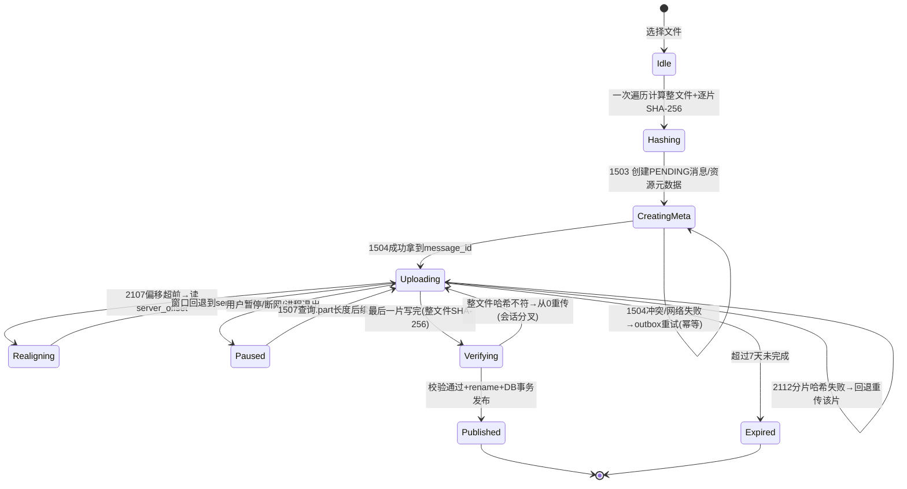
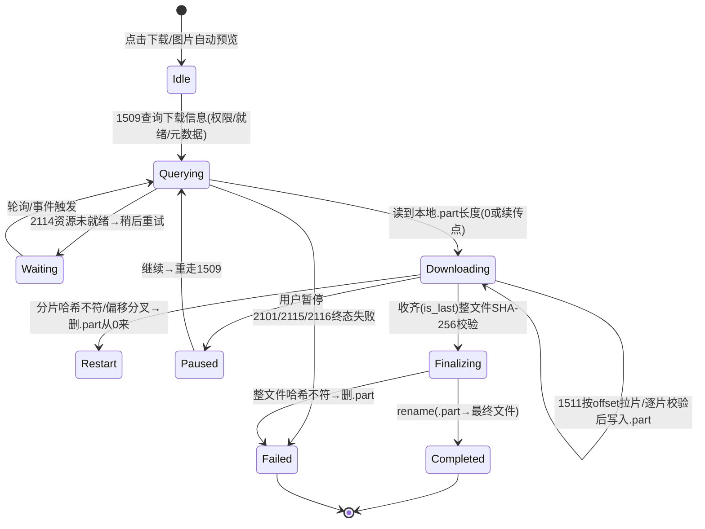
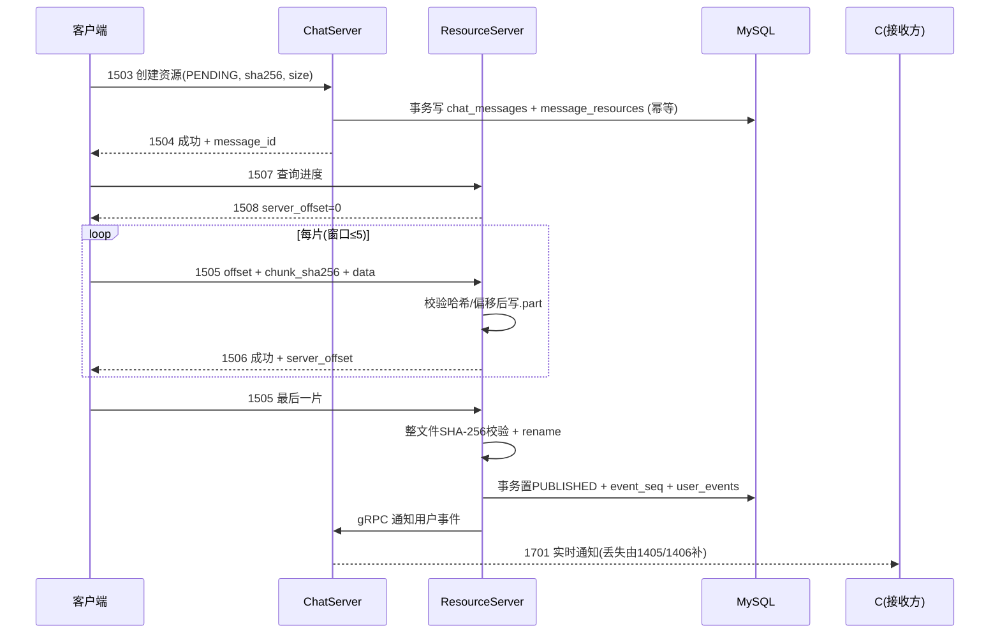

# 断点续传与文件消息（面试调研）

> 读者：张晨斐本人。用途：面试复盘、背答、改进项目。
> 关联文档：`调研总览.md`、`消息可靠传输与幂等去重.md`、`离线消息、补拉与消息撤回.md`、`性能压测与容量扩展.md`、`系统架构与整体链路.md`。
> **重要前提**：当前工作区检出的是 `master` 分支，`server/`、`client/` 下**没有**资源服务与断点续传代码（只有 `开发文档/day31/38/39/40` 的课程笔记）。完整实现位于远程分支 `origin/Season_2`，本文凡引用 Season_2 代码处均标注 `git show origin/Season_2:<路径>`。面试口径以实现为准，别再讲课程版的旧协议（seq+MD5）。

## 0. 调研范围

### 0.1 覆盖的面试问题

| 编号 | 场次/题号 | 问题核心 | 你当时的结果 |
| --- | --- | --- | --- |
| B1 | 9.11 科大讯飞一面 问3 | 断点续传怎么实现（上传侧＋下载侧） | ✅ 大体完整；2 处口径需修正 |
| B2 | 9.11 科大讯飞一面 问4 | 整个架构（发送端/接收端/几个服务） | ✅ 答得不错，作为上下文 |
| B3 | 9.1 多益网络 问1 | 自我介绍中的"文件分片上传与断点续传"（无追问） | ⚠️ 没被追问≠安全，需能自证 |
| B4 | 9.1 中望软件一面 问1 | 自我介绍中的"资源分片上传、离线传输" | ⚠️ "离线传输"用词有混淆风险 |
| B5 | 9.15 OPPO 二面（关联） | 离线消息补拉/客户端兜底（问5、问16） | 澄清：补拉 ≠ 断点续传 |

### 0.2 证据来源（只读核对过）

- 面经原文：`/Users/echo9923/Desktop/面经/9.11 科大讯飞一面.txt`、`9.1 多益网络一面.txt`、`9.1 中望软件一面.txt`、`9.15 OPPO二面.txt`。
- 当前工作区（master）开发文档：
  - `day31-文件传输.md`：客户端分片上传（`seq`＋`md5`＋`trans_size`）、单线程/多线程逻辑服务器、`FILE_WORKER_COUNT` 按文件名哈希路由；
  - `day38-断点续传.md`：上传/下载断点续传思路、暂停/续传、续传信息写 Redis（`SetFileInfo`，TTL 3600 秒）、资源服务集成、服务器断点传输逻辑；
  - `day39-多媒体信息传输.md`：图片消息、资源服务器存储、拥塞窗口（`MAX_CWND_SIZE`）；
  - `day40-聊天图片资源续传和进度显示.md`：进度条、续传逻辑、服务器处理；
  - `day42-Qt粘包引发的血案.md`：Qt `QDataStream` 粘包解析陷阱（文件流混合接收时的解析问题，可作为"传输协议解析"加分点）。
- `origin/Season_2` 实现（重写后的真实版本）：
  - `server/ResourceServer/`（`FileWorker`、`FileSystem`、`ResourceUploadFile`、`const.h` 等）；
  - `client/llfcchat/src/net/filetcpmgr.cpp`（上传/下载续传、缓冲/窗口/`.part`）；
  - `client/llfcchat/src/chat/MessageTextEdit.cpp`（采集文件时一次性计算整文件与逐片 SHA-256）；
  - `server/common/include/Sha256.h`、`tests/integration/im_scenarios.cpp`（`resource-resume`、`resource-corrupt`、`resource-offset`、`resource-idempotent`、`resource-expiry` 等场景）；
  - `开发文档/day45-图片与文件统一资源传输改造.md`、`AGENTS.md`（协议表与数据架构）。
- 关键常量（已核实）：`MAX_FILE_LEN 1024*32`（32KiB）；ResourceServer 帧上限 `MAX_LENGTH 1024*50`（50KiB）；`MAX_CWND_SIZE 5`；图片上限 20MB、文件上限 100MB；未完成资源保留 7 天（`kResourceRetentionSeconds = 7*24*3600`）。

### 0.3 一个总判断

你当时对讯飞一面 Q3 的描述"能听懂、框架对"，但有两个细节会被懂行的面试官抓住：

1. 续传进度**不在聊天服务**，而在资源服务（现在是客户端直连 ResourceServer，进度真值是磁盘 `.part` 长度）；聊天服务只持有消息与资源元数据（MySQL）。
2. 下载是**客户端按 offset 拉取**（1511），不是"资源服务从断点分片处向用户端推送"。
3. "离线传输"是另一个概念（离线事件补拉，`user_events`＋1405/1406），与文件断点续传不要混讲。

把这三处改掉，你的回答就是"真做过"的级别。

---

## 1. 问题清单总表

| 编号 | 问题 | 状态 | 一句话结论 |
| --- | --- | --- | --- |
| B1 | 断点续传怎么实现 | ✅（2 处修正） | 机制、分片、校验都对；"谁存进度、拉还是推"要改 |
| B2 | 架构与服务划分 | ✅ | 5 服务＋资源服务存储文件的宏观描述正确 |
| B3 | 多益自我介绍中的文件分片上传 | ⚠️ | 面试官没追问，不代表可以不复盘；准备好 30 秒版本 |
| B4 | 中望"资源分片上传、离线传输" | ⚠️ | 术语要拆开：分片上传/断点续传 vs 离线事件补拉 |
| B5 | OPPO 离线补拉关联题 | ⚠️ | 你在 Q16 说"客户端每 500ms 轮询"与现状（30~60s 随机周期＋缺口触发）不一致 |

---

## 2. 逐题调研

### 2.1 B1 科大讯飞一面 问3：断点续传怎么实现

**【面试官原话】**

> "断点续传怎么实现？"

**【你当时的回答（原文压缩）】**

> "文件消息统一由资源服务器存储，资源服务会完整保存已收到文件的信息。断点续传分两部分。
> 一是上传到资源服务时的断点续传：发送方先查本地待办表（SQLite），看是否有未完成事项；若查到有一条资源消息处于上传中，就拿该 message ID 发给聊天服务。聊天服务根据 message ID 定位存放位置，把已收到文件大小发回发送方。发送方对比大小后，按 32K 一片定位应从哪一片继续传，再继续发给聊天服务。服务端每收一片回 ACK，直到 ACK 的 SHA 校验通过且文件大小校验通过，才算上传完成。
> 二是接收方下载断点续传：接收方也有待操作表，若存在下载中的文件，会向聊天服务查询已接收大小，资源服务从断点分片处继续向用户端推送；用户端收到后更新文件大小和状态，直到接收完毕。"

**【状态】** ✅ 整体可用，能自证做过。但有 3 处口径要修正（见下），否则遇到懂 IM 的面试官会被反杀。

**【考点分析】**

- 面试官想验证四件事：分片协议（字段）、进度判定（谁是真值）、校验（怎么知道没传坏）、失败恢复（重传/重启后怎么办）。
- 高频追问：分片多大、为什么；分片哈希还是整文件哈希；服务端怎么防重复分片；服务端重启后进度还在吗；两个客户端同时传同一文件会怎样；断点位置以谁为准。

**【可直接背的口语化回答（修正版，按"协议→上传→下载→校验→发布"组织）】**

> "我把文件消息统一做成资源消息：**聊天服务只存消息和资源元数据**（文件名、大小、SHA-256、MIME），**资源服务存文件本体**。
> 上传流程五步：第一，客户端选文件时一次性算出**整文件 SHA-256 和每个 32KiB 分片的 SHA-256**，通过聊天服务创建一条 PENDING 消息和资源元数据（按 sender＋client_message_id 幂等）；第二，客户端向资源服务查询 `.part` 已落盘长度，对齐偏移；第三，按 32K 分片上传，每片带 `message_id＋offset＋chunk_sha256`，客户端最多 5 片在途；第四，服务端逐片校验哈希后按偏移写入，重复分片先比对磁盘内容——一致就幂等返回成功，不一致就回退到该偏移并报哈希错误；偏移超前就返回当前 `server_offset` 让客户端重新对齐；第五，最后一片完成后计算整文件 SHA-256，原子改名为最终文件，并把消息置为 PUBLISHED、为接收者分配事件序号。
> 下载同理：接收方先查下载信息（带权限校验），然后从本地 `.part` 的实际大小开始，按 offset 分片拉取，逐片校验哈希后写入，收齐后整文件校验再改名。
> 所以断点位置的**真值是资源服务磁盘上 `.part` 的长度**（上传）和客户端本地 `.part` 的长度（下载）；服务端重启后会把未确认的尾片截断到分片边界，从上一个确定边界继续。"

**【技术要点拆解】**

| 维度 | 课程版（day31/38，旧） | Season_2（新，当前实现） |
| --- | --- | --- |
| 分片标识 | `seq`（第几片）＋`md5`（整文件）＋`trans_size` | `offset`＋`chunk_sha256`（每片） |
| 进度真值 | 聊天服务内存 map / Redis（`file_upload_<md5>`，TTL 3600s） | 资源服务磁盘 `.part` 长度（1507 查询） |
| 校验 | 整文件 MD5（结束才校验） | 每片 SHA-256＋整文件 SHA-256 |
| 归属 | 上传经过聊天服务 | 客户端直连 ResourceServer |
| 路由 | 文件名哈希分到文件 worker | `message_id % worker` 固定路由（同文件同线程，写不竞争） |
| 可见性 | 落库后可用 | 校验通过＋改名＋DB 发布后才进入接收者事件流 |

- **32K 的取舍**：太大→重传粒度粗、单帧大、内存与 Base64 膨胀大；太小→系统调用/哈希/JSON 开销占比高。32K 编码成 Base64 约 43.7KB，加 JSON 字段仍在 ResourceServer 50KB 帧上限内（已核实 `MAX_LENGTH 1024*50`）。
- **两种哈希的分工**：分片哈希用于断点/幂等/定位损坏片；整文件哈希用于发布门槛（防止"片都合法但拼起来不是目标文件"）。
- **幂等三条规则**（Season_2 `ResourceUploadFile.cpp`）：
  1. 偏移等于已收位置：正常追加；
  2. 偏移小于已收位置且完全落在已写区间内：比对磁盘同区间哈希，一致返回成功（重复片幂等），不一致则截断到该偏移并要求重传；
  3. 偏移大于已收位置：返回 `FileOffsetInvalid`＋`server_offset`，客户端回退。
- **服务端重启恢复**（`RecoverUploadFile`）：仅凭 `.part` 长度无法区分"最后一片写完但未确认"，所以按 `((size-1)/32K)*32K` 回退，保证只认已确认的分片边界，宁可重传最后一片。
- **发布原子性**：整文件校验通过→同目录 `rename`（`.part`→最终文件，原子）→ DB 事务置 PUBLISHED＋递增 `users.last_event_seq`＋插入 `user_events`；DB 失败则把文件改回 `.part`，不 RPC、不通知。

**【当前项目实现对照】**

- 上传协议：`server/ResourceServer/include/const.h` 的 `ID_RESOURCE_CHUNK_UPLOAD_REQ=1505 / RSP=1506`，`ID_RESOURCE_UPLOAD_PROGRESS_REQ=1507 / RSP=1508`；
- 写盘与校验：`server/ResourceServer/src/ResourceUploadFile.cpp`（`WriteUploadChunk`、`RecoverUploadFile`、`TruncateUploadFile`）；`FileWorker.cpp` 的 `HandleResourceChunk`、`CompleteResourceUpload`（整文件 SHA-256→rename→DB 发布→跨服通知）；
- 下载协议：1509/1510（下载信息＋权限/就绪校验）、1511/1512（按 offset 下载，返回分片 SHA-256）；
- 客户端：`client/llfcchat/src/net/filetcpmgr.cpp`（`BatchSend` 5 片窗口、`handleResourceChunkUploadRsp`、`handleResourceChunkDownRsp`、`.part` 与整文件校验后 rename）；`MessageTextEdit.cpp` 预计算整文件＋逐片 SHA-256；
- 测试：`tests/integration/im_scenarios.cpp` 的 `resource-resume`（aligned/partial/damaged-aligned/full-pending/direct-retry 五种子场景）、`resource-corrupt`、`resource-offset`、`resource-idempotent`、`resource-expiry`；`REPORT.md` 记录"资源损坏尾片恢复和下载字节比对"通过。
- `day38` 还可以用来回答"演进过程"：早期用 seq＋MD5＋Redis 进度，后来改成 offset＋分片哈希＋磁盘真值，理由是**减少状态分叉、让重试天然幂等、防半写**。

**【差距与改进建议】**

1. 面试时把"发给聊天服务查进度"改成"向资源服务查 `.part` 长度"；把"推送"改成"客户端按 offset 拉取"。
2. 明确说明"旧版是 seq+MD5，新版是 offset+chunk SHA-256"——能讲清演进反而加分。
3. 可补的进阶（见 3.3/3.6）：秒传、多资源节点路由、对象存储/CDN、跨端续传元数据。

**【追问预判】**

- "分片为什么是 32K，不是 1M？" → 在延迟/重传粒度/单帧上限之间平衡；1M 会让重传成本和内存变大，且要拆更多协议字段。
- "整文件 SHA-256 要读全文件，100MB 不会很慢吗？" → 只在完成时算一次，报告里实测约数百毫秒；客户端侧在选文件时一次遍历同时算整文件和各片哈希。
- "服务端重启后进度会不会错？" → 会把未确认尾片截断到分片边界，宁可重传最后一片，也不发布不确定数据。
- "两个用户同时上传同一个文件名会互相覆盖吗？" → 不会，磁盘路径按 `sender_uid/message_id`，每消息独立；代价是同一文件重复存（秒传未实现）。

---

### 2.2 B2 科大讯飞一面 问4：整个架构（上下文）

**【面试官原话】**

> "整个架构怎么样？有发送端、接收端，还有几个服务？"

**【你当时的回答（压缩）】**

> 登录两阶段：网关校验账号密码，gRPC 调调度服务；调度按负载均衡分配聊天节点。聊天服务处理登录、好友、文本消息、资源/语音消息；资源服务承担文件收发，文件可靠传到资源服务，下载也从资源服务开始。

**【状态】** ✅ 与实现基本一致。被追问时的两个易错点：资源消息的**创建**在聊天服务（1503 在 ChatServer），**分片**在资源服务；资源消息的**发布通知**由 ResourceServer 通过 gRPC 让 ChatServer 下发 1701。

**【可直接背的口语化回答】**

> "五个服务：网关负责 HTTP 登录注册和 token；验证服务发验证码；调度服务按连接数/租约把用户分配到聊天节点；聊天服务维持长连接、处理文本/好友/资源消息的创建与发布，并把消息作为权威数据写 MySQL；资源服务负责文件分片的上传、下载、校验和存储。文件消息的链路是：聊天服务创建 PENDING 消息和资源元数据 → 资源服务收分片、校验、改名，并在自己的 DB 事务里把消息置为 PUBLISHED、给接收者分配事件序号（users.last_event_seq + user_events）→ gRPC 通知聊天服务下发 1701 实时推送，丢了就靠 1405/1406 按事件序号补拉。"

**【技术要点拆解】** 资源与消息的职责边界：ChatServer＝元数据＋可见性＋事件；ResourceServer＝字节流＋完整性＋磁盘；两者通过 `message_id` 关联。

**【当前项目实现对照】** `AGENTS.md`"图片与文件统一资源传输"；`day45`；`server/ResourceServer/include/ChatServerGrpcClient.h`（发布后通知 ChatServer）。

**【追问预判】** "文件消息什么时候对接收方可见？" → 发布之后；PENDING/FAILED 不进入事件流（防"坏文件先可见"）。

---

### 2.3 B3 多益网络 问1：自我介绍里的"文件分片上传与断点续传"

**【面试官原话】**

> （自我介绍后没有追问文件断点续传。）

**【你当时的自我介绍原文（压缩）】**

> "……实现了加好友发送文本消息，然后发送这个文件传输等基础功能；这个项目里我们消息设计了可靠性传输，以及文件分片上传和断点续传。"

**【状态】** ⚠️ 没被追问不代表稳。面试官可能：1）不感兴趣；2）留着二面问；3）已经把你的描述当"背的"。准备一个 30 秒的版本，随时能展开。

**【可直接背的口语化回答（30 秒版）】**

> "文件通道是独立于文本消息的：客户端把文件切成 32K 分片，每片带偏移和分片 SHA-256，通过 outbox 排队上传到资源服务；服务端按偏移写入 `.part` 文件，重复片幂等、坏片回退、偏移超前返回 `server_offset` 重新对齐；收齐后校验整文件 SHA-256 再原子改名发布消息。断开或退出后，从服务端 `.part` 长度继续，不用从头传。下载侧同理，从本地 `.part` 大小续拉，整文件校验后再改名。"

**【技术要点拆解】** 一句话结构：分片（大小＋字段）→ 幂等（重复/乱序/坏片）→ 校验（片＋整文件）→ 断点（真值＋对齐）→ 发布（原子性）。

**【当前项目实现对照】** 同 B1；`day40` 的进度条与暂停/继续按钮是客户端体验层，与协议层的 `server_offset` 对齐配合。

**【追问预判】** "分片上传和断点续传是一个东西吗？" → 分片是手段（切块并行/重传粒度），断点是能力（从已确认偏移继续）；两者配合但不等价。

---

### 2.4 B4 中望软件一面 问1：资源分片上传、离线传输

**【面试官原话】**

> （自我介绍后未追问。）

**【你当时的自我介绍原文（压缩）】**

> "……实现了正常的注册登录、好友申请、消息发送和资源的分片上传，以及离线传输。消息经过设计实现了可靠传输。"

**【状态】** ⚠️ "离线传输"这个说法有风险：你实际实现的是**离线事件补拉**（用户不在线时消息进权威表，上线后按 `event_seq` 增量拉取），不是"离线文件传输"，也不是"断点续传"。一旦被追问，必须能区分。

**【可直接背的口语化回答（概念拆分版）】**

> "我那边有两件事，容易混，我先拆开：
> **文件断点续传**：传文件时断网/退出，下次从 `.part` 已确认偏移继续，属于传输层能力；
> **离线消息补拉**：接收方不在线时消息照常落到服务端权威表，上线后按每用户的事件序号 `event_seq` 增量拉取，属于消息可靠链路；
> 两者都用 `message_id` 关联资源，但机制不同——前者看字节偏移和分片哈希，后者看事件游标和幂等去重。"

**【技术要点拆解】**

| 概念 | 触发条件 | 恢复依据 | 数据位置 | 失败语义 |
| --- | --- | --- | --- | --- |
| 断点续传 | 传输中断/暂停/进程退出 | 偏移＋分片哈希 | 磁盘 `.part` | 重传分片 |
| 离线补拉 | 接收方离线/通知丢失 | `event_seq` 游标 | MySQL `user_events` | 补齐事件 |
| 消息重发 | 发送方没收到成功回包 | `(sender, client_message_id)` | 客户端 outbox＋DB 唯一键 | 幂等返回原消息 |

**【当前项目实现对照】** Season_2 `users.last_event_seq`＋`user_events`＋1405/1406（`AGENTS.md`）；离线 100 条补拉在 `REPORT.md` 有记录；断点续传见 B1。

**【追问预判】** "离线期间别人发的大文件怎么办？" → 文件不缺：消息和资源已发布，接收方上线后按事件拉取，按需下载；资源在服务端有 7 天保留期（过期会置失败并清理，这是已知边界）。

---

### 2.5 B5 OPPO 二面（关联）：离线补拉与断点续传的区别

**【面试官原话（问16）】**

> "服务端落库成功，但是我发给用户失败了，这里有什么补偿机制吗？"

**【你当时的回答（压缩）】**

> "服务端只发送一次、不再负责；客户端兜底：每隔 500ms 向服务端请求最新序号，对不上就拉；点开会话时也主动拉一次。"

**【状态】** ⚠️ 机制方向对，但 500ms 轮询的口径与现状不符（Season_2 是登录/重连/发现缺口/30~60 秒随机周期触发增量同步，唯一实时通知是 1701，客户端不回 ACK）。这是"消息可靠链路"的问题，详见 `离线消息、补拉与消息撤回.md`，此处只做与断点续传的概念切分：

- 消息补偿看**事件序号**，不是文件偏移；
- 文件续传看**偏移＋分片哈希**，与消息补偿解耦；
- 两者交叉点：资源消息在发布前不属于接收者事件；发布后即使通知丢失，也能被增量同步补到，下载再单独续传。

**【可直接背的口语化回答】**

> "消息通知失败和文件续传是两条恢复路径：通知失败靠接收方按 `event_seq` 增量同步补齐，实时通知只发一次，不做服务端重推；文件传输中断靠偏移＋分片哈希继续。这样任何一条路径重复执行都是幂等的：消息按唯一 ID 去重，文件按偏移覆盖。"

**【当前项目实现对照】** `AGENTS.md`：OutboxDispatcher＋ChatSyncManager（30~60s 随机周期 1405/1406）；`REPORT.md`：丢弃 100 条回包＋100 条通知后全部补齐、零重复。**待核实**：你面试说的"500ms 轮询"是旧版实现还是临场口语，建议改用现状口径。

**【追问预判】** "为什么不用服务端重推？" → 服务端保存状态、客户端拉取，避免重推风暴和状态分叉；代价是依赖客户端定时/触发同步。

---

## 3. 专题与行动项

### 3.1 文件传输协议设计

**帧格式**（与现有一致）：`msg_type(2B) + body_len(4B) + JSON body`；ResourceServer `MAX_LENGTH = 50KiB`，`HEAD_TOTAL_LEN = 6`。

**协议表（Season_2 已实现）**：

| ID | 语义 | 关键字段 |
| --- | --- | --- |
| 1503/1504 | 创建资源消息（ChatServer） | `message_id/client_message_id`、`original_file_name`、`file_size_bytes`、`sha256`、`mime_type`、类型（图片/文件） |
| 1505/1506 | 上传分片 | `message_id`、`offset`、`chunk_sha256`、`data`(Base64)；响应带 `error/server_offset` |
| 1507/1508 | 查询上传进度 | `message_id`→`.part` 实际长度＋消息状态 |
| 1509/1510 | 查询下载信息 | 权限（必须是会话双方）、`PUBLISHED` 校验、元数据 |
| 1511/1512 | 下载分片 | `message_id`、`offset`→`bytes/is_last/chunk_sha256/data` |
| 1701 / 1405、1406 | 发布通知 / 增量同步 | `event_seq`、资源扩展字段 |

**分片大小 32K 的取舍分析**：

| 因素 | 32K | 更大（1M） | 更小（4K） |
| --- | --- | --- | --- |
| 单帧大小 | base64 后约 43.7KB，<50KB 上限 | 需拆帧/调大上限，内存峰值大 | 帧小但有大量小包 |
| 重传粒度 | 最多重传 32K | 重传成本高 | 重传便宜但总帧数多 |
| 每片哈希/系统调用开销 | 适中 | 摊薄更好 | 开销占比高 |
| 断点精度 | 32K | 粗 | 细 |
| 在途窗口 | 5 片≈160K | 窗口受限 | 需要更大窗口 |

- **元信息**：文件名、大小、整文件 SHA-256、MIME 放 `message_resources`（MySQL），与消息一对一；资源本体磁盘路径按 `sender_uid/message_id`，进行中 `.part`。
- **进度**：上传进度＝服务端 `.part` 长度（客户端显示用本地确认偏移）；下载进度＝本地 `.part` 长度。两边都以"已确认字节"为准，不用内存计数（防重启分叉）。
- **大小限制**：图片 20MB、文件 100MB、未完成 7 天过期——被追问"大文件/超大文件"时的边界答案。

### 3.2 上传/下载断点续传完整状态机

**上传（客户端视角）**：

**下载（客户端视角）**：

**一次成功的上传时序（happy path）**：

### 3.3 秒传（哈希去重）

**原理**：上传前先拿整文件 SHA-256 查询服务端是否已有相同内容；命中则直接关联已有文件、跳过传输（"秒传"）。工程上还要处理：

- **引用计数/删除**：多个消息引用同一物理文件，删除要引用计数；
- **权限与隐私**：按用户/会话隔离，不能因为"哈希存在"泄露他人文件存在性（可加用户维度盐或仅允许同一会话查重）；
- **可信校验**：秒传命中后也要校验大小/抽样，防止哈希碰撞与恶意文件；
- **分片级秒传**：对象存储可做"分片哈希命中即跳过该片"，适合断点场景。

**当前实现**：**未实现秒传**。`message_resources` 每行有自己的 `sha256`，但**没有唯一索引/引用表**，每个消息独立存一份文件（不过同一 `message_id` 的重复上传已幂等）。面试被问到时，正确说法是："设计上留了 `sha256` 字段，可以做查重秒传；当前版本没做，所以重复文件会重复存储。"不要含糊说"应该有"。

### 3.4 重试与幂等（分片级 ACK、偏移确认）

- **分片级 ACK**：1505→1506，1506 的 `server_offset` 代表"服务端已确认落盘的位置"；客户端收到后才推进确认序号（`_last_confirmed_seq`）。5 片窗口（`MAX_CWND_SIZE 5`）让吞吐和重传成本平衡。
- **偏移确认的三种情况**（服务端判定，已实现）：
  - `offset == received`：正常追加；
  - `offset < received` 且完全在已写区间：比对磁盘哈希，一致→成功（幂等），不一致→截断到 `offset`＋报错；
  - `offset > received`：`2107 FileOffsetInvalid`＋`server_offset`，客户端回退窗口。
- **失败重试**：客户端对失败分片重发原 `offset`＋原 `chunk_sha256`；资源创建走 outbox（`SEND_RESOURCE`），消息 ID 复用，服务端按 `(sender_user_id, client_message_id)` 幂等。
- **重启恢复**：`RecoverUploadFile` 回退未确认尾片；整文件哈希在完成时重算（注释：100MB 约数百 ms）。
- **发布幂等**：重复完成返回原 `event_seq`，不重复分配事件；DB 失败则恢复 `.part` 供末片重试。
- **边界**：2101~2116 错误码区分"文件不存在/偏移错误/哈希不符/超限/未就绪/无权限/状态非法"；失败/过期资源不分配事件、不通知接收方。

### 3.5 与消息可靠性链路的衔接

**两种设计对比**：

| 方案 | 消息何时可见 | 优点 | 缺点 | 本项目 |
| --- | --- | --- | --- | --- |
| A. 先传文件拿 URL，再发消息 | 文件传完才创建消息 | 简单，消息一发出就完整 | 用户等待久；重试消息可能重复上传；孤儿文件难清理 | 早期课程版偏此思路 |
| B. 先创建消息（PENDING），边传边发 | 校验发布后才对接收方可见 | 有进度、可断点、发布原子；发送方可立即看到"上传中"气泡 | 协议与状态更复杂；需处理 PENDING 失败/过期 | **当前实现（Season_2 混合版）** |
| C. 完全边传边发（先推片段） | 传输中即部分可见 | 感知最快 | 接收方可能永久拿到不完整文件；一致性问题多 | 不用 |

**当前链路的衔接点**：

1. 资源创建（1503）与文本发送一样走 outbox，复用 `(sender, client_message_id)` 幂等；
2. 资源发布（PUBLISHED）与接收者 `event_seq`、`user_events` 同事务——保证"文件可用"与"消息可见"原子；
3. 实时 1701 丢失不影响最终到达（1405/1406 增量同步）；
4. 下载的断点与消息补偿解耦：消息补拉只负责"知道有这个资源"，字节续传单独走 1509/1511。

**因此面试里最稳的一句话**："文件消息不是先传完文件再发消息，而是先创建 PENDING 消息和元数据，分片传完后整文件校验通过才发布——发布动作和接收者事件序号在同一事务里，所以不会出现'消息可见但文件没传完'。"

### 3.6 当前项目实现对照与差距

| 能力 | master 工作区（当前检出） | origin/Season_2（完整实现） |
| --- | --- | --- |
| 资源服务 | ❌ 无 `server/ResourceServer/`，只有 day31/38/39/40 文档与 day30"第二季待开发"清单 | ✅ `server/ResourceServer/`（FileWorker/DownloadWorker/ResourceUploadFile 等） |
| 分片协议 | 文档版：`seq`＋`md5`＋`trans_size`，上传经聊天服务 | ✅ `offset`＋`chunk_sha256`，客户端直连资源服务 |
| 断点续传 | ❌ 工作区无代码 | ✅ 上传（1507 查 `.part` 长度）＋下载（本地 `.part` 偏移续拉） |
| 校验 | 文档版整文件 MD5 | ✅ 分片 SHA-256＋整文件 SHA-256，`.part`→rename 原子发布 |
| 进度真值 | 聊天服务 map / Redis（TTL 3600s） | ✅ 磁盘 `.part` 长度；Redis 不再存续传进度 |
| 幂等 | 无 | ✅ 重复片比对磁盘哈希；创建按 client_message_id 幂等 |
| 秒传 | 无 | ❌ 无引用表/唯一索引，未实现 |
| 下载鉴权 | 无 | ✅ 1509 校验请求者是会话双方；未就绪/无权限/过期有独立错误码 |
| 过期清理 | 无 | ✅ 7 天保留期，过期置 FAILED 并清盘 |
| 测试 | day30 手工测试描述 | ✅ 集成场景 `resource-resume/corrupt/offset/idempotent/expiry`＋REPORT 字节比对 |
| 服务端队列上限 | `MAX_RECVQUE 10000 / MAX_SENDQUE 1000` | `MAX_RECVQUE/MAX_SENDQUE = 2000000`（注意：数值很大，过载内存风险需评估） |
| 单机存储 | —— | 单 ResourceServer、本地磁盘；day38 明确说"分布式资源服务器读者自行进阶" |
| 观测 | 无 | 有测试证据，缺生产指标（上传失败原因计数、`server_offset` 分布等） |

**可以主动暴露的边界**（面试加分）：

1. 资源服务目前是单机本地磁盘，不是对象存储，也没有多节点路由/副本；
2. 没有秒传和跨用户去重；
3. PENDING 资源 7 天过期后置失败，接收方不会再收到；
4. 同名文件按 `message_id` 隔离，不互相覆盖，但占多份磁盘。

### 3.7 小结与行动项

**结论**：

1. 你的讯飞一面 Q3 已经是"及格以上"，只需修正三处口径（进度归属、拉取方式、SHA 版本），就能从"背的"变成"做过且有演进认知"。
2. 当前工作区与面试叙事存在**代码缺失**：断点续传代码在 `origin/Season_2`。面试官若要"看代码/看提交"，先切到包含实现的提交，别用 master 演示。
3. 三个高频追问的答案要提前背熟：32K 取舍、幂等三规则、发布原子性（event_seq 同事务）。

**可在项目中动手改的 3 条**（按性价比排序）：

1. **把 Season_2 的实现与证据取回当前工作环境**（例如 `git checkout origin/Season_2` 或创建本地分支），跑通 `resource-resume`、`resource-corrupt`、`resource-idempotent`、`resource-offset` 四个场景，把输出保存到 `面试调研/` 作为"可演示证据"。
2. **实现最小秒传闭环**：`message_resources.sha256` 加索引，1503 前提供"按哈希查已有文件"的查询（按会话/用户隔离权限＋引用计数），命中则跳过 1505 直接发布；哪怕只实现单用户/同文件的版本，面试就能说"秒传我做了，边界是……"。
3. **补资源链路的可观测性**：上传失败原因计数（哈希不符/偏移错误/权限/过期）、`server_offset` 回退次数、整文件校验耗时；再写一个"中途 kill -9 ResourceServer 后续传成功"的脚本，作为断点续传可靠性的演示。
