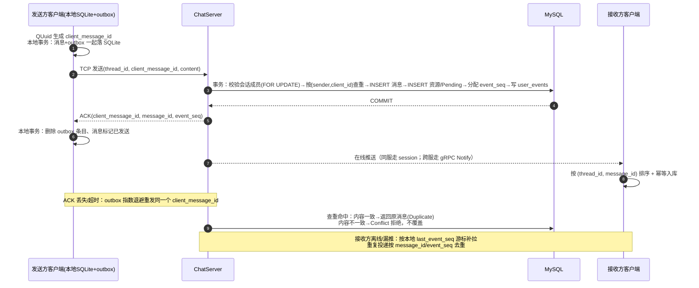

# 消息可靠传输与幂等去重（面试复盘调研）

> 定位：把"不丢不重不乱序 / 幂等 / ACK / 重试 / 唯一索引 / 事务边界 / 消息 ID 设计"相关的面试问答逐条复盘，给出可直接背的口语稿、代码对照与改进项。
> 同级文档：调研总览、系统架构与整体链路、消息存储与分页拉取、离线消息、补拉与消息撤回、聊天服务集群与负载均衡、Redis使用与高可用设计、多端登录互斥与在线状态、连接管理、并发模型与协议、性能压测与容量扩展、断点续传与文件消息。

---

## 0. 调研范围

**覆盖问题**

| 来源 | 问题 | 主题 |
|---|---|---|
| 9.11 科大讯飞一面 问2 | 丢失/重复层面有没有测过 | 验证与测试 |
| 9.11 科大讯飞一面 问5 | 聊天服务崩溃、消息已发怎么处理 | 崩溃恢复 |
| 9.11 科大讯飞一面 问8 | 一次性语义是什么 | exactly-once 概念 |
| 9.18 中兴一面 问3 | 唯一索引怎么设计 | 幂等键与去重 |
| 9.15 OPPO二面 问3 | 落库与清重试是事务吗 | 事务边界 |
| 9.15 OPPO二面 问4 | 重试次数有限制吗 | 重试策略 |
| 9.15 OPPO二面 问16 | 落库成功但下发失败怎么补偿 | 推送 vs 拉取 |
| 9.15 OPPO二面 问17 | 重复拉取/重复投递怎么防 | 接收端去重 |
| 9.15 OPPO二面 问18 | 没收到 ACK 触发重发会重复吗 | ACK 丢失与去重 |
| 9.1 多益网络 问34 | 消息 id 除了自增还有什么设计 | ID 设计 |

**证据来源（只读核对）**
- 面经原文：`/Users/echo9923/Desktop/面经/` 下 `9.11 科大讯飞一面.txt`、`9.18 中兴一面.txt`、`9.15 OPPO二面.txt`、`9.1 多益网络一面.txt`。
- 开发文档：`day17-登录服务验证和客户端数据管理.md`、`day27-分布式服务设计.md`、`day29-好友认证和聊天通信.md`、`day30-项目难点和面试技巧.md`、`day35心跳逻辑.md`、`day37-聊天信息存储方案.md`、`day41-分布式死锁解决方案.md`。
- 代码（只读）：master `server/ChatServer/src/{LogicSystem.cpp,MysqlDao.cpp,CServer.cpp,CSession.cpp}`、`sql备份/llfc2.sql`、`client/llfcchat/src/{chatpage.cpp,tcpmgr.cpp,userdata.cpp}`；`origin/Season_2` 分支的 `server/ChatServer/src/MysqlDao.cpp`、`server/ResourceServer/`、`client/llfcchat/src/store/`（`outboxdispatcher.cpp`、`localchatdb.cpp`、`chatsyncmanager.cpp`）。

**⚠️ 口径校准**：和《系统架构与整体链路》0 节一致——你面试讲的是 **Season_2**（客户端 SQLite+outbox、服务端 `client_message_id` 查重、建表脚本含 `UNIQUE KEY uk_chat_messages_client`、event_seq 补拉都有代码），但当前工作区是 master（无 SQLite/outbox、无消息唯一索引、无 event_seq）。本文每条"当前项目实现对照"都会分开标注。

### 0.1 一张图先看全链路（发送→落库→ACK→重试→去重→补拉）

**六个关键词**：`at-least-once（不丢）` + `幂等去重（不重）` + `会话内序列号 event_seq（不乱序）` + `outbox（本地不丢）` + `先说结论：做不到真正的 exactly-once，做到的是业务上的"恰好一次效果"`。

---

## 1. 问题清单总表

| # | 来源 | 问题 | 当时的回答（压缩） | 状态 |
|---|---|---|---|---|
| 1 | 科大讯飞一面 问2 | 丢失/重复测过吗 | "可靠传输是后面补的，还没有测过" | ❌ 诚实但薄弱，无测试方案 |
| 2 | 科大讯飞一面 问5 | 聊天服务崩溃怎么处理 | 两种情形：写库中崩→不回 ACK 客户端重传；落库后崩→接收方游标补拉、每 5 秒拉一次 | ⚠️ 思路对；漏"commit 后 ACK 前崩"、5 秒数字与代码不符 |
| 3 | 科大讯飞一面 问8 | 一次性语义是什么 | "先生成唯一 UID，再做哈希并记录，保证同一消息不会重复入库" | ❌ 术语答错（exactly-once 讲成幂等去重），方案含糊 |
| 4 | 中兴一面 问3 | 唯一索引怎么设计 | 发送者 id + 消息 uuid 做唯一索引；insert on duplicate update 忽略重复 | ⚠️ 方向对，但 master 无此实现；Season_2 事务内查重+内容校验，建表脚本另有唯一索引兜底 |
| 5 | OPPO二面 问3 | 落库与清重试是事务吗 | "对，是事务了；写失败不发 ACK，客户端一直重试" | ⚠️ 混为一谈：服务端落库是事务，客户端清 outbox 是另一个本地事务 |
| 6 | OPPO二面 问4 | 重试次数有限制吗 | "现在没有限制，应该要限制，差不多 3 次后标失败" | ⚠️ 承认缺口；未给退避/上限/资源消息差异 |
| 7 | OPPO二面 问16 | 落库成功但下发失败怎么办 | 服务端只发一次；客户端每 500ms 拉最新序列号；点开会话也拉一次 | ⚠️ 方向对；500ms 与代码不符（Season_2 30~60s），没讲"为什么服务端不重推" |
| 8 | OPPO二面 问17 | 重复拉取怎么防重复 | 消息带 UUID+发送者 UID，查库已存在就丢弃 | ⚠️ 只覆盖发送侧重试；接收端应按服务端 message_id 去重 |
| 9 | OPPO二面 问18 | 没收到 ACK 重发会重复吗 | insert + on duplicate key，保证只插一次 | ⚠️ 口径与当前代码不符（master 无；Season_2 是查重+Conflict，唯一索引兜底） |
| 10 | 多益网络 问34 | 消息 id 的其他设计 | 自增 uint32 会溢出→客户端生成 UUID+sender id 做联合主键 | ⚠️ 结论对、理由错（MySQL 是大整数；真正原因是分布式幂等） |

---

## 2. 逐题调研

### 2.1 科大讯飞一面 问2：丢失、重复有没有测过？

**面试官原话**
> "消息在丢失、重复层面有没有测过？"

**你当时的回答**
> "可靠性传输是后面补的，还没有测过。"

**状态**：❌ 答不上/未做。这是自我介绍里说"保证不丢、不重复、不乱序"后的必然追问——**不能说没测**，至少要有测试设计。

**考点分析**
- 面试官验证的是"绝对化宣称是否有证据"。可靠性这种核心卖点没测试 = 没闭环。
- 正确姿势不是编数据，而是讲"我设计了什么测试方法 + 目前测到什么程度 + 发现过什么问题"。

**可直接背的口语化参考回答**
> "分三层测。第一层单链路：正常发送比对服务端 chat_messages 的行数与内容；第二层故障注入：发送后立刻 kill 聊天服务进程（分别在 commit 前、commit 后）、或者直接把 ACK 丢掉，验证客户端 outbox 重发后数据库里同一条 client_message_id 只有一行；第三层并发与乱序：多客户端同时给同一会话发消息、以及'实时推送和补拉同时触发'，验证接收端按 (thread_id, message_id) 排序后无重复无缺口。目前我完成的是第一层和部分第二层，故障注入的自动化脚本还在补。测过的结论是：ACK 丢失场景下重发不会产生重复行，因为服务端按发送者+client_message_id 查重。"

（如果你不打算补测，就删掉最后一句结论，别编数据。）

**技术要点拆解**
- 不丢的验证口径：发送方本地有记录、服务端有权威记录，两端行数对账（按 client_message_id 去重后）。
- 不重的验证口径：`SELECT sender_user_id, client_message_id, COUNT(*) FROM chat_messages GROUP BY 1,2 HAVING COUNT(*)>1` 应为空。
- 不乱序的验证口径：同一会话内 message_id 单调递增；客户端显示的 sequence 与数据库一致。
- 测试手段：故障注入（kill -9、iptables drop ACK、tc netem 丢包/延迟）、并发脚本、对账脚本。

**当前项目实现对照**
- master 工作区没有测试目录；Season_2 已有 `tests/integration/im_scenarios.cpp`（含 dedup 重发去重、离线补拉等场景）和 `bench_run/.../REPORT.md`（丢弃 100 条回包+全部通知后重试补齐、库内零重复）。`day30-项目难点和面试技巧.md` 只描述了"pingpong 延迟、连接数压测"，不覆盖丢失/重复。
- 8000 连接压测口径见《性能压测与容量扩展》。

**差距与改进建议**
- 最低限度做一个 `scripts/reliability_check.sql` + 一个发送端重试测试：把服务端 ACK 延时/丢弃，观察 outbox 重发与 DB 行数。这是面试可展示的"可复现证据"。
- 把"没测过"改写成"设计过但未全面自动化"，并说出三层方案——比硬说测过安全。

**追问预判**
1. "怎么模拟丢消息？" → kill chat server（覆盖 commit 前/后两种）、iptables/tc 丢包模拟 ACK 丢失、客户端断网后恢复。
2. "怎么证明不重？" → 数据库唯一性对账 + 客户端 UI 层消息 ID 集合去重；两边都查。
3. "重复出现时怎么定位？" → 先看是发送侧重试（同 client_message_id 多行）还是接收端推送+拉取双写（同 message_id 两行），再看服务端查重为什么没拦住。

---

### 2.2 科大讯飞一面 问5：聊天服务崩溃，消息已发送，怎么处理？

**面试官原话**
> "如果已经选了一个聊天服务，聊天服务崩溃了，其中一个用户已发送消息，但聊天服务崩了，怎么处理？"

**你当时的回答（转写截取）**
> "分两种情况：1）服务写 MySQL 过程中崩溃：写入未成功，不会回 ACK；客户端发现没收到 ACK 会持续上传、超时重传，直到服务端确认成功。2）消息已可靠写入 MySQL 后服务崩溃：发送方已认为成功；接收方……维护一个游标记录最新收到消息序号；例如客户端到 36，下一条却是 38，缺 37，就会向服务端补拉 37；同时客户端每 5 秒也会主动拉取一次。"

**状态**：⚠️ 半对。方向完全正确（先落库、ACK、游标补拉），但被追问会漏三个点：①**commit 成功但 ACK 丢失**的第三种情形；②"每 5 秒"与实现不符；③发送方觉得成功但接收方其实没收到时，谁负责最终一致。

**考点分析**
- 这题本质是"分布式系统里如何界定'成功'"：ACK 之前以客户端超时重试为准，ACK 之后以服务端数据库为准，接收方以游标拉取为准。
- 面试官想听的是**状态机 + 提交点**：commit 是分界点。崩溃在 commit 前 = 消息不存在，重试即可；崩溃在 commit 后 = 消息已存在，重试会撞幂等，返回原结果。

**可直接背的口语化参考回答（三情形版）**
> "先把'成功'的分界点定在 MySQL 事务 commit。第一，崩溃发生在 commit 前：事务回滚，消息不存在，客户端收不到 ACK，outbox 超时后重发同一个 client_message_id，重试成功即完成。第二，崩溃发生在 commit 后、ACK 回包前：消息其实已经在库里，客户端也会重试；服务端按'发送者 ID + client_message_id'查重命中，直接把已存的那条消息（含 message_id、event_seq）作为 ACK 返回，客户端销掉 outbox、收敛状态，所以既不会丢也不会重复。第三种，接收方视角：发送成功只代表'进了服务端权威存储'，不代表对方收到了；接收方客户端本地记录 `last_event_seq`，登录时把游标发给服务端补拉缺口，服务端 push 只是加速手段，push 丢了也不影响最终一致；另外客户端在重连、周期同步（我实现里是 30~60 秒随机 + 点开会话立即拉）时兜底。这样链路就是：客户端 at-least-once 重试 + 服务端幂等 + 接收端游标补拉，合起来达到业务上的不丢不重。"

**技术要点拆解**
- 提交点语义：InnoDB 事务 commit 是唯一分界；客户端无法区分"未执行"和"执行了但 ACK 丢了"，所以必须用幂等键兜底。
- 三种崩溃窗口：commit 前 / commit 后 ACK 前 / ACK 后。（第二种是最容易被忽略也最常被追问的。）
- 接收端一致性：以服务端事件序列号（Season_2 `user_events.event_seq`）或会话内 message_id 为游标，push+pull 双通道，pull 为准。
- 服务崩溃后的连接：调度租约 6s 过期摘除，客户端断线重连重新申请节点（见《聊天服务集群与负载均衡》）。

**当前项目实现对照**
- master：`LogicSystem::DealChatTextMsg` 先调 `MysqlMgr::AddChatMsg`，再在 Defer 里回 `ID_TEXT_CHAT_MSG_RSP`（`server/ChatServer/src/LogicSystem.cpp:512,525-528`）；**但 `AddChatMsg` 返回值被忽略，落库失败也会回 ACK**——这正是"commit 前崩"被违反的地方，属高优先级 Bug。
- master：无客户端 outbox、无 event_seq；接收端行为是登录后拉会话列表、点开会话用 `message_id` 游标拉历史（day37「聊天记录增量加载」一节，约 L2432 起；实现有分页 Bug，见 2.7 与《消息存储与分页拉取》）。
- Season_2：`MysqlDao::AddChatMsg`（返回 `SaveMessageResult`）对 InnoDB 1213 死锁做有限重试（`1 << attempt` 退避），`AddChatMsgTransaction` 返回 Stored/Duplicate/Conflict，`LogicSystem.cpp:638-659` 区分处理；Duplicate 返回 canonical 消息。
- "每 5 秒拉取"：master 无周期同步；Season_2 `chatsyncmanager.cpp:446` 是 30~60 秒随机周期，另有登录快照、推送、重连触发。口径要改成"周期兜底 + 触发式同步"。

**差距与改进建议**
- **必修 Bug**：`LogicSystem.cpp:512` 判断 `AddChatMsg` 返回值，false 时回错误码而不是 Success（否则客户端永远丢这条消息且感知不到）。
- 补"commit 后 ACK 前"到口语稿（这是区分背稿和真懂的分水岭）。
- 把"5 秒"改成可解释的数字：太频繁（500ms）给服务端和客户端都增加无效负载；做法是触发式（登录/重连/点开/推送带 seq）+ 低频兜底（30~60s）。

**追问预判**
1. "如果服务端 commit 后崩溃，客户端重试，服务端换了另一个节点怎么办？" → 所有聊天节点连同一个 MySQL，幂等键全局唯一，换节点查重同样命中；token 和会话位置也在 Redis，重连后重新绑定即可。
2. "接收方游标按会话还是全局？" → 全局事件序列号更优：一次拉取能覆盖所有会话且天然全局有序；按会话游标（thread_id+message_id）也可以，但会话多时补拉请求会变多。
3. "服务端推送失败会重推吗？" → 当前不重推，只依赖客户端拉取；可选优化是接收方对推送回 ack、服务端用 user_events 的 delivered 标记做有限重推。

---

### 2.3 科大讯飞一面 问8：一次性语义（exactly-once）是什么？

**面试官原话**
> "一次性语义是什么？"

**你当时的回答**
> "用户发消息时不希望重复，只落库一次。先生成唯一 UID，再做哈希并记录，保证同一消息不会重复入库。"

**状态**：❌ 术语没答对 + 方案说不清。"做哈希并记录"容易被追问"哈希存哪、冲突怎么办、进程重启还在吗"。

**考点分析**
- 消息投递语义三档：at-most-once（至多一次，可能丢）、at-least-once（至少一次，可能重）、exactly-once（恰好一次）。
- "一次性语义"在工程上几乎做不到严格端到端 exactly-once（需要两阶段提交/确定性重放等，代价高）；业界通常用 **at-least-once + 幂等去重 = 业务上的恰好一次（effectively-once）**。
- 面试官要听你说清"不是魔法，是重试+去重的组合，以及为什么这等价于恰好一次"。

**可直接背的口语化参考回答**
> "一次性语义指消息恰好被处理一次。严格端到端 exactly-once 需要发送端和接收端跨网络、跨进程做原子提交，代价很高，工程上一般不做。我的设计是 at-least-once + 幂等去重，达到业务上的恰好一次：发送端本地把消息和 outbox 记录在同一个 SQLite 事务里落盘，保证不丢；ACK 没回来就重发同一个 client_message_id，所以网络层是至少一次；服务端用'发送者 ID + client_message_id'做幂等键，事务里先查重：已存在且内容一致就直接返回已存的消息（重复请求被折叠），内容不一致返回冲突拒绝覆盖。这样重复包会在服务端被吸收，数据库里一条消息只存在一次，对业务就是恰好一次。注意幂等只保证'不重'，'不丢'靠的是重试和接收端游标补拉。"

**技术要点拆解**
- 三档语义定义 + 常见误区（"TCP 可靠 = 消息不丢"错，因为进程崩溃/TCP 连接断开时缓冲区数据可能丢；"上了 MQ = 不丢"错，消费端还得 ack + 幂等）。
- effectively-once 公式：至少一次投递 + 幂等消费端 = 结果恰好一次。
- 幂等键要满足：全局唯一（发送者内唯一即可）、客户端可离线生成、可重放。
- 严格 exactly-once 的代价：两阶段提交/XA、事务性消息、去重窗口+存储，跨服务时基本不可用；分布式事务（2PC）还有阻塞和协调者单点问题。

**当前项目实现对照**
- master：无 client_message_id 字段、无唯一索引、无查重（`sql备份/llfc2.sql:24-36`；`MysqlDao.cpp:863-923`）；"做哈希并记录"无对应实现（实际未实现）。
- Season_2：订单式幂等已实现——事务内 `SELECT ... WHERE sender_user_id=? AND client_message_id=? FOR UPDATE`，一致则返回 Duplicate 并把已存消息回填，不一致返回 `MESSAGE_CONFLICT`（`const.h` 注释"unique-id 相同但内容冲突，原消息不变"）；建表脚本另有 `UNIQUE KEY uk_chat_messages_client(sender_user_id, client_message_id)`（`sql备份/20260830_database_rebuild.sql:78`）。
- 客户端 UUID：master 的 `client/llfcchat/src/chatpage.cpp` 用 `QUuid::createUuid()` 生成 `unique_id`（L158 生成、L186 写进协议，但服务端不落库）；Season_2 的 `chat/chatpage.cpp`（L492）生成 `client_message_id`，与本地消息、outbox 同一事务落 SQLite。

**差距与改进建议**
- 面试中第一句话先纠正概念："严格 exactly-once 我们不宣称，我说的是 at-least-once+幂等=业务恰好一次。"这样后面所有追问都有防线。
- 服务端 DB 层唯一索引兜底已经存在（Season_2 建表脚本 `uk_chat_messages_client`，`sql备份/20260830_database_rebuild.sql:78`）；但应用层主路径仍是事务内 SELECT FOR UPDATE、未捕获 1062，建议补 catch/upsert 让兜底闭环。SQL 与注意点见 2.9。

**追问预判**
1. "为什么不用分布式事务做到严格恰好一次？" → 跨客户端-服务端的 2PC 需要双方都支持事务协调，客户端崩溃/网络分区时协调者会阻塞；成本远高于幂等方案。
2. "幂等键为什么不用服务端生成？" → 服务端生成需要先往返一次，客户端离线体验差；客户端生成 UUID 可离线、可重放。
3. "重复消息内容不一致是什么场景？" → 客户端 Bug 或恶意重放；必须拒绝并报冲突，绝不能静默覆盖、也不能当作重复忽略。

---

### 2.4 9.18 中兴一面 问3：唯一索引怎么设计？

**面试官原话**
> "如果 MySQL 落库成功了，然后实际发送失败，然后客户端重试时，你好像是写的是靠唯一索引去重，然后你这个唯一索引是怎么设计的？"

**你当时的回答（转写截取）**
> "消息从客户端发送时生成唯一 uuid，同时发送者有自己的用户 id；服务端把发送者 id 以及消息 uuid 设计一个索引……通过用户 id 以及消息 uuid 唯一确定一条消息。收到重复消息时，使用 insert on duplicate update 的命令去插入，有重复的消息就自动忽略。"

**状态**：⚠️ 方案方向正确（复合键、upsert），但：①master 代码和 SQL 里根本没有这个索引；②"自动忽略"不对——重复时还要把已存的 message_id 返回给客户端。

**考点分析**
- 幂等键设计：为什么是 (sender_id, uuid) 而不是 uuid 全局唯一？因为不同客户端理论上可能生成相同 UUID（概率极低），带上 sender_id 后范围收敛、索引更符合查询；也避免恶意用户猜别人 uuid 触发冲突。
- SQL 语义细节：`ON DUPLICATE KEY UPDATE` 的 affected rows、`LAST_INSERT_ID()` 技巧、自增列消耗、并发下的锁行为。

**可直接背的口语化参考回答**
> "客户端发消息时本地生成一个 UUID 作为 client_message_id，服务端消息表加唯一索引 `UNIQUE KEY uk_sender_client (sender_user_id, client_message_id)`，插入用：
> `INSERT INTO chat_messages(...) VALUES (...) ON DUPLICATE KEY UPDATE message_id = LAST_INSERT_ID(message_id);`
> 然后 `SELECT LAST_INSERT_ID()` 取出真实 message_id。这样新消息正常插入，重复消息不会产生新行，而且能拿到第一次插入的 message_id 回给客户端——注意不能只'忽略'，否则客户端没法把本地未确认消息和服务端记录关联起来。另外我还做了内容校验：如果同一个幂等键对应的内容不一致，返回冲突错误而不是静默去重。最后，兜底查询用 (sender_user_id, client_message_id)，索引避开 uuid 单独全表扫描。"

**技术要点拆解**
- 唯一索引 vs 先查后插：
  - 先 `SELECT ... FOR UPDATE` 再 INSERT：事务中要持锁，且"查不到"时靠间隙锁防并发，容易死锁（day41 记录了 `private_chat` 场景的死锁分析和"先 INSERT 后查"的修复方案）。
  - `INSERT ... ON DUPLICATE KEY UPDATE`：一条语句原子完成，依赖唯一索引，冲突时走 update 分支；更简洁。
  - 两者可组合：唯一索引保底 + 冲突后 SELECT 取原记录/比内容。
- `LAST_INSERT_ID(expr)` 技巧：把 expr 设为已存在行的主键，使本次语句的 `LAST_INSERT_ID()` 返回该行 id；否则重复时拿到的还是旧的自增游标或 0。
- affected rows 语义：MySQL 返回 1=插入、2=更新、0=重复且未发生实际修改（`message_id=message_id` 时可能出现）。**不要用 affected rows 判断是否重复**，统一用"再查一次 + LAST_INSERT_ID"。
- 自增列在重复插入时会被消耗（产生 gap），无害，但要能解释。
- day41 提示的另一个坑：`ON DUPLICATE KEY UPDATE` 在高并发下也有 gap lock/插入意向锁竞争，热点幂等键仍可能引发死锁，需要有限重试（InnoDB 1213）。

**当前项目实现对照**
- master：`chat_message` 表只有 `PRIMARY KEY(message_id)` + 两个普通索引，**没有 unique_id 列、没有唯一索引**（`sql备份/llfc2.sql:24-36`）；`MysqlDao::AddChatMsg` 是批量 INSERT，无去重（`server/ChatServer/src/MysqlDao.cpp:863-923`）→ 与回答不符。
- 项目中唯一使用 upsert 的地方是好友申请表：`ON DUPLICATE KEY UPDATE from_uid = from_uid, to_uid = to_uid, descs=?, back_name=?`（`MysqlDao.cpp:186`；`day28` 437 行），可以引用它说明"我懂 upsert，只是消息表还没补"。
- Season_2：主路径是事务内 `SELECT ... FOR UPDATE` 查重 + 内容/资源元数据一致性比对；重复返回 Duplicate，冲突返回 `MESSAGE_CONFLICT`。建表脚本另有唯一索引 `uk_chat_messages_client` 兜底；应用层未捕获 1062，可补。

**差距与改进建议**
- 动手改：Season_2 建表脚本已有 `UNIQUE KEY uk_chat_messages_client(sender_user_id, client_message_id)`，保留"查重失败分支"做内容校验，并给应用层补 1062 捕获；这样 DB 层、应用层双重保证。
- 准备 SQL 迁移脚本（不改历史数据：先查重、清理冲突、再加索引）。
- 口径修正：把"忽略重复"改成"重复时返回第一次写入的 canonical 消息"。

**追问预判**
1. "UUID 会不会重复？" → v4 随机 122 位，概率可忽略；且与 sender_id 组合，实际冲突时按内容比对走 Conflict 流程。
2. "为什么不用 message_id 本身做幂等？" → message_id 服务端生成，意识到重复之前拿不到；幂等键必须客户端可离线生成。
3. "on duplicate 有什么缺点？" → 自增 gup、热点键锁竞争、affected rows 语义反直觉、`LAST_INSERT_ID` 依赖连接会话；都要能说。
4. "和先 SELECT 后 INSERT 比呢？" → 正确性上等价（只要唯一索引在），性能上 upsert 少一次往返；但复杂校验（内容一致性）时仍要 SELECT，所以实际是 upsert 兜底 + 冲突后查询。

---

### 2.5 OPPO二面 问3：落库与清重试是一个事务吗？

**面试官原话**
> "比如说消息要落到这个 MySQL 库里面才能算成功……你落库成功，你这里会清掉（outbox）对吧？那你这两个过程是事务的吗？"

**你当时的回答**
> "啊对，是事务了……如果我们这边写失败了，不会发 ACK，不发 ACK 的话，客户端发现迟迟没有收到 ACK，就会一直重试。"

**状态**：⚠️ 答得过于笼统。面试官问的是**跨端两个动作的一致性**（服务端落库 vs 客户端清 outbox），你的回答默认成服务端单机事务。真实答案：不是一个事务，也不可能是一个事务。

**考点分析**
- 事务边界的准确划分：服务端事务（校验+去重+落库+事件序号）在 MySQL 内；客户端本地事务（消息+outbox 同写、ACK 到达后删 outbox+改状态）在 SQLite 内。
- 跨边界一致性手段：本地事务保证"要发的一定被记录"，ACK+幂等保证"重复发也不会重复落"，即 outbox 模式（Transactional Outbox）+ 幂等消费。
- 面试官可能诱导你答"2PC"，要主动否掉并给出理由。

**可直接背的口语化参考回答**
> "不是一个事务，而且做不到一个事务——一边是客户端的 SQLite，一边是服务端的 MySQL，中间隔着网络。我用的是两段本地事务 + 幂等来替代跨端事务：第一段，客户端把'业务消息'和'outbox 待发送记录'放在同一个本地事务里提交，保证要么都成功要么都失败，消息不会漏发；第二段，服务端在一个事务里做完会话校验、按 client_message_id 查重、插入消息和资源元数据、分配接收方 event_seq、写 user_events，提交成功才回 ACK。客户端收到 ACK 后再开一个本地事务：删 outbox、把消息标记为已发送。中间任何一步失败或超时，outbox 都会重发同一个 client_message_id，服务端幂等吸收。所以跨端一致性不是靠事务，而是靠'本地事务 + at-least-once 重试 + 幂等去重'。"

**技术要点拆解**
- 事务边界图：
  - 客户端事务 A：`INSERT local_message` + `INSERT outbox`（原子）。
  - 服务端事务 B：成员校验 + 查重 + 消息/资源/事件写入（原子）。
  - 客户端事务 C：`DELETE outbox` + `UPDATE local_message status`（原子）。
- 不确定窗口：ACK 丢失时客户端不知道 B 是否提交；重发后由幂等查询给出确定结果——这是"向不确定要确定"的标准解法。
- 为什么不用 2PC/XA：需要两端资源管理器+协调者，网络分区时阻塞；SQLite 不支持 XA；收益低。
- 事务内的顺序问题：先查重（FOR UPDATE）再插入，或依赖唯一索引；`day41` 已分析过锁与死锁。
- 事务粒度：批量消息建议一个事务一批；也要限制批大小，避免长事务锁竞争。

**当前项目实现对照**
- master 服务端：`AddChatMsg` 是单事务批量插入（`setAutoCommit(false)`、commit/rollback，`MysqlDao.cpp:863-923`），但没有幂等键，重复请求会重复插入；客户端根本没有本地库/outbox，所以"两段事务"只存在于 Season_2。
- Season_2：客户端 `localchatstore`/`localchatdb` + `outboxdispatcher` 实现了"本地落库+outbox 同写、ACK 后销账"；服务端 `AddChatMsgTransaction` 单事务覆盖成员校验/查重/消息/资源/事件，并对 1213 死锁有限重试。
- ⚠️ logic 细节：master `LogicSystem.cpp:512` 忽略 `AddChatMsg` 返回值，落库失败仍回 ACK——事务边界在代码里被破坏，必须修。

**差距与改进建议**
- 给 outbox 表设计字段并写进文档：`client_message_id, thread_id, payload, status, attempt, next_retry_at, created_at`；删除时机只能是"收到含相同 client_message_id 的 ACK 之后"。
- 明确 ack 的幂等：ACK 重复到达时客户端删 outbox 本身要幂等（DELETE 不存在不算错）。
- 服务端返回结构里带 `client_message_id`（已有）+ `message_id` + `event_seq`，客户端三者对账。

**追问预判**
1. "客户端在事务 A 提交后崩溃，重启怎么办？" → outbox 记录还在，调度器扫描待发送条目继续重发；SQLite 持久化在本地，重启不丢。
2. "服务端事务 B 提交后崩溃，ACK 没发出去呢？" → 客户端重发，服务端查重命中返回原消息（2.2 第二种情形）。
3. "为什么不把 outbox 放服务端，由服务端重试？" → 服务端只知道"该发给谁"，不知道"客户端是否已经展示"；出站可靠性由发送方负责才闭环，服务端只做权威存储和转发。

---

### 2.6 OPPO二面 问4：重试次数有限制吗？

**面试官原话**
> "那这个重试次数有限制吗？"

**你当时的回答**
> "重试次数现在是没有做限制，但是应该是要做限制的，差不多发送 3 次，像微信那样，过一段时间还没成功就标记为发送失败，让用户后续再重新发一下。"

**状态**：⚠️ 诚实且方向对，但没讲策略细节；"3 次"太粗，且和代码不一致（Season_2 是指数退避、没有次数上限）。

**考点分析**
- 重试是双刃剑：不重试会丢，无限重试会放大故障（重试风暴）、占用资源、UI 状态永远"发送中"。
- 标准策略：**指数退避 + 上限 + 抖动（jitter）**；区分可重试错误（超时、连接断开）和不可重试错误（参数非法、内容冲突）。
- 上限之后的处理：标记失败、允许用户手动重发、保留消息可编辑重发；资源消息则保留续传能力。

**可直接背的口语化参考回答**
> "我的策略是指数退避加封顶：首次 2 秒，之后 4、8、16 秒翻倍，最高 30 秒一条，加随机抖动避免多客户端同时重试形成风暴。达到最大次数或最大时长后，把消息标记为'发送失败'，UI 上给一个重发按钮，用户手动触发或者下次登录时提示。同时区分错误类型：连接断开、超时这类可重试；参数非法、幂等冲突、鉴权失败直接标失败不重试。资源消息不一样：文本失败重发即可，文件失败要保留断点，重连后从已上传的分片位置继续，不重传整个文件。这样既保证不丢，又不会无限占用资源和用户界面。"

**技术要点拆解**
- 退避公式：`delay = min(max_delay, base * 2^attempt) * random(0.5~1.5)`。
- 重试位置：网络重连后统一 rescan outbox；进程重启后从 SQLite 恢复 `next_retry_at`。
- 重试安全前提：幂等键；否则每次重试都可能产生重复。
- 失败语义分级：Failed（用户可见、可手动重发） vs 后台继续（资源续传） vs 丢弃（明确非法）。
- 服务端侧也要有保护：限流、最大在途请求、熔断（当前项目未做，需诚实）。

**当前项目实现对照**
- master：无重试机制（无 outbox），此题为 Season_2 设计。
- Season_2：`client/llfcchat/config/config.ini` 有 `RequestRetryInitialMs=2000`、`RequestRetryMaxMs=30000`；`outboxdispatcher.cpp` 按 next_retry_at 扫描重发；"源文件丢失"等永久失败会 `markSendFailed`。**但未见到最大重试次数/最长重试时间**，仍需补。
- 服务端 `AddChatMsg` 对 InnoDB 1213 死锁有有限重试（`1 << attempt`），这是另一个维度的重试（DB 层），别和客户端重试混淆。

**差距与改进建议**
- 给 outbox 增加 `attempt` 和 `max_attempt`（或 `give_up_at`），并在 UI 层暴露"失败/重发"。
- 至少补一条：文本消息达到上限标失败；资源消息永不放弃（保留续传，但限制并发窗口）。
- 准备面试数字口径：2s 起步、30s 封顶、N 次后标失败——能解释每个数字的取舍。

**追问预判**
1. "重试风暴怎么防？" → 指数退避 + 抖动 + 服务端限流；大量客户端同时重启用随机化错峰。
2. "为什么资源消息不标失败？" → 文件传输成本高，直接标失败会让用户重传全部；保留断点续传更省流量，但要有上限和清理策略（防止僵尸任务）。
3. "服务端没收到 ACK 会重试吗？" → 那是发送方职责；接收端推送不重试，靠拉取兜底（见 2.7）。

---

### 2.7 OPPO二面 问16：落库成功，但发给用户失败了，有什么补偿？

**面试官原话**
> "会不会出现，比如说我这个服务端落库成功，但是我发给用户失败了，这里有什么补偿机制吗？"

**你当时的回答（转写截取）**
> "服务端不想太重……服务端只发送一次，如果发送失败就不再管了，用户自己处理：每隔 500ms 向服务端请求最新序列号，对不上就拉；点开某个对话时也主动拉一次。"

**状态**：⚠️ 思路对（服务端只发一次、客户端兜底），但"500ms"与代码不符，且没讲透"为什么服务端不负责推送可靠"。

**考点分析**
- 核心认知：**推送（push）是加速器，拉取（pull）才是可靠性的来源**。服务端保存权威数据，接收方用游标补拉，push 失败不影响最终一致。
- 追问点：为什么不给推送加 ACK 重推？为什么是序列号而不是时间戳？500ms 频率合理吗？

**可直接背的口语化参考回答**
> "我的原则是：服务端只保证'消息可靠地进入权威存储'，不保证'实时送到对方屏幕'。所以 push 只发一次，发不到就放弃，接收端用拉取兜底。接收端本地有 last_event_seq 游标：登录、重连、点开会话、收到 push 时都会带游标对比，落后就按页补拉；再有一个 30 到 60 秒的随机周期同步做最终兜底。这里不能高频轮询——500ms 一次对在线用户纯属浪费，对服务端也是无效 QPS；引擎是'触发式同步 + 低频兜底'，不是 500ms。另外我选 event_seq 而不是时间戳，因为序列号单调且能精确判断缺口，时间戳会有时钟漂移和同毫秒并发的问题。"

**技术要点拆解**
- push/pull 分工：push 负责低延迟；pull 负责不丢。
- 游标设计：
  - 全局事件序列号（Season_2 `user_events.event_seq`，按接收人分配）：一次同步覆盖所有会话，天然全局有序；
  - 会话维度（thread_id + message_id）：实现简单，但会话多时同步请求多。
- 触发点：登录快照、连接建立、收到通知（对比 seq）、点开会话、周期定时。
- 推送失败原因：对端不在线、跨服 gRPC 失败、连接刚好断开；这些都不该阻塞发送方的主流程。
- 拉取与推送的并发冲突：优先按 seq 去重排序，见 2.8。

**当前项目实现对照**
- master：接收端没有逐条推送 ack；`DealChatTextMsg` 查 `uip_<touid>`，同服走 session、跨服走 gRPC `NotifyTextChatMsg`（`server/ChatServer/src/LogicSystem.cpp:531-569`）；接收方不在线时直接返回，不排队不重试。拉取侧：登录拉会话列表（`ID_LOAD_CHAT_THREAD_REQ`），点开会话按 message_id 拉 10 条（`LogicSystem::LoadChatMsg`，`server/ChatServer/src/LogicSystem.cpp:870-910`）。
- ⚠️ master `LoadChatMsg` 有两个 Bug：`load_more` 永远 false（不翻页）、`next_cursor` 没推进（`MysqlDao.cpp:800-859`）；i.e. 实际只拉到每个会话最早的 11 条。修法见《消息存储与分页拉取》。
- Season_2：`ChatSyncManager` 实现登录快照+推送应用+增量分页补拉，周期 30~60s 随机（`chatsyncmanager.cpp:446-448`）；客户端 `ChatSyncManager::slot_user_message_notify`（`chatsyncmanager.cpp:206`）即时应用。**没有 500ms 轮询**。

**差距与改进建议**
- 面试口径从"500ms 轮询"改为"触发式 + 30~60s 兜底"，并准备解释为什么高频轮询是坏设计。
- 修复 master 分页 Bug，否则"游标补拉"在代码上不成立（面试官真去点开会话就露馅）。
- 可选增强：接收方对 push 回 ack，服务端在 `user_events` 标记 delivered，未 delivered 的下次登录只补拉这些事件（减少全量对比）。

**追问预判**
1. "为什么不给服务端推送加重试？" → 服务端无法知道客户端是否真的展示（网络 ack 不等于已读），重试成本高且状态复杂；权威存储 + 客户端拉取更简单且最终一致。
2. "推送和拉取同时到达怎么办？" → 统一按 message_id/event_seq 幂等入库，前端按序插入（2.8）。
3. "周期同步频率怎么定？" → 与其频繁轮询，不如事件触发；兜底周期取值要平衡"最坏离线后延迟"和"无效请求量"，30~60s 随机是经验值。

---

### 2.8 OPPO二面 问17：重复拉取/重复投递怎么防止重复？

**面试官原话**
> "那你怎么能够保证它不发生这种重复拉取……什么样的消息重复拉取的问题，你怎么防止它有这个重复投递的问题？"

**你当时的回答**
> "每个消息由发送者产生唯一 UUID，加上发送方的用户 UID，拼起来作为消息唯一标识。客户端取到之后会查一下是否已经落库过，落库过就丢弃，不再入库。"

**状态**：⚠️ 方向对但不完整。只说到了"发送方 UUID"，没有讲**接收端**怎么去重（push 和 pull 可能带来同一条消息）；"查一下是否落库"在客户端要落到本地库的 unique 约束上。

**考点分析**
- 重复来源两类：①发送侧重发导致服务端重复入库（靠服务端幂等解决）；②接收端 push 与 pull 交错、pull 分页重叠、ACK 重试导致同一条消息多次到达（靠接收端幂等解决）。
- 接收端去重键应该用**服务端的 message_id（或 event_seq）**，因为不管从哪个通道来，同一条消息的服务端 ID 都一致；用发送方 UUID 也行（uuid+sender），但本地要有唯一索引。

**可直接背的口语化参考回答**
> "分两头防。服务端：发送者带 client_message_id，服务端按 (sender_id, client_message_id) 幂等，重复请求不会产生第二行。接收端：不管消息从实时推送来、还是从补拉来，同一条消息的服务端 message_id 和 event_seq 是固定的，所以本地 SQLite 对 message_id 建唯一约束，入库用 insert or ignore / on conflict do nothing；如果先入内存，就用按 (thread_id, message_id) 有序的 map 插入，重复的直接覆盖或丢弃。推送和拉取可能并发，所以 UI 更新也按 message_id 排序去重，而不是'来一条追加一条'。简单说：发送侧用 client_message_id 去重，接收侧用服务端 message_id 去重，两侧都不能少。"

**技术要点拆解**
- 三条路径同一 key：发送方重试（client_message_id）、服务端转发（message_id）、接收方多通道（message_id）。
- 本地去重手段：SQLite `UNIQUE(message_id)` / `INSERT OR IGNORE`；内存 `QMap<int, msg>` 天然按 key 覆盖（但要注意别把后到的旧消息覆盖新消息——这里没问题，message_id 相同则内容相同）。
- 补拉分页重叠：用 `message_id > cursor` 或 `before_message_id` 严格边界 + 本地去重双保险。
- push/pull 乱序：先入本地库，UI 按 (thread_id, message_id) 顺序渲染，不能假设到达顺序即显示顺序。
- 客户端所有状态变更（outbox 删除、状态标记）都要幂等。

**当前项目实现对照**
- master：客户端 `ChatThreadData::_msg_map` 是 `QMap<int, shared_ptr<ChatDataBase>>`，`AddMsg` 用 `insert`（同 key 覆盖），只做到内存级按 message_id 去重（`client/llfcchat/src/userdata.cpp:47-52`）；无本地库、无 SQLite 唯一约束。
- 服务端无幂等；`LoadChatMsg` 游标 Bug 使补拉不完整。
- Season_2：本地库在 `localchatdb.cpp` 建表（含唯一约束）+ `localchatstore` 批量写入；`ChatSyncManager` 处理 push/pull 并用 `insertedMessageIds` 回执给 UI 去重渲染。

**差距与改进建议**
- 修复 master 两个分页 Bug（`load_more`、`next_cursor`），这是"补拉去重"成立的前提。
- 本地库建唯一约束：`UNIQUE(thread_id, message_id)`；若登记 outbox 用 client_message_id 作主键。
- 在文档里写清"去重键三分工"表格，面试可脱口而出。

**追问预判**
1. "同一会话的两条消息 message_id 可能相同吗？" → 不会，message_id 是全局自增主键，跨会话也唯一；本地再按 thread_id 分组展示。
2. "先推送到、后补拉到达同一条，会不会显示两次？" → 本地库 INSERT OR IGNORE + UI 按 id 索引更新，不会。
3. "数据库唯一冲突时要不要报错？" → 接收端正常重复是预期行为，静默忽略；只有内容和 ID 不匹配（真正的数据损坏）才记异常。

---

### 2.9 OPPO二面 问18：ACK 没收到触发重发，会不会重复？

**面试官原话**
> "他实际可能已经发送出去了，只是因为有延迟，在一定时间内没有拿到 ACK，触发重发，那这两个消息是否也会出现这种重复的问题？"

**你当时的回答**
> "落库的时候用 insert，插入时用 on duplicate key，这样就保证只插一次；后面的 update 什么也不做，这样保证同样的消息只入库一次。"

**状态**：⚠️ 结论对（幂等），但"什么都不做的 update"有问题：拿不到已存在的 message_id；且当前代码里既没有 upsert 也没有唯一索引。这是同一考点的第二次追问（问17 后紧接问18），说明面试官在压力测试你的口径是否统一。

**考点分析**
- 标准答案要能区分三种重复请求结果：新插入（Stored）、重复且一致（Duplicate，返回原消息）、重复但不一致（Conflict，拒绝）。
- 实现细节：唯一索引 + upsert 或事务内查重；两者都要能讲。
- 为什么"忽略重复"不够：发送方需要把本地未确认消息和服务端 canonical 记录绑定（message_id、event_seq），否则客户端状态永远对不上。

**可直接背的口语化参考回答**
> "会出现重发，但不会重复入库。服务端在一个事务里先按 (sender_id, client_message_id) 查重，查到就比对内容：内容一致，说明就是之前那条，直接返回已存的 message_id 和 event_seq，客户端把本地那条从'发送中'改成'已发送'；内容不一致返回冲突错误，不覆盖原消息。没查到就插入。为了更硬，消息表还会加唯一索引 (sender_user_id, client_message_id) 兜底，插入语句用 ON DUPLICATE KEY UPDATE message_id=LAST_INSERT_ID(message_id)，这样即使并发穿透了应用层查重，数据库也不会产生第二行。所以重发的语义是'返回第一次的结果'，不是'再插一条'。"

**技术要点拆解**
- 状态机：`Stored` / `Duplicate` / `Conflict` / `Failed`，客户端对四种结果分别处理。
- 并发穿透场景：两个相同请求同时进入不同聊天服务实例，应用层 SELECT 都查不到 → 唯一索引让其中一个 INSERT 失败/走 update；配合有限重试。
- ACK 结构建议：`{client_message_id, message_id, event_seq, thread_id, status}`。
- 客户端销账：只有拿到与 client_message_id 匹配的 ACK 才删除 outbox；重复 ACK 幂等处理。
- 如果服务端在事务中"查重"但不加唯一索引：并发窗口依赖 gap lock，语义不直观，day41 有死锁分析。

**当前项目实现对照**
- master：`chat_message` 无唯一索引（`sql备份/llfc2.sql:24-36`），`AddChatMsg` 无 upsert/查重，重发必然重复入库；ACK 里带 `unique_id` 但不落库（`LogicSystem.cpp:515-523`）。→ 面试口径与代码冲突。
- Season_2：事务内查重 + 内容比对（一致性校验含资源元数据 sha256），Duplicate 返回 canonical；建表脚本已含唯一索引 `uk_chat_messages_client`（`sql备份/20260830_database_rebuild.sql:78`）作 DB 层兜底，但应用层未捕获 1062（主路径 `MysqlDao.cpp:651-701`）。
- day28 好友申请表的 upsert（`ON DUPLICATE KEY UPDATE ...`）是目前仓库里唯一可引用的 upsert 实例。

**差距与改进建议**
- 高优先级：给 `chat_messages` 加唯一索引 + upsert（或保留查重 + 唯一索引兜底），并在迁移脚本里处理历史重复数据。
- 统一面试口径：问17、问18 都回答"发送侧 client_message_id、接收侧 message_id，两侧幂等"。
- 把 day41 的锁分析引用进答案：为什么 upsert 比"SELECT FOR UPDATE 后 INSERT"更不容易死锁。

**追问预判**
1. "两个请求同时插，唯一索引冲突了谁负责重试？" → 冲突方 catch 1062/走 ON DUPLICATE 分支，读取已存记录返回；不会形成重复行。
2. "冲突时内容不一致怎么处理？" → 返回 Conflict + 错误码，客户端提示重新发送并换新的 client_message_id；绝不覆盖服务端已展示的消息。
3. "ACK 自己也丢了两次呢？" → 客户端每次重发都收到同一个 canonical 结果，销账幂等，最终一致。

---

### 2.10 9.1 多益网络 问34：消息 ID 除了自增还有什么设计？

**面试官原话**
> "你觉得消息 id 除了自增之外还有什么其他的设计吗？或者说自增 id 可能会遇到一些问题？"

**你当时的回答（转写截取）**
> "自增 id 的数据类型好像是 uint32 位的，超过了又存不了之前的消息可能就要删除了……所以让客户端在发送消息时生成一个本地唯一的 uuid，把 uuid 和发送者 id 合起来做主键。"

**状态**：⚠️ 结论方向对（客户端 UUID + 发送者 ID 做唯一标识），但理由错了（MySQL 用的是 `BIGINT UNSIGNED`，不是 uint32；溢出不是核心问题），"联合主键"的说法也不严谨（更应该是联合唯一索引 + 保留自增主键）。

**考点分析**
- 这题在考前你是否理解"ID 的三种角色"：**排序键、路由/存储键、幂等键**。它们可以不同。
- 自增 ID 的真实问题：分布式多写入点下，DB 自增是集中式的，高并发插入时存在锁竞争/写放大；跨库分表后全局有序难以保证；分库分表时需要雪花/号段等方案。
- 客户端 UUID 的真实价值：离线可用、可重放、天然做幂等键。

**可直接背的口语化参考回答**
> "消息 ID 要分成几个角色看。第一是排序键：我保留服务端自增/BIGINT 主键 message_id，因为它单调递增、InnoDB 聚簇索引插入友好，用它做会话内排序和分页游标。第二是幂等键：客户端发送前生成 UUID 作为 client_message_id，服务端用 (sender_id, client_message_id) 建唯一索引，用于重试去重；UUID 离线可生成、不需要服务端参与。第三是分布式扩展：如果写入量大了要分库分表，自增主键的全局唯一和有序就要换成号段模式、雪花 ID 或者数据库+Redis 发号器，但那属于容量扩展阶段的问题。所以我不会把 uuid+sender 直接当主键——这样聚簇索引会随机插入、页分裂严重，而且排序还得靠别的字段；正确做法是自增主键做排序、唯一索引做幂等。"

**技术要点拆解**
- 三种 ID 角色对照表：

| 角色 | 方案 | 要点 |
|---|---|---|
| 排序/游标 | 服务端自增 message_id（BIGINT） | 单调、会话内有序、聚簇索引友好 |
| 幂等 | 客户端 client_message_id（UUIDv4） | 离线生成、可重放、(sender_id, uuid) 唯一 |
| 全局事件游标 | 接收人维度 event_seq | 一次拉取跨会话、判断缺口 |
| 分布式扩容 | 雪花/号段/UUIDv7 | 分库分表后保持唯一与趋势有序 |

- 主键 vs 唯一索引：主键是聚簇索引，随机 UUID 主键会导致页分裂、写性能劣化；所以 UUID 只做二级唯一索引。
- 用 UUIDv7（时间有序）替代 v4 可改善二级索引局部性，是加分点。
- "uint32 溢出"要纠正为"BIGINT UNSIGNED 42 亿亿级，现实中不是问题；真问题是分布式唯一和有序"。

**当前项目实现对照**
- master：`chat_message.message_id BIGINT UNSIGNED AUTO_INCREMENT`（`sql备份/llfc2.sql:25`）；无 client_message_id。
- Season_2：`chat_messages.message_id` 自增 + `client_message_id` 字符串字段 + `user_events.event_seq`（按接收人分配；`AllocateEventSeq`/`InsertMessageEvent` 定义在 `MysqlDao.cpp:115/130`，调用在 743-746）。
- 你回答里说"用联合主键"：day37 文档的数据模型设计也是"message_id 自增主键 + (thread_id, message_id) 索引"，和"uuid+sender 做联合主键"不一致——面试时应以代码为准。

**差距与改进建议**
- 把 SQL 直接背下来：
  `PRIMARY KEY(message_id)`, `UNIQUE KEY uk_chat_messages_client(sender_user_id, client_message_id)`（Season_2 实际索引名）, `KEY idx_thread_message(thread_id, message_id)`。
- 补一个扩容视角：若按 thread_id 分库，message_id 只在库内自增，跨库排序要引入全局 seq/时间戳；这就是为什么接收人维度 event_seq 更好用。

**追问预判**
1. "分库分表后消息 ID 怎么发？" → 号段模式（DB 批量取号存内存）、雪花算法（时间+机器+序列）、或 Redis INCR；要权衡时钟回拨、单点、趋势递增。
2. "UUID 做主键有什么问题？" → 随机写导致 B+ 树页分裂和缓存命中率下降；用 UUIDv7 或只做唯一索引。
3. "既然有 event_seq，为什么还要 message_id？" → message_id 是消息本身的标识（内容存储、去重、引用回复），event_seq 是"某接收人的事件流位置"（补拉游标）；两者维度不同。

---

## 3. 小结与行动项

**薄弱点排序**
1. **概念术语**："一次性语义"答成幂等去重（讯飞问8）；exactly-once / at-least-once / effectively-once 要能一句话分清。
2. **代码与口径不符（最危险）**：唯一索引、on duplicate、SQLite+outbox、event_seq 在 master 都不存在；被要求现场指代码会崩。
3. **被追问打穿的两个点**：commit 后 ACK 丢失（讯飞问5 只讲了两情形）、接收端 push/pull 去重（OPPO 问17 只讲了发送侧）。
4. **master 真实 Bug**（面试前必须修，否则演示会翻车）：
   - `server/ChatServer/src/LogicSystem.cpp:512`：忽略 `AddChatMsg` 返回值，落库失败仍回 ACK。
   - `server/ChatServer/src/MysqlDao.cpp:800-859`：`LoadChatMsg` 的 `load_more` 恒 false、`next_cursor` 不推进，补拉只有第一页。
5. **测试空白**：丢失/重复没有对账与故障注入测试（讯飞问2）。

**行动项（建议动手做，按优先级）**
1. **修两个可靠性 Bug**：`LogicSystem::DealChatTextMsg` 判断落库结果再回 ACK；修 `LoadChatMsg` 分页（`load_more = count > page_size`，`next_cursor = 最后一条 message_id`）。改完写一个"ACK 丢失重发 → 库里仍一行"的验证脚本。
2. **补齐幂等落地的最后一环**：Season_2 建表脚本已有 `UNIQUE KEY uk_chat_messages_client(sender_user_id, client_message_id)`，但应用层未捕获 1062；在 `AddChatMsgTransaction` 补 1062 捕获（或 `ON DUPLICATE KEY UPDATE` 分支），保留内容一致性比对返回 Conflict；用 SQL 对账脚本验证无重复行。
3. **整理一页"可靠性设计卡"**：一图（本文 mermaid）+ 三个键（client_message_id / message_id / event_seq）+ 三种崩溃窗口 + 四种保存结果（Stored/Duplicate/Conflict/Failed）+ 一句"at-least-once + 幂等 = 业务恰好一次，不宣称严格 exactly-once"。面试前读三遍。

**关联文档**：《系统架构与整体链路》（登录/调度/ACK 全链路）、《消息存储与分页拉取》（LoadChatMsg 分页修复、游标设计）、《补拉与消息撤回》（event_seq 与重复投递）、《离线消息》（离线场景一致性）、《聊天服务集群与负载均衡》（跨服推送）、《断点续传与文件消息》（资源消息的可靠性差异）、《性能压测与容量扩展》（对账与压测方法）。
