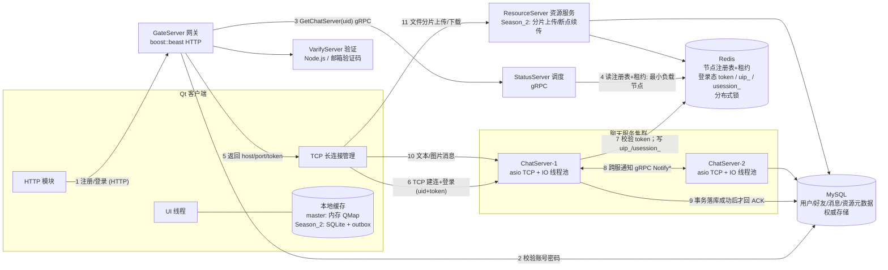

# 系统架构与整体链路（面试复盘调研）

> 定位：把"分布式 IM 项目整体架构 / 服务拆分 / 服务间通信"相关的面试问答逐条复盘，给出可直接背的口语稿和代码对照。
> 同级文档：调研总览、消息可靠传输与幂等去重、消息存储与分页拉取、离线消息、补拉与消息撤回、聊天服务集群与负载均衡、Redis使用与高可用设计、多端登录互斥与在线状态、连接管理、并发模型与协议、性能压测与容量扩展、断点续传与文件消息。

---

## 0. 调研范围

**覆盖问题**
- 9.11 科大讯飞一面 问4（整体架构、几个服务）
- 9.15 OPPO二面 问1、问2（自我介绍；画网关→验证→调度→聊天→资源交互逻辑）
- 9.1 中望软件一面 问1、问2、问5、问7、问8（自我介绍/服务拆分；是否论文；为什么做；学到什么；最难的点）
- 9.20 华为主管面 问6（先 gRPC 后自研 RPC 的关系）
- 9.23 中兴二面 问2（项目来源）
- 9.24 网易 问10、问11（项目来源；改造了哪一部分）
- 9.8 百度二面 问11~14、问33~34（RPC vs HTTP；为什么微服务内部用 RPC；gRPC 与 HTTP/2；RPC 框架解决什么问题；业务层通信技术栈 vs 高性能数据面）
- 9.11 中望软件二面 问5、问8、问9（岗位匹配、时间线、个人项目）

**证据来源（只读核对）**
- 面经原文：`/Users/echo9923/Desktop/面经/` 下对应场次 txt（转写稿，含 ASR 噪声）。
- 开发文档：`开发文档/day01-项目结构概述.md`、`day17-登录服务验证和客户端数据管理.md`、`day27-分布式服务设计.md`、`day29-好友认证和聊天通信.md`、`day30-项目难点和面试技巧.md`、`day35心跳逻辑.md`、`day37-聊天信息存储方案.md`、`day41-分布式死锁解决方案.md`。
- 代码（只读）：工作区 `server/`、`client/`（当前为 `master` 分支），以及 `origin/Season_2` 分支（`git show/grep` 只读核查，未切换分支）。

**⚠️ 最重要的口径校准（先看这条再背任何答案）**

| 面试里的说法 | 当前工作区 master | origin/Season_2 分支 |
|---|---|---|
| 聊天节点 2s 续写、6s 过期 | ❌ 无 Redis TTL；`CServer` 每 60s 把连接数写 `logincount` HASH（`server/ChatServer/src/CServer.cpp:106,114`） | ✅ `ChatServer.cpp` 注释明确 "[Discovery] registration/lease refresh defaults to 2s with a 6s TTL"，用 `SET chatserver:lease:<name> <count> EX <ttl>` 续租 |
| 调度按最小连接数选节点 | ❌ `StatusServiceImpl::getChatServer()` 取 `_servers.begin()`，最小连接数逻辑被注释（`server/StatusServer/src/StatusServiceImpl.cpp:57-91`） | ✅ Redis 注册表 + 租约读取，取最小 load，同负载轮询（`StatusServer/src/StatusServiceImpl.cpp:109-151`） |
| 客户端 SQLite + outbox 重试表 | ❌ `client/` 下 grep 不到 sqlite/QSqlDatabase/outbox，消息只在内存 `QMap`（`client/llfcchat/src/userdata.cpp`） | ✅ `src/store/localchatdb.cpp`、`localchatstore.cpp`、`outboxdispatcher.cpp`，配置 2s~30s 指数退避 |
| 资源服务负责文件 | ❌ `server/` 下无 ResourceServer | ✅ `server/ResourceServer/`（含 FileWorker、ResourceUploadFile 等） |
| 消息唯一索引/幂等去重 | ❌ `chat_message` 无 unique 索引、`AddChatMsg` 无 on duplicate（见文件 2） | ✅ 建表脚本含 `UNIQUE KEY uk_chat_messages_client(sender_user_id, client_message_id)`（`sql备份/20260830_database_rebuild.sql:78`），应用层事务内查重（SELECT ... FOR UPDATE）+ 内容一致性校验 |
| IO 线程池 + 业务线程池 | ⚠️ ChatServer 有 `AsioIOServicePool` + LogicSystem 单业务线程；GateServer 也有 `AsioIOServicePool`（HTTP IO 池，`GateServer/src/CServer.cpp:13`），但没有独立业务线程池（逻辑在 IO 线程内同步执行） | ✅ `LogicSystem` 内 `_logic_workers`/`_delivery_workers` 多个 `LogicWorker` |

**复盘结论**：你面试时讲的是 **Season_2 版本**；但当前会话打开的工作区是 **master 旧快照**。面试官若说"打开代码看看"或让你现场跑，会当场穿帮。两条路选一条：①把工作区切到/合并 Season_2，并以它为准准备；②按 master 重写面试口径（会明显变弱，不推荐）。本文档默认**以 Season_2 为面试口径，同时标出 master 差异**。

### 0.1 一张图看懂整体架构（客户端-网关-验证-调度-聊天-资源-MySQL/Redis）

> 图注：标 `Season_2` 的组件（ResourceServer、SQLite+outbox）在当前 master 工作区不存在；网关→验证的虚线环节表示注册/验证码流程（登录主链路不经过 VarifyServer）。

---

## 1. 问题清单总表

| # | 来源 | 问题 | 当时的回答（压缩） | 状态 |
|---|---|---|---|---|
| 1 | 9.11 科大讯飞一面 问4 | 整体架构/几个服务 | 登录两阶段：网关校验账号密码→gRPC 调调度分配聊天节点；若干聊天服务；资源服务负责文件 | ✅ 主干对；"资源服务"仅 Season_2 有 |
| 2 | 9.15 OPPO二面 问1 | 自我介绍 | 5 服务 + gRPC + 水平扩展 + 可靠传输 + 断点续传 + 多端互斥 | ✅ 流利但信息密度低 |
| 3 | 9.15 OPPO二面 问2 | 画网关→验证→调度→聊天→资源交互 | HTTP 登录→网关查 MySQL→gRPC 调度→读 Redis（2s/6s/最小连接数）→TCP 建连→Redis 写 UID+token；客户端 SQLite+outbox；落库后 ACK | ⚠️ 链路对，但细节只对 Season_2；表达混乱，缺失异常分支 |
| 4 | 9.1 中望一面 问1 | 自我介绍/服务拆分 | 网关、聊天、资源、验证、调度 5 服务，gRPC | ✅ |
| 5 | 9.1 中望一面 问2 | 是毕业论文吗 | 不是，与毕业方向无关 | ✅ |
| 6 | 9.1 中望一面 问5 | 为什么做这个 | 学 C++ 网络开发；开源 demo 上改 | ✅ 诚实，但"迭代了什么"要补 |
| 7 | 9.1 中望一面 问7 | 学到什么 | MySQL/Redis、分布式概念（服务发现/扩容）、IO+业务线程池 | ✅ |
| 8 | 9.1 中望一面 问8 | 最难的点 | 连接生命周期管理；消息可靠传输设计 | ✅ 好答案，可再深一层 |
| 9 | 9.20 华为主管面 问6 | 先 gRPC 后自研 RPC 的关系 | 第一个项目用 gRPC；后来自研学 RPC 底层 | ✅ 动机清楚 |
| 10 | 9.23 中兴二面 问2 | 项目来源 | 网上雏形 + 大量迭代 | ⚠️ 没例子没量化，容易被追着打 |
| 11 | 9.24 网易 问10 | 项目来源 | 晚上基于雏形学习网络编程，读源码后改进 | ⚠️ 同上 |
| 12 | 9.24 网易 问11 | 改造了哪一部分 | 负载均衡/水平扩展；可靠传输链路；IO+业务线程池 | ⚠️ 只说"加了什么"，没说"怎么实现、遇到什么问题" |
| 13 | 9.8 百度二面 问11~14 | RPC vs HTTP 四连问 | 面经只记了问题，未记录回答 | ❌ 待补 |
| 14 | 9.8 百度二面 问33~34 | 业务层通信技术栈 / 数据面技术栈 | 面经未记录回答 | ❌ 待补 |
| 15 | 9.11 中望二面 问5 | 实习/项目和岗位不匹配怎么考虑 | 项目偏 C++、用到 Qt；实习方向由 mentor 分配 | ✅ |
| 16 | 9.11 中望二面 问8 | 两个项目时间线关系 | 实习结束后的空余时间做自己的项目 | ⚠️ 表述含糊，没直接回答"重合" |
| 17 | 9.11 中望二面 问9 | 确认是自己项目 | 确认 | ✅ |

---

## 2. 逐题调研

### 2.1 9.11 科大讯飞一面 问4：整体架构与几个服务

**面试官原话（转写截取）**
> "整个架构怎么样？有发送端、接收端，还有几个服务？"

**你当时的回答（转写截取）**
> "用户登录分两阶段，第一阶段校验账号密码。网关层校验登录，再通过 gRPC 与调度服务通信；调度服务为用户分配聊天节点，实现负载均衡。另有若干聊天服务，用户登录、发送好友消息、文本消息、上传资源/语音消息都经聊天服务处理……还有资源服务，承担文件收发。"

**考点分析**
- 考"能不能一句话把系统边界和数据流讲清"：服务有哪些、各自职责、谁调用谁、权威数据存哪里。
- 面试官在意的是**分层是否清晰**（接入层/调度层/业务层/存储层），而不是背出 5 个名词。
- 你回答的隐藏坑："上传资源/语音消息都经聊天服务处理"和"资源服务承担文件收发"前后矛盾；准确说法是：文件传输走 ResourceServer，聊天服务只处理和落库"消息与资源元数据"。

**可直接背的口语化参考回答（约 60 秒版）**
> "整体是微服务架构，共 5 个服务：GateServer 网关负责 HTTP 接入（注册/登录/验证码）；VarifyServer 是独立的验证码/邮箱验证服务；StatusServer 是调度/状态服务，负责登录鉴权和给客户端分配聊天节点；ChatServer 聊天服务集群处理 TCP 长连接、好友申请、文本/图片消息，并做水平扩展；ResourceServer 资源服务负责文件的分片上传、断点续传和下载。服务间用 gRPC 通信，客户端和网关用 HTTP，和聊天/资源服务用自定义 TLV 的 TCP 长连接。数据的权威存储是 MySQL，Redis 存节点注册、登录态、分布式锁这些临时状态。典型链路是：客户端 HTTP 登录→网关查 MySQL 校验密码→gRPC 问调度要一个负载最小的聊天节点→拿到 host/port/token 后和聊天服务建 TCP 长连接，登录成功后所有消息走 TCP。"

**技术要点拆解**
- 5 服务职责：GateServer（beast/HTTP，注册登录）、VarifyServer（Node.js，验证码）、StatusServer（gRPC，鉴权+调度）、ChatServer（asio TCP、好友/消息、水平扩展）、ResourceServer（文件分片/续传）。
- 两条通信通道：控制面 HTTP（客户端↔网关）、数据面 TCP 长连接（客户端↔聊天/资源）。
- 服务间统一 gRPC（proto 里 Define StatusService/ChatService）。
- 存储权威：MySQL（用户、好友、消息、资源元数据）；Redis（注册表/租约、token、登录位置、session id、分布式锁）。

**当前项目实现对照**
- `开发文档/day01-项目结构概述.md`：GateServer/VarifyServer/StatusServer/ChatServer 描述与代码一致；VarifyServer 是 Node.js（`server/VarifyServer/server.js` 等）。
- master `server/` 下**没有 ResourceServer**；`origin/Season_2:server/ResourceServer/` 有完整实现（`LogicSystem.cpp`、`FileWorker.cpp`、`ResourceUploadFile.h` 等）。
- 聊天服务集群：master 有 `chatserver1.ini`/`chatserver2.ini` 与 PeerServer 配置（`server/ChatServer/config/`），支持双节点互连；调度逻辑在 master 被注释（见 2.3）。

**差距与改进建议**
- 讲架构时把"数据面/控制面/存储面"三分讲出来，比罗列服务名高级得多。
- 补一句每个服务的**规模约束**：单聊服务测试支撑 8000 稳定连接（讯飞问1 口径是"两个聊天服务 8000"，day30 口径是单服务 8000）；ChatServer 是 1 个 gRPC server 线程（`ChatServer.cpp:54`）+ Asio IO 线程池，master 业务侧只有 LogicSystem 单线程（见 2.4/2.8）。
- 资源服务要能说出"为什么独立"：大文件传输会长时间占用连接和磁盘 IO，独立后不拖累消息面；再讲断点续传的进度表。

**追问预判**
1. "为什么验证服务要单独拆？" → 验证码发送依赖第三方邮箱、失败重试和限流逻辑不同，独立部署便于隔离故障、单独扩容，也避免把 SMTP 超时带到网关主流程。
2. "调度服务和网关为什么不合并？" → 调度是全局状态（所有聊天节点的负载/存活），网关是无状态入口；分开后网关可以多实例水平扩展，调度也能单独做主备。
3. "资源服务挂了消息还能发吗？" → 能，文本消息链路不依赖资源服务；资源消息会先落一条 Pending 状态的消息，上传完成后再转 Published（Season_2 设计）。

---

### 2.2 9.15 OPPO二面 问1：自我介绍（架构版）

**面试官原话**
> "这个简历的内容和你基本上是差介绍的，然后每天花大概两分钟左右做个自我介绍。"

**你当时的回答（要点）**
> "把整个服务拆分成 5 个服务，服务之间通过 gRPC 通信……实现了注册登录、好友发送申请、发送消息、文本消息、资源消息断点续传、多端登录互斥……消息可靠性传输，保证消息不重复不乱序不丢失。"

**考点分析**
- 自我介绍决定后面 20 分钟的提问方向：技术亮点要"埋钩子"，而不是念功能清单。
- "不丢不重不乱序"这种绝对表述，会直接招来"你怎么证明"（本场问2、问3 就是这么来的）。

**可直接背的口语化参考回答（2 分钟版，重排顺序）**
> "第二个项目是一个 C++ 分布式 IM 系统。我做的最主要的三件事：第一，把单体聊天拆成网关、验证、调度、聊天、资源 5 个微服务，服务间用 gRPC，聊天服务支持水平扩展，调度按节点实时负载分配，后端统一 MySQL + Redis；第二，设计了消息可靠链路：客户端本地持久化 + outbox 重试，服务端先落库再 ACK、按'发送者 ID+客户端消息 ID'做幂等去重，接收端用事件序列号补拉，做到了业务层面的不丢不重、会话内有序；第三，完成文件分片上传下载和断点续传、多端登录互斥和心跳保活。压测上双聊天节点支撑过 8000 稳定连接。我想重点聊可靠传输和微服务调度这两块，您看可以吗？"

**技术要点拆解**
- 自我介绍结构：项目定位 → 我做的三件事（带技术关键词）→ 量化结果 → 主动抛话题。
- 弱化"全功能罗列"，强化"我设计/我改的"。

**当前项目实现对照**
- 功能清单与 `开发文档/day30-项目难点和面试技巧.md`、day37~40 文档一致；但"多端互斥、断点续传、本地持久化"只在 Season_2 有代码，master 无。参见同级文档《多端登录互斥与在线状态》《断点续传与文件消息》。

**差距与改进建议**
- 绝对化表述改口径："通过 at-least-once + 幂等去重达到业务上的'恰好一次'效果"（详见《消息可靠传输与幂等去重》）。
- 自我介绍里出现的每个关键词都要准备一个 30 秒展开 + 一个失败/边界案例。

**追问预判**
1. "你说的微服务，拆分依据是什么？" → 按变更频率和资源类型拆：接入（HTTP）与长连接（TCP）流量模型不同；验证依赖外部邮箱；调度是全局状态；资源是 IO 密集。拆完各自的扩容、故障隔离诉求都独立。
2. "服务间通信除了 gRPC 还考虑过什么？" → 控制面 HTTP/REST 也行但性能差、无双向流；消息面考虑过消息队列做异步解耦，但当前规模引入 MQ 会多一个运维组件，gRPC 同步调用+MySQL 权威存储已够。

---

### 2.3 9.15 OPPO二面 问2：画网关→验证→调度→聊天→资源交互逻辑

**面试官原话**
> "能不能拿这个笔先画一下，你这个即时通信系统从网关到验证到调度到聊天到资源，这几个微服务它的交互逻辑是什么样的？"

**你当时的回答（转写截取，ASR 噪声大）**
> "用户最开始登录的时候会给网关发 HTTP 请求，把 email 和 password 发给网关，网关读 MySQL 验证，通过之后向调度服务发 gRPC，把 UID 发给调度服务。调度服务读 Redis：一个哈希写所有在线 chat server 信息；另一个记录每个 chat server 在线连接数，过期时间 6 秒，聊天服务每 2 秒写一次，宕机 3 次没心跳自动下线。调度返回连接数最小的节点 IP 和 port，网关再返回给用户。用户和 chat server 建 TCP 连接，Redis 写 UID 和 token……客户端有持久化 SQLite，发送前先落库，同时有 outbox 重试表；chat server 收到后在 MySQL 落库，落库成功后回 ACK，才把 outbox 对应记录删掉……"

**考点分析**
- 白板题考三件事：①链路顺序正确；②每一跳的数据结构/存储介质说得出；③异常分支（节点挂了、用户离线、落库失败）。
- 你的回答里混入了大量断点续传的内容（转写开头一段全是文件分片），面试官不得不打断——**画架构时要按"一次登录+发一条消息"主线讲，别岔到文件**。
- "6 秒过期、3 次心跳"这类数字极容易被追问"为什么是 6 秒""2 秒和 6 秒怎么推导"，答不上就减分。

**可直接背的口语化参考回答（白板逐跳版）**
> "客户端先发 HTTP 登录到网关：网关查 MySQL 校验账号密码；通过后带 uid 调 StatusServer 的 GetChatServer。调度服务读 Redis 里两张结构：哈希 `chatserver:registry` 存节点注册信息（name→tcp_host/tcp_port/rpc_port），每个节点自己的 key `chatserver:lease:<name>` 存当前已认证连接数、TTL 6 秒，聊天服务每 2 秒 `SET ... EX 6` 续租；调度过滤掉租约已过期的节点，在存活节点里取负载最小（并列则轮询）返回 host/port，并生成一次性 token 写 Redis（`utoken_<uid>`，24h 过期）。客户端拿到 host/port/token 后和对应 ChatServer 建 TCP 长连接：先发心跳保活，再发登录包（uid+token），聊天服务查 Redis 里的 token 比对，通过后把 `uip_<uid>` 写成自己节点名、`usession_<uid>` 写 session id，完成登录。之后发消息：客户端在本地库先落消息并写入 outbox，通过 TCP 发到 chat server；chat server 在一个事务里校验会话成员、按'发送者+客户端消息 ID'查重、插入 chat_messages、分配接收方事件序列号 event_seq、写 user_events，提交成功后回 ACK（带 message_id 和 event_seq）；客户端收到 ACK 才删 outbox 条目。服务端再把消息推给接收方：先查 `uip_<touid>`，同节点就直接用 session 推，跨节点就 gRPC 调对端 ChatServer 推；对端不在线就不推，消息已经在库里，等对方上线按 event_seq 补拉。"

**技术要点拆解**
- 登录两阶段：①HTTP 网关鉴权（MySQL）②TCP 聊天服务鉴权（Redis token）。
- 调度数据结构：注册表（稳定信息）+ 租约 key（动态负载 + TTL 自动摘除）。
- 数据流：客户端本地库（outbox）→ chat server 事务落库 → ACK → 推送/补拉。
- 权威存储：MySQL 先落库再 ACK；Redis 只做瞬时状态。

**当前项目实现对照**
- master 链路与上述一致但弱化：日志/调度见 `server/GateServer/src/LogicSystem.cpp:245-285`（CheckPwd→StatusGrpcClient::GetChatServer）、`server/ChatServer/src/LogicSystem.cpp:128-143`（Redis 校验 token）、`LogicSystem.cpp:512` 落库后回 `ID_TEXT_CHAT_MSG_RSP`。
- "2s/6s/最小连接数"：master ❌（`CServer.cpp` 60s 写 `logincount` 无 TTL；`StatusServiceImpl.cpp:57-92` 注释掉了最小连接数逻辑）；Season_2 ✅（`ChatServer.cpp` lease timer + `StatusServiceImpl.cpp:110-151`）。
- "SQLite+outbox"：master ❌；Season_2 ✅（`client/llfcchat/src/store/`）。
- ⚠️ master 还有一个隐患：`MysqlMgr::AddChatMsg` 的返回值在 `LogicSystem.cpp:512` 被忽略，落库失败也会回 ACK（文件 2 详述）。

**差距与改进建议**
- 回答结构固定成"正常链路 → 失败分支 → 为什么这么设计"，白板画 6 个框 + 3 条 Redis key 即可，不要展开文件传输。
- 数字要能推导：注册 2s/租约 6s 的意义是"允许连续 2 次丢心跳仍算存活，3 次（6s）未续租即摘除"；超过 6s 客户端才可能感知，这是**可用性 vs 故障发现速度的取舍**。
- 明确"调度不知道聊天服务真实存活，只知道租约在不在"——假死（进程活着但处理不了请求）需要客户端失败上报/健康检查，这一点 OPPO 问11、问12 你已经被问倒。

**追问预判**
1. "token 为什么放 Redis 不放 StatusServer 内存？" → 调度服务可能多实例/重启，Redis 是共享存储；token 也用于聊天服务二次校验，放共享存储才能跨服务读取（day17 最初版本就是内存 map，属于旧设计）。
2. "聊天节点续租失败会怎样？" → 6s 后租约 key 自动过期，调度不再分配；已连在它上面的用户走断线重连重新申请节点。
3. "为什么要双写注册表和租约两个 key？" → 注册信息（IP/端口）基本不变，租约（负载+存活）高频变化且需要自动过期；分开后写负载只是 SETEX 一个小 key，也避免注册表被反复重写。
4. "客户端怎么知道消息发送成功？" → ACK 携带 client_message_id + 服务端 message_id + event_seq，客户端按 client_message_id 销 outbox。

---

### 2.4 9.1 中望软件一面 问5、问7、问8：项目来源、收获、最难的点

**面试官原话（摘取）**
> 问5："当时是基于什么原因要做这个事情？"
> 问7："你在这个过程中学到了什么东西呢？"
> 问8："你认为这个任务里面比较难的是什么？"

**你当时的回答（要点）**
> 问5：出于学 C++ 网络开发的心理；最先在开源项目上不断改进加功能，最初是个简单 demo，后来随学习深入不断修改完善。
> 问7：第一次正式用 MySQL/Redis；分布式概念（服务发现、扩容）；多线程实战（IO 线程池+业务线程池）。
> 问8：连接的生命周期管理；消息可靠传输设计。

**考点分析**
- 问5 考"动机真实性 + 你在开源基础上到底做了什么"；只答"学习"会引导面试官问"那这算你的项目吗"（中兴二面问2、网易问10 都追了这一点）。
- 问8 是送分题，但要答出**问题的本质和解决思路**，而不是名词。

**可直接背的口语化参考回答**
> 问5："动机是补 C++ 工程能力。最初是跟着一个开源聊天 demo 学 asio 和 Qt，但我把它从'单机 demo'改造成了'分布式系统'：拆分微服务、加调度和注册租约、重做消息可靠链路（本地持久化+outbox+幂等去重+序列号补拉）、加文件断点续传和多端互斥。现在版本里超过一半的代码和设计是我自己迭代的，原始 demo 只留下了基本的 asio/Qt 骨架。"
> 问8："最难的是连接生命周期管理。一条 TCP 连接同时被三类线程持有：主线程 accept、IO 线程读写、业务线程处理，任何一方都可能因为超时、读写错误或业务异常要关连接，早期直接 close 导致悬空指针和多线程竞态。我的做法是把'请求关闭'和'真正关闭'分离：每个连接持有一个原子状态，任意线程调用关闭只做 CAS 状态迁移，只有迁移成功的那个线程把关闭任务投递回该连接绑定的 IO 线程，由它统一释放；配合 shared_ptr 保证回调期对象存活。第二个难点是可靠传输：本质是在'网络不可靠+服务可能崩溃'的前提下，用先落库再 ACK、客户端 outbox 重试、服务端幂等去重回执、接收端序列号补拉，把 at-least-once 收敛成业务上的不丢不重不乱序。"

**技术要点拆解**
- 连接生命周期：状态机（正常/关闭中/已关闭/发完最后一包再关，中望一面答9 提过四状态）、原子变量 CAS、只投递到绑定 IO 线程执行 close、shared_ptr 保活。
- 可靠传输四件事：本地持久化（不丢出站）、ACK+重试（不丢在途）、幂等键+去重（不重）、序列号（有序/补拉）。

**当前项目实现对照**
- 连接管理：`server/ChatServer/include/CSession.h`、`CSession.cpp` 的 `Close()`、`_last_heartbeat`、`DealExceptionSession`；`CServer::on_timer` 60s 扫描（`CServer.cpp:75-118`）。
- 原始 demo 出处：`day01` 文档即 llfc 课程笔记（图片托管在 cdn.llfc.club）；`git log` 可见来自 `secondtonone1` 的 `Merge pull request #2/#3`（#3 为 Persistent_storage_of_chat_records）——迭代过程有据可查。
- 线程模型 master vs Season_2 差异见 0 节表格；"IO 线程池+业务线程池"完整形态在 Season_2。

**差距与改进建议**
- 把"开源项目改的"讲成**能力迁移故事**：留下什么、重写什么、为什么重写，最好能给出 diff 级别的例子（如"原版调度是内存 token，我改成 Redis 注册表+租约"）。
- 连接生命周期可以现场画"三线程都会 close"的时序图，讲清竞态窗口，这是你答得最好的一题，要主动往这里引。

**追问预判**
1. "四状态具体怎么迁移？" → 正常→关闭中（CAS 成功者负责收尾）；正在发送最后一包→发送完成→关闭；所有读写回调先检查状态，已关闭直接返回。
2. "为什么不用一把锁直接保护 close？" → 锁只能保护临界区，挡不住 close 之后回调仍持有裸指针的问题；核心要解决的是对象生命周期，所以用原子状态+shared_ptr+单线程收尾。
3. "可靠传输里服务端崩溃在 commit 之后、ACK 之前怎么办？" → 客户端没收到 ACK 会重试同一个 client_message_id，服务端查重命中后返回已存消息，客户端收敛状态，不产生重复（文件 2 详述）。

---

### 2.5 9.20 华为主管面 问6：先 gRPC、后自研 RPC 的关系

**面试官原话**
> "针对于你这个 RPC 的项目……当时做这个的原始初衷是什么，就是解决什么样的问题？"

**你当时的回答（转写截取）**
> "原始的初衷是出于学习的目的。第一个项目是分布式即时通讯系统，采用的是 gRPC 谷歌提供的框架；后续做这个 RPC 就想学习一下 RPC 底层需要做什么，相当于把这个服务给搭建起来了。"

**考点分析**
- 主管面用这题判断"自驱力 + 学习路径是否闭环"：不是重复造轮子，而是"用过 → 好奇 → 拆开实现 → 反哺理解"。
- 可以顺着把两个项目的连接点讲清：自研 RPC 的 IO/协程/协议知识反哺了 IM 的性能优化（IO 线程池、TLV 粘包处理、异步链路）。

**可直接背的口语化参考回答**
> "两个项目是递进关系，不是重复。IM 是我在用 gRPC：proto 定义服务、连接池复用 stub、超时和错误码处理，让我理解了'应该怎么用'。但我对'为什么这样设计'不满足：序列化为什么选 protobuf、HTTP/2 多路复用怎么支撑流、连接池和超时重试怎么做、RPC 框架到底解决了哪些问题。所以我写了第二个 RPC 框架：epoll 主从 Reactor + 自研用户态协程做 N:M 调度、自定义二进制协议解决粘包、protobuf 编解码、服务注册与发现。写完再回看 IM，就敢说清楚每个 gRPC 参数的取舍，也用到了 IM 的 IO 线程池和协议设计上。所以它们一个是'工程使用'，一个是'原理内化'。"

**技术要点拆解**
- gRPC：HTTP/2（多路复用、头部压缩、单连接并发流）、protobuf、四种流模式、deadline、连接池。
- 自研 RPC 对应物：自定义协议（包长+ID）、协程/线程池、服务发现、负载均衡、超时重试、熔断（未做要诚实）。
- 递进关系话术："用→懂原理→反过来优化工程"。

**当前项目实现对照**
- IM 用 gRPC：`server/proto/`；`server/ChatServer/src/ChatGrpcClient.cpp` 实现连接池（`ChatConPool`，day27 文档）。
- 自研 RPC 不在本仓库（另一个项目）。
- 追问点：科大讯飞一面 问21 你被问"gRPC 流式有几种交互模式"答"没太深入"——这是明显的待补点。

**差距与改进建议**
- 补 gRPC 四类流：一元、服务端流、客户端流、双向流；结合场景说"IM 的通知是一元调用，文件传输用客户端流会更省连接"。
- 准备一个"gRPC 的坑"：如默认 4MB 消息上限、连接池复用要配 keepalive、跨语言 proto 版本兼容规则。

**追问预判**
1. "自研 RPC 比 gRPC 强在哪？" → 不乱答"更强"；诚实说"定位不同：我的框架在轻量同构场景下延迟更可控（协程切换约 9ns），但生态、跨语言、流式、可观测性远不如 gRPC"。
2. "gRPC 为什么基于 HTTP/2？" → 多路复用解决 HTTP/1.1 队头阻塞、header 压缩、二进制帧、双向流、单连接多请求，天然适配 RPC。
3. "如果让你给 IM 换掉 gRPC，你会换吗？" → 不会。服务间调用量不大，gRPC 的生态和调试成本更划算；自研的收益只有在极端性能或深度定制场景才成立。

---

### 2.6 9.23 中兴二面 问2 / 9.24 网易 问10、问11：项目来源与改造点

**面试官原话**
> 中兴二面问2："这两个项目是你自己在网上找的或者自己去哪学习的一个项目吗？"
> 网易问10："这两个项目你来源是什么呀？"
> 网易问11："你的源码你大概改造了，改造的是哪一部分呢？"

**你当时的回答（要点）**
> 来源：网上/开源雏形，抱着学习网络编程和多并发编程的目的，读源码后不断改进。
> 改造点：①加负载均衡和水平扩展；②最关键链路——消息可靠性传输，自己设计；③高并发处理改成 IO 线程池+业务线程池。

**考点分析**
- "开源改造"不丢人，丢分的是**说不出改造深度**。回答要给出"原版做法 → 问题 → 我的方案 → 结果"四段式。
- 网易问12、13 紧接着问了指标和上限（8000 连接怎么来的），说明面试官在验证"改造是否真实"。改造点要绑定可验证的数字与代码。

**可直接背的口语化参考回答**
> "它最初是网上一个 asio+Qt 的聊天 demo，只支持单机、内存 token、消息只存内存。我做了三层改造：第一层，把聊天做成集群：调度服务 + Redis 注册表/租约做服务发现，ChatServer 每 2 秒续租上报负载、6 秒过期自动摘除，调度按最小负载分配，两节点支持互连；第二层，重做消息链路：原版只有'收到就转发'，我加了客户端本地持久化+outbox 重试、服务端事务落库后 ACK、按发送者+客户端消息 ID 幂等去重、接收方按 event_seq 游标补拉，把'不丢不重不乱序'从口号变成可测的设计；第三层，并发模型：从单 io_context 改成 IO 线程池 + 业务逻辑 worker，网络线程只做编解码，慢逻辑（DB/Redis 调用）丢业务线程，避免阻塞事件循环。压测上两个聊天节点稳定支撑 8000 连接、每秒 1K 条 256 字节消息、P99 小于 1 秒。"

**技术要点拆解**
- 改造点与证据绑定：调度（`StatusServiceImpl` + 注册租约）、可靠链路（day37 + Season_2 [`outboxdispatcher.cpp`](origin/Season_2)）、线程模型（`AsioIOServicePool` + `LogicWorker`）。
- 数字要能复述测试条件（机器核数、消息大小、判定标准），网易问15 已拿到你的测试方法，说明这个展开有效。

**当前项目实现对照**
- master 的 `StatusServiceImpl` 负载均衡被注释、无租约，改造点只对 Season_2 成立；`AsioIOServicePool` 在 master 存在（`server/ChatServer/src/AsioIOServicePool.cpp`），但业务 worker 只有 `LogicSystem` 一个线程（`LogicSystem.cpp:18`）。
- 建议：把 master 与 Season_2 合并/对齐后再对外讲，否则面试官看仓库会认为"写在简历上的改造在代码里找不到"。

**差距与改进建议**
- 做一张"原版 vs 我的版本"对照表放进项目 README（不改原版代码，只写文档），面试时可直接展示。
- 每个改造点配一个失败案例（如"早期租约用 60s 导致宕机节点 1 分钟才摘除，改为 2s/6s"）。

**追问预判**
1. "8000 连接的上限是什么决定的？" → 测试机 20 核 32G、IO 线程+业务线程+压测客户端线程总和超过核数、CPU 打满；DB 读写也是瓶颈。换机器/分库/加缓存还能上（你网易问14/16 答得不错，照这个思路）。
2. "为什么 6 秒过期？" → 3 次续租窗口：2s×3=6s，容忍两次丢包，同时保证宕机后最多 6s 摘除。
3. "原版哪里让你觉得必须重做？" → 原版把消息只放内存、转发失败即丢、单机 token，无法支撑"服务端权威存储+多节点"；这是设计缺陷不是 bug，所以是重做而不是补丁。

---

### 2.7 9.8 百度二面 问11~14、33~34：RPC 与 HTTP、业务层 vs 数据面（面经未记录回答，全部待补）

**面试官原话**
> 问11："RPC 和 HTTP 有什么区别？"
> 问12："为什么微服务内部调用要用 RPC，而不是直接用 HTTP？"
> 问13："RPC 一定不用 HTTP 吗？（gRPC 和 HTTP/2 的关系）"
> 问14："RPC 框架解决了哪些问题？（序列化、服务发现、负载均衡、超时重试、熔断等）"
> 问33："做业务层服务之间通信，需要了解哪些技术？"
> 问34："做底层数据/高性能数据面，和做业务层有什么不同的技术栈要求？"

**你当时的回答**
> 面经 txt 只整理了题目，没有记录回答。按"没答/答不深"处理，以下为补课稿。

**考点分析**
- 问11~13 是一条线：别把 RPC 和 HTTP 对立起来，正确认知是"RPC 是编程模型/调用语义，HTTP 是传输协议之一"。
- 问14 考框架视野：序列化、连接管理、服务发现、负载均衡、超时重试、熔断限流、可观测性。
- 问33~34 考职业方向认知，答得好能反客为主。

**可直接背的口语化参考回答**
> 问11/12："两者不是同一层的东西。HTTP 是应用层传输协议，RPC 是'像调本地函数一样调远程'的编程模型。RPC 可以底层用 HTTP（gRPC 就是 HTTP/2+protobuf），也可以走自定义 TCP 协议。微服务内部倾向 RPC，主要是三点：①契约强类型（proto 生成 stub，编译期检查）；②性能好，protobuf 二进制比 JSON 小、解析快，长连接+多路复用没有 HTTP/1.1 的队头阻塞和频繁建连开销；③框架层内置负载均衡、超时、重试、链路追踪，调用点对开发者透明。对外网关用 HTTP 是因为浏览器/生态通用，对内用 RPC 是因为可控、高效。"
> 问13："RPC 不一定不用 HTTP，gRPC 本身就是标准 HTTP/2：请求映射成 HEADERS+DATA 帧，用 stream id 做多路复用，protobuf 做 payload。区分点在于'是否走通用 REST 语义'，而不是'用不用 HTTP'。"
> 问14："RPC 框架把分布式调用的公共复杂度下沉：序列化/反序列化、连接管理/连接池、服务注册发现、负载均衡、超时与重试（含幂等前提）、熔断限流降级、上下文透传、监控与链路追踪。没有框架的话，这些逻辑会散落在每个调用点。"
> 问33："业务层通信要懂：协议选型（HTTP/gRPC/消息队列）、序列化、接口契约与版本兼容、超时重试幂等、服务发现与负载均衡、数据一致性与事务边界、可观测性（日志/指标/链路）、容量与降级。"
> 问34："数据面更偏'单机极限性能'：用户态网络（DPDK、io_uring）、零拷贝、无锁/无阻塞数据结构、内存池、NUMA、CPU 亲和、eBPF/XDP、网卡多队列；业务层更偏'系统设计与协作'：API 设计、领域拆分、缓存与数据库、一致性、故障隔离。共同基础是 TCP/IP、Linux、性能分析。"

**技术要点拆解**
- RPC vs HTTP 常见误区：把 gRPC 当"HTTP 的对立面"；实际上 gRPC-over-HTTP/2。
- HTTP/2 关键机制：单连接多路复用（stream）、头部 HPACK 压缩、二进制帧、服务端推送（已弃）、流量控制。
- RPC 框架清单请按"连接层/编解码层/治理层/观测层"分组记忆。

**当前项目实现对照**
- 项目内 gRPC 使用：`server/proto/` 定义 `StatusService`/`ChatService`；`ChatGrpcClient` 用连接池复用 stub（day27）。
- 项目内 HTTP：GateServer 用 boost::beast 处理表单 POST/JSON（day04/05）。
- 高频数据面技术在本项目未使用；回答时不要把未做的说成做过。

**差距与改进建议**
- 结合自己项目举例：`GetChatServer` 是短小一元 RPC；`NotifyTextChatMsg` 是同构服务间通知；如果做文件切片传输，用客户端流式 gRPC 比循环一元调用更合适。
- 准备一个"如果重来"：跨服通知目前是同步 gRPC，接收方不在线时直接返回；可改成"写 user_events 表 + 接收方拉取"的解耦模型（Season_2 已这么做）。

**追问预判**
1. "HTTP/2 队头阻塞彻底解决了吗？" → TCP 层仍有队头阻塞（丢包阻塞所有流），HTTP/3 换 QUIC/UDP 才解决；gRPC 在弱网下同样受影响。
2. "RPC 重试一定安全吗？" → 不安全，重试要求等幂；这正是本项目用 client_message_id 幂等的原因（文件 2）。
3. "什么时候不该用微服务/RPC？" → 团队规模小、业务耦合强时，单体+进程内调用更简单；拆分带来的运维、调试、分布式事务成本要算账。

---

### 2.8 9.11 中望软件二面 问5、问8、问9：岗位匹配、时间线、个人项目

**面试官原话**
> 问5："两段实习经历跟你的专业关系不大，跟投递岗位关系也不太大，你是怎么考虑的？"
> 问8："我看你这个时间节点好像有重合的地方，这两个项目，这个项目跟它是什么关系？"
> 问9："结束之后是你自己的项目是吗？"

**你当时的回答（转写截取）**
> 问5：项目偏 C++，第二个还用到 Qt；实习方向由 mentor 分配，不一定理想；实习主要锻炼团队协作和独立承担。
> 问8："因为当时实习结束之后，白天还是有空余的时间嘛。金山那边 6 点钟就下班了，然后晚上就做一下自己的项目。"
> 问9：确认是自己项目。

**考点分析**
- 问5 是"动机与稳定性"题：面试官担心你干不久。要点是把岗位需要的能力映射到你的经历上。
- 问8 是简历一致性核查：时间线重合不是问题，**回答模糊才是问题**。要直接说"项目 X 时间段、实习 Y 时间段、两者并行/先后，不冲突"。

**可直接背的口语化参考回答**
> 问5："我的主线一直是 C++ 工程。金山做的是输入法引擎性能优化，练的是性能分析和大型代码库调试；华为做的是 ArkUI 内存测试框架，练的是从 0 设计测试方案和跨团队交付；业余的 IM/RPC 项目把网络编程、分布式、数据库这些服务端核心能力补齐了。这个岗位要的 C++、Qt、网络通信、工程化，我三条线都覆盖到了，所以我不觉得是错配，反而是有意为之的组合。"
> 问8："时间线上，IM 项目主体是 2025 年 9 月到 12 月，跟金山实习的下班时间并行，我一般是晚上和周末推进；RPC 项目是 IM 稳定之后今年上半年做的，跟华为实习也不同期。简历上看起来相邻，实际没有和实习冲突。"

**技术要点拆解**
- 岗位匹配公式：岗位 JD 关键词 → 我的证据 → 结论。
- 时间线回答结构：起止时间 + 投入方式 + 与实习的关系 + 成果。

**当前项目实现对照**
- 项目规模：约 2.5 万行（中望一面问49 你回答"25000 多行"），与仓库代码量量级一致（`server/` + `client/`）。
- Git 历史可证明迭代：`git log` 有 CMake/vcpkg 迁移、配置修改、持久化合并等提交。

**差距与改进建议**
- 简历上给项目标注起止时间，避免"重合"引发追问。
- 准备一句话量化投入："平均每周 10~15 小时，持续 X 个月，X 个提交/约 2.5 万行。"

**追问预判**
1. "实习那么忙，你怎么保证项目质量？" → 小步提交 + 可运行验证（每阶段跑通再进下一步）、测试用例/压测（8000 连接测试脚本）。
2. "为什么不去做客户端/前端？" → 兴趣在网络与服务端；Qt 只是我用来验证服务端链路的客户端工具。

---

## 3. 小结与行动项

**薄弱点排序**
1. **代码与面试口径不一致（最危险）**：2s/6s、最小连接数、SQLite+outbox、资源服务只在 `origin/Season_2`；当前 master 工作区对不上。若面试官看仓库，可靠性叙事会整体崩塌。
2. **RPC 理论题是盲区**（百度二面问11~14、33~34 无回答记录；科大讯飞问21 流式 gRPC 也答了"没太深入"）。
3. **"开源改造"叙事缺细节**：来源、改造点、数字都有，但缺"原版问题→我的方案→结果"的对照，容易被追问打穿。
4. **架构图表达混乱**：OPPO 白板时岔到断点续传、异常分支缺失（假死节点、离线补偿在问11~13 被追着问）。

**行动项（建议动手做）**
1. **对齐代码分支**：把 `origin/Season_2` 合并回 master（或明确以 Season_2 为发布分支），至少把 README/项目描述更新为"面经口径"，并补一张原版 vs 现版对照表。验证命令：`git log --oneline --all -- server/ChatServer/src/ChatServer.cpp`。
2. **补 gRPC 专项笔记 + 一次实验**：在 `server/proto` 里加一个 streaming 示例（如文件分片客户端流），跑通并记录，把"四种流模式"变成可讲案例。
3. **白板演练 3 分钟版架构图**：固定顺序"客户端→网关(HTTP+MySQL)→调度(gRPC+Redis 注册租约)→聊天集群(TCP+MySQL)→资源服务(分片/续传)"，每个箭头一句话，最后补 2 个异常分支（节点摘除、离线补拉）。可参考本文 2.3 的口语稿逐句背。

**关联文档**：《消息可靠传输与幂等去重》（ACK/重试/去重/序列号）、《聊天服务集群与负载均衡》（注册租约与调度细节）、《Redis使用与高可用设计》（Redis 故障与加固，对应 OPPO 问8~10）、《多端登录互斥与在线状态》（登录态/踢人）、《断点续传与文件消息》（资源服务）。
