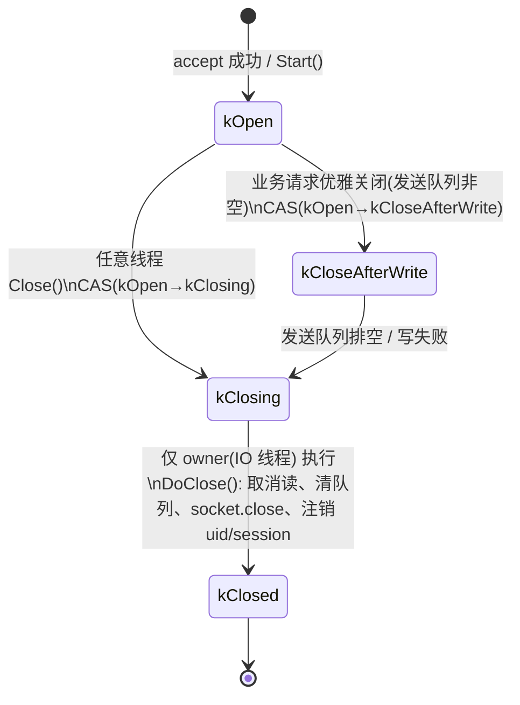

# 连接管理、并发模型与协议

> 面试调研子文档 ｜ 来源：9.18 中兴一面 问4/7/8/14 · 9.15 OPPO二面 问14/15 · 9.1 中望软件一面 问8~13 · 9.24 腾讯后台一面 问25 · 9.24 网易服务端一面 问13 · 8.31 百度一面 问39/40/41
> 相关文档：[调研总览](调研总览.md) · [系统架构与整体链路](系统架构与整体链路.md) · [多端登录互斥与在线状态](多端登录互斥与在线状态.md) · [聊天服务集群与负载均衡](聊天服务集群与负载均衡.md)

## 0. 调研范围

- **面经原文（只读）**：
  - `/Users/echo9923/Desktop/面经/9.18 中兴一面.txt` 问4（最难问题=连接生命周期）、问7/8（多进程 vs 多线程）、问14（网络问题调试）
  - `/Users/echo9923/Desktop/面经/9.15 OPPO二面.txt` 问14（粘包）、问15（心跳超时）
  - `/Users/echo9923/Desktop/面经/9.1 中望软件一面.txt` 问8、9、10、11/12、13（连接生命周期 + 原子变量）
  - `/Users/echo9923/Desktop/面经/9.24 腾讯后台一面.txt` 问25（无锁结构/条件变量）
  - `/Users/echo9923/Desktop/面经/9.24 网易服务端客户端一面.txt` 问13（8000 用户上限）
  - `/Users/echo9923/Desktop/面经/8.31 百度一面.txt` 问39/40/41（epoll/select；问39、40 转写缺失，问41 问句仅存半句，均有回答）
- **项目文档对照**：day16（asio 实现 tcp 服务器）、day29（好友认证与聊天通信）、day30（项目难点与面试口径）、day33/day34（踢人）、day35（心跳与死锁规避）、day41（MySQL 死锁）、day42（Qt 粘包血案）。
- **代码核实**：`server/ChatServer/src/CSession.cpp`、`CServer.cpp`、`LogicSystem.cpp`、`AsioIOServicePool.cpp`、`UserMgr.cpp`；`client/llfcchat/src/tcpmgr.cpp`、`chatdialog.cpp`、`mainwindow.cpp`（以上为 master；关键差异已对照 `origin/Season_2`，该分支有 `common/include/SessionLifecycle.h` 四状态状态机、socket 操作投递 IO 线程、修复后的 `client/llfcchat/src/net/tcpmgr.cpp`）。
- **结论性质**：只读调研 + 背答口径整理，不改动任何代码；涉及"当前仓库"的结论均已标明 master / Season_2 分支；证据不足的标注"待核实"。

## 1. 问题清单总表

| # | 场次 | 问题 | 你的回答状态 | 一句话结论 |
|---|---|---|---|---|
| 1 | 9.18 中兴 问4 | 项目最难的问题及解决 | ✅ 可以 | 连接生命周期管理整个故事完整；"原子状态位+统一 close 到 IO 线程"master 未实现，`origin/Season_2` 已实现（`SessionLifecycle` 四状态 + close 投递 IO 线程） |
| 2 | 9.18 中兴 问7/8 | 高并发用多进程还是多线程 | ⚠️ 半对 | "内存隔离拿不到对方连接信息 / 多线程共享堆好沟通"方向对；缺路由成本、崩溃域、多路复用的完整对比 |
| 3 | 9.18 中兴 问14 | 网络问题怎么调试 | ❌ 答得弱 | 只答"断点+本机测试"，没有工具链和真实案例，面试官明显不满意（紧接着问"平时怎么调试"） |
| 4 | 9.15 OPPO 问14 | 粘包怎么解决 | ✅ 基本可以 | "4 字节头 + 循环读"方向对；细节口径与代码不一致（实际是 2B ID+2B 长度），缺最大包长防护 |
| 5 | 9.15 OPPO 问15 | 心跳超时怎么定义 | ✅ 可以 | UID→session、时间戳、轮询线程判超时全说对；可补"参数怎么定、假死怎么检、重连怎么退避" |
| 6 | 9.1 中望 问8 | 项目最难的是什么 | ✅ 可以 | "连接生命周期 + 消息可靠传输"两条线清楚 |
| 7 | 9.1 中望 问9 | 三处可能 close 怎么解决 | ✅ 可以（Season_2 代码佐证） | "四状态原子变量、close 只改状态、最后统一关闭"讲得好，`origin/Season_2` 的 `SessionLifecycle` + 投递 IO 线程正是这个实现；只有看 master 工作区才对不上（mutex+直连 close） |
| 8 | 9.1 中望 问10 | 原子变量是什么 | ✅ 可以 | 读改写+丢更新例子正确；可补 CAS/内存序 |
| 9 | 9.1 中望 问11/12 | 原子能力是哪个级别 | ⚠️ 半对 | "C++ 层、硬件保证"对；"上层扩宽类型"表述含糊，可补 x86/ARM 指令与 libatomic |
| 10 | 9.1 中望 问13 | 主要是 C++ 级多线程 | ✅ 可以 | 确认即可，可列项目里用到的线程/同步原语清单 |
| 11 | 9.24 腾讯 问25 | 无锁结构/条件变量 | ✅ 可以 | 诚实回答没写无锁队列，原子变量只为少加锁；可补充条件变量在项目中的两处用途 |
| 12 | 9.24 网易 问13 | 8000 用户靠什么支撑 | ⚠️ 半对 | "asio 事件循环 + IO 线程池"对；"业务线程池"master 实为单线程、Season_2 才是 LogicWorkers 分片池；8000 数据来源需自己复测留证 |
| 13 | 8.31 百度 问39 | epoll 原理 | ⚠️ 半对 | 只讲到"内核注册+中断唤醒"，缺红黑树/就绪链表/回调机制 |
| 14 | 8.31 百度 问40 | select 原理与上限 | ✅ 基本可以 | 位图、1024、O(n)、拷贝、轮询都对；缺"每次调用重置 fd_set、LT 语义" |
| 15 | 8.31 百度 问41 | epoll 复杂度和就绪返回 | ⚠️ 不确定 | 纠结"O(1) 还是 O(n)"，正确表述是"就绪事件 O(k)，全活跃时退化 O(n)" |

**最需要修的三处薄弱点**
1. **网络排障**（问14）从"断点+本机"升级为分层工具链（见 2.23 专题）。
2. **连接状态机口径与分支绑定**（问9）：master 的 `CSession::Close()` 是 mutex + 直接 `_socket.close()`，`_b_close` 是普通 bool 且从未被读取；`origin/Season_2` 已实现四状态状态机（`SessionLifecycle`：Open/Draining/Closing/Closed + CAS + close 投递 IO 线程 + 5s 优雅关闭）。面试前切到 Season_2，叙述即可与代码一致；若只能看 master，要按旧版如实说。
3. **心跳参数和 8000 数据**：客户端 10s 心跳、服务端 20s 阈值、60s 扫描（最坏 ~80s 检出；Season_2 阈值/扫描可配置但默认同值）；8000 连接/1W~2W 是 day30 的教程口径，master 里没有压测代码，Season_2 有 `bench_run/` 与重测报告（可复现数据是 3000 在线/P99≈783ms，见《性能压测与容量扩展》）；8000 是否为本人实测待核实。

## 2. 逐题调研

### 2.1 中兴一面 问4：项目中最难的问题

**面试官原话（转写）**
> "嗯好那呃我再提再提一个最后一个问题吧，就是你在你在做这两个项目中有没有遇到过？就是说比较困难的问题，这个问题是什么？然后你是如何去解决这个问题的？你来说一下。"

**你当时的回答（压缩）**
> 最难的是分布式 IM 里"用户连接生命周期管理"：连接在主线程 accept 创建，读写固定在一个 IO 线程，业务又丢到业务线程执行；三个线程都可能因不同原因关闭连接（主线程心跳超时、IO 线程读写错误、业务线程参数/请求非法）。方案是用原子变量处理关闭状态，`close` 只有第一个线程能往下走，最终统一投递到对应 IO 线程执行真正的 close。

**状态：✅ 可以（Season_2 代码可佐证；只有 master 对不上）。** 这是全场答得最好的题之一：问题定义（分布三处）、解决思路（单点收敛+状态位）都清楚，而且 `origin/Season_2` 确实实现了同名四状态状态机（Open/Draining/Closing/Closed + CAS + close 投递 IO 线程）。风险仅在于：如果你演示的是 master 工作区，它是旧版 mutex+直连 close，面试前请切分支。

**考点分析**
1. 多线程下共享对象的生命周期是 C++ 服务端开发的核心难题：谁持有、谁释放、关闭与回调的竞态。
2. 是否理解"关闭"不是一个瞬间动作，而是一个需要所有线程达成一致的状态迁移。
3. 是否能把 asio 的 `shared_ptr` 保活（`shared_from_this`）和业务层的资源回收讲清楚。

**参考回答（可直接背，分三段）**
> 最难的问题是**用户连接的生命周期管理**。一条 TCP 连接在系统里被三个执行体触碰：主线程负责 accept 和心跳巡检，IO 线程池负责这条连接上的读写，业务线程负责执行具体请求。三个地方都可能触发关闭：心跳超时、读写报错、业务校验失败。
>
> 早期版本谁出错谁就调 `close`，很快就出现并发问题：一个线程正在写发送队列，另一个线程把 socket 关了；或者同一个连接被关两次、回调还在跑的时候对象状态已经乱了，严重时是 use-after-free。
>
> 最后的方案是把"关闭"收敛成一个**单点、幂等的状态机**：每个连接有一个原子状态位，只有从"正常"到"正在关闭"的 CAS 成功的那一个线程，才能继续执行完整的关闭流程，其他线程发现状态已经不是正常就返回。真正的 `socket.close()` 不在业务调用栈里直接做，而是投递回这个连接所属的 IO 线程，由它顺序执行：取消挂起的异步读写、清空发送队列、关闭 socket、从服务器的连接表和 uid→session 表里注销。这样关闭动作和这条连接的读写回调天然串行，不会和回调抢资源。

**技术要点拆解**
- 为什么 IO 线程是最合适的 close 执行者：一条连接的读写回调在该 IO 线程上串行执行（asio 对同一 socket 的回调做了串行化），close 放在同一线程就不用担心和回调并发。
- `shared_ptr` 保活：异步回调捕获 `shared_from_this()`，保证回调执行期间对象不析构；从容器移除后，最后一个 shared_ptr 释放才真正析构。
- 幂等：CAS 保证多线程重复 close 只生效一次；重复调用直接返回。
- 详细状态机见 2.16。

**当前项目实现对照（master vs `origin/Season_2`，重要）**
- **master（旧版）**：`server/ChatServer/include/CSession.h`（59 行）的 `bool _b_close` 是普通 bool，只被赋值、从未被读取（死字段）；`_last_heartbeat` 是 `std::atomic<time_t>`（69 行）。`server/ChatServer/src/CSession.cpp::Close()`（79–83 行）是 `lock_guard(_session_mtx)` + `_socket.close()`，直接在调用线程关闭，没有状态机、没有投递 IO 线程。生命周期保护靠：`CServer::CheckValid`（CServer.cpp 65–73 行）在读写回调里检查 session 是否还在 `_sessions` 表；`ClearSession`（41–53 行）加 `_mutex` 移除并解绑 uid；`UserMgr::RmvUserSession`（UserMgr.cpp 27–44 行）比对 session_id 不同则不动（防误删）。
- **`origin/Season_2`（已实现面试描述的设计）**：`server/common/include/SessionLifecycle.h` 定义 `Open / Draining / Closing / Closed` 四状态，用 `std::atomic<State>` + CAS（`BeginDrain / BeginClose / CompleteClose`）单点收敛；`server/ChatServer/src/CSession.cpp` 的 `Start/Send/SendAndClose/Close` 全部 `boost::asio::post/dispatch` 到 socket 所属 IO 线程执行（`Close` 内 cancel/shutdown/close，193–216 行）；`SendAndClose` 实现"发完最后一包再关"（Draining + 5s `_drain_timer` 超时兜底，148–191 行）。
- 结论：面试讲连接生命周期优先用 Season_2 的代码（与当时回答"正常/发完最后一包/正在关闭/已关闭"一一对应）；如果面试官看的是 master，就按"旧版是 mutex + 直连 close，Season_2 已收敛成状态机"如实说明。

**差距与改进建议**
- 口径统一：讲 Season_2 时直接说"IM 项目里就是四状态状态机 + close 投递 IO 线程"——代码真实存在，不要再把它归到 RPC 框架；讲 master 时明确是旧版并说明 Season_2 的改造。
- 可选（master 上 1–2 天）：按 Season_2 的 `SessionLifecycle` 给 CSession 移植状态机 + `boost::asio::post` 投递 close，见行动项。

**追问预判**
1. "为什么 close 不能直接在业务线程做？" → 和 IO 回调并发、发送队列竞态、fd 生命周期；见 2.18。
2. "多个线程同时 close 怎么办？" → 原子 CAS 只放行一个；其余观察状态直接返回。
3. "shared_ptr 能保证安全吗？" → 保活不保状态：对象活着但 socket 可能已关，仍需状态位和幂等。
4. "关闭顺序是什么？" → 先停止接收（取消读）→ 处理发送队列/发最后通知 → close socket → 从注册表移除 → 回调自然结束。

---

### 2.2 中兴一面 问7/8：高并发用多进程还是多线程？

**面试官原话（转写）**
> 问7："嗯我我再问一个问题，我看你呃这有做过那个TCP连接高并发的处理。嗯我想问一下，就是对于这种高并发场景，呃用那个用进程或者多线程有什么区别？"
> 问8："就是呃并发的场景，你用多进程去处理和和用多线程去处理这种并发有什么区别？"

**你当时的回答（压缩）**
> 多进程之间内存隔离，处理连接时不知道另一个进程的连接信息、访问不到对方的连接；多线程在一个进程内共享堆空间，线程之间通信、拿连接很方便。

**状态：⚠️ 半对。** 抓住了"路由成本"这个关键点（跨进程看不到对方连接），但回答偏薄：没提崩溃隔离、锁竞争、多路复用、SO_REUSEPORT、以及行业里两种模型的适用边界。面试官问了两次（问7、问8），说明想听更结构化的对比。

**考点分析**
1. 并发模型的本质区别：地址空间、调度单位、故障域、通信方式。
2. IM 场景的特殊约束：消息要按 uid 路由到"持有该连接的进程/线程"，所以"能不能直接拿到任意连接"是核心。
3. 是否知道多进程也能高并发（nginx/SO_REUSEPORT），以及对比不能只停留在教科书定义。

**参考回答（可直接背）**
> 放到 IM 场景，我会从四个维度对比。
>
> 第一是**连接路由**。多线程共享堆内存，`uid → session` 一张表加锁就能查到任意用户的连接，消息可以直接投递；多进程地址空间隔离，A 进程拿不到 B 进程里的连接，要么用共享内存/消息队列做跨进程转发，要么把路由信息放 Redis，由目标进程订阅或轮询，链路上多一跳，时延和复杂度都上升。
>
> 第二是**故障隔离**。多进程一个 worker 崩溃只损失它持有的连接，其他进程继续服务；多线程一个线程访问越界或崩溃，整个进程（所有连接）一起挂。IM 长连接重启代价很高，所以进程级隔离更安全。
>
> 第三是**并发与锁**。多线程共享数据方便，但 `uid→session`、计数这些共享结构要加锁，核多了锁竞争和缓存行乒乓会上来；多进程天然无共享，几乎无锁，但要用 SO_REUSEPORT 让每个进程各自 accept，或主进程 accept 后分发。
>
> 第四是**可观测与部署**。多线程调试一个进程即可；多进程要看多个 PID。
>
> 我的项目选的是**单进程多线程 + 多实例横向扩展**：ChatServer 内部用 asio 的 io_context 池（多线程事件循环）处理读写，业务逻辑入队由工作线程处理；需要按 uid 找连接时直接查本机 `UserMgr` 的表。用户被 StatusServer 分配到哪个实例，就由哪个实例持有他的连接；跨实例投递走 gRPC。如果连接量更大，可以选择多进程模型：每个进程独立 accept + 连接固定在自己进程，但跨进程推送要额外设计，所以我第一版选了实现最直接、路由成本最低的多线程。

**技术要点拆解**

| 维度 | 多进程 | 多线程 |
|---|---|---|
| 地址空间 | 隔离，跨进程拿不到对象 | 共享堆，`uid→session` 直接可查 |
| 通信 | IPC/共享内存/Redis/消息队列 | 内存 + 锁/原子/条件变量 |
| 故障域 | 单进程崩溃影响其连接 | 整个进程崩溃 |
| 锁竞争 | 少 | 共享结构需锁 |
| 扩展方式 | SO_REUSEPORT 多 worker / master-worker | 线程池 / io_context 池 |
| 调试 | 多进程日志、gdb attach 多进程 | 单进程内线程栈 |
| IM 适用 | 接入层、强隔离；跨进程路由成本 | 逻辑集中、路由直接；需防锁和崩溃 |

- 单机横向对比之外还有"I/O 多路复用"这条主轴：事件循环 + 异步 IO 用少量线程支撑万级连接（见 2.19/2.20）。
- 面试加分："并发模型选型的本质是**消息路由成本 vs 故障隔离成本**的权衡。"

**当前项目实现对照**
- `server/ChatServer/src/AsioIOServicePool.cpp`：IO 线程池大小 = `std::thread::hardware_concurrency()`，round-robin 分配 `io_context`，每个 `io_context` 跑在独立线程。
- `server/ChatServer/src/LogicSystem.cpp`：**master** 是单工作线程消费逻辑队列（`_worker_thread` + `std::condition_variable`），即"IO 多线程 + 业务单线程"；**Season_2** 已改为按 uid 分片的 `LogicWorkers`（默认 4）＋跨服 `DeliveryWorkers`（默认 4）。
- `server/ChatServer/src/UserMgr.cpp`：进程内 `unordered_map<int, shared_ptr<CSession>>` + mutex，实现 uid→连接直查——正是"多线程方便路由"的体现。
- `server/StatusServer` 把用户分配到不同 ChatServer 实例，属于"多进程/多实例 + 客户端粘住某一实例"的横向扩展，跨实例推送走 gRPC。

**差距与改进建议**
- 回答里可以主动补"我们不是单机多进程，而是单进程多线程 + 多实例"，避免面试官以为你不了解多进程（nginx/SO_REUSEPORT）的实践。
- master 业务线程是单线程，队列积压会成瓶颈；Season_2 已改成按 uid 分片的 `LogicWorkers`（同 uid 串行保序）＋独立的 `DeliveryWorkers` 隔离同步 gRPC，可直接拿来讲扩展思路（见 2.19）。

**追问预判**
1. "多进程下两个用户连到不同进程，怎么互发消息？" → Redis 在线路由 + gRPC 转发，或 MQ；本项目的跨服通知就是这个思路。
2. "多线程共享表加锁不会成瓶颈吗？" → 读多写少可换 shared_mutex；按 uid 分片；或者连接表只增删少改，锁粒度小。
3. "为什么不用协程？" → 我们用了单业务线程队列；协程适合业务里有大量阻塞等待的场景，RPC 框架项目里我实现了 M:N 协程。
4. "一个进程崩了客户端怎么办？" → 客户端断线重连 + 重新登录分配新节点；服务发现与摘除机制见 [聊天服务集群与负载均衡](聊天服务集群与负载均衡.md)。

---

### 2.3 中兴一面 问14：网络问题怎么调试？

**面试官原话（转写）**
> "哎，我看你对网络比较了解是吧？那你那你在实习或者自己做项目的时候有没有遇遇到什么问题，然后是用什么方法去调试的，就解决这种网络问题的。"

**你当时的回答（压缩）**
> "在实习的过程中啊，倒没有碰见什么网络的问题。项目的过程中…网络问题也是比较少的，因为平时的话都是在自己的本机上进行一个网络通讯的测试的。"
> 追问问15："平时你们调试代码是怎么调试的？" 答："打断点，然后去调试的。"

**状态：❌ 答得弱。** 这是全场最明显的减分项：既没有案例，也没有工具链。面试官追问两句都是在给你机会，仍然只答出"断点 + 本机测试"。

**考点分析**
1. 网络问题排查是服务端基本功：连通性、协议、链路、系统调用、内核统计五层。
2. 是否真的独立解决过线上/联调问题，而不是只会在 IDE 里单步。
3. 能否把工具和具体现象对应起来（TIME_WAIT、粘包、重传、RST、队列堆积）。

**参考回答（可直接背，按"分层排查"框架）**
> 我一般按"先定位是哪一层，再选工具"的顺序排查。
>
> 第一层**连通性**：先 `ping`/`telnet host port`/`nc -vz` 确认 TCP 能不能建上；HTTP 层用 `curl -v` 看状态码和头。
>
> 第二层**连接与队列**：用 `ss -lntp` 看监听和 backlog，`ss -tnp state established` 看 ESTABLISHED、Recv-Q/Send-Q。如果 Send-Q 一直不降，说明对端不读或本端发太快；Recv-Q 堆积说明应用没及时收。`ss -s` 和 `netstat -s` 看重传、RST、TIME_WAIT 统计。
>
> 第三层**抓包**：`tcpdump -i any -nn port 8990 -w x.pcap` 抓下来用 Wireshark 跟流看三次握手、FIN/RST、重传、是否发了心跳。我自己项目里排查"客户端一直没掉线但服务端心跳超时"的问题，就是用 tcpdump 确认客户端心跳确实没发出来。
>
> 第四层**进程与系统调用**：`gdb -p PID` + `thread apply all bt` 看线程卡在哪；`strace -f -p PID -e trace=network,read,write` 看是不是某个系统调用阻塞或返回错误；`lsof -p PID` 看 fd 是否泄漏。
>
> 第五层**资源与链路**：`top/vmstat/iostat` 看 CPU/内存/IO，`dmesg` 看内核 OOM 或网卡丢包，跨机房用 `mtr -rw` 看每一跳丢包，必要时 `tc/netem` 本地模拟丢包和延迟复现。
>
> 另外前置条件是**日志要能串起来**：连接 id、uid、消息 id 打全，很多网络问题其实是应用层问题，日志比抓包更快。断点调试我只用在本机复现，线上基本靠日志和工具。

**技术要点拆解（工具-现象对照）**

| 现象 | 首选工具 | 看什么 |
|---|---|---|
| 连不上 | ping / telnet / nc | DNS、路由、端口监听、防火墙 |
| 连接被重置 | tcpdump + ss -s | 谁发 RST：对端进程退出/半开/协议错 |
| 延迟高 | ping / mtr / tcpdump | 链路丢包、重传、Nagle/延迟 ACK |
| 大量 TIME_WAIT | ss -s / netstat -an | 谁先 close，短连接 QPS |
| fd 泄漏/句柄耗尽 | lsof -p / ls /proc/PID/fd | fd 是否随连接增长 |
| 线程卡死 | gdb / pstack / perf top | 栈、锁等待、CPU 热点 |
| 系统调用异常 | strace -f -e trace=network | accept/read/write 返回值 errno |
| 内核丢弃 | dmesg / nstat / ethtool -S | 网卡队列、somaxconn、重传 |

**当前项目实现对照**
- 项目里有 `AsioIOServicePool` / gRPC / Redis / MySQL 四个网络依赖，联调场景天然存在；day10（验证码派发调试）、day42（Qt 粘包）都是真实可讲的案例。
- 客户端 `tcpmgr.cpp` 对 `QTcpSocket::error` / `disconnected` 有日志；服务端各层有 printf 日志但没有连接 id 关联的结构化日志——这是排障能力弱的原因之一。

**差距与改进建议**
- 把 day42 的粘包案例改造成"用 Wireshark/tcpdump + 断点复现"的排障故事：断点导致消息累积 → 抓包看到两条消息在一个 TCP 段里 → 定位流式解析问题。这是"本机调试"也能讲出网络工具的真实案例。
- 给服务端日志加连接 id / uid / msg id；在面试里主动说"我们知道日志串不起来是排障瓶颈"。

**追问预判**
1. "线上不能打断点，你怎么定位？" → 日志 + gdb attach 看栈 + strace + 抓包，不改代码不重启。
2. "TIME_WAIT 很多怎么处理？" → 看谁主动 close；让客户端主动关、连接复用、`tcp_tw_reuse`（谨慎）、长连接设计。
3. "怎么确认是网络丢包还是应用慢？" → tcpdump 看重传计数 + 服务端 Send-Q/业务队列积压 + strace 看 read/write 时机。
4. "DNS 问题怎么查？" → dig/nslookup，看解析耗时和 TTL；容器环境看 /etc/resolv.conf。

---

### 2.4 OPPO二面 问14：自定义二进制协议解决粘包

**面试官原话（转写）**
> "然后嗯，我看了一下，你这个 TCP 连接高频化处理，你是你采用这个自定义二进制协议解决粘包的问题。你这个是怎么解决粘包问题啊？"

**你当时的回答（压缩）**
> 消息头部固定 4 字节标注整个包的长度；读的时候先读 4 字节头，解析出长度，然后 while 循环直到把整个包读完。

**状态：✅ 基本可以（口径要校准）。** 长度字段 + 循环读是正确的通用答案。两个问题：① 实际代码的 4 字节头是"2 字节消息 ID + 2 字节包体长度"，不是"4 字节总长度"；② 没有讲最大包长/魔数/校验等防护。

**考点分析**
1. 粘包根因：TCP 字节流没有消息边界，合并/拆分是内核行为。
2. 定长 vs 分隔符 vs 长度前缀的取舍；长度前缀工程上最通用。
3. 工程细节：长度字段本身的字节序、上限校验、半包状态机。

**参考回答（可直接背，并与代码口径一致）**
> TCP 是字节流，只保证字节顺序，不保证"一次发送对应一次接收"：应用层两次 `write` 可能被合并成一个 TCP 段（Nagle 算法、延迟 ACK），一个 `write` 也可能被拆成多个段，所以接收端必须自己划边界。
>
> 我们用的是**长度前缀协议**：包头固定 4 字节——2 字节消息 ID + 2 字节消息体长度——统一用网络字节序（大端）。收数据时维护一个接收缓冲和"当前消息"状态：先凑满 4 字节头，解析出消息 ID 和 body 长度，并校验长度不超过上限（我们是 2KB，超过直接断开，防止恶意/错乱数据把内存打爆）；然后按 body 长度继续读，读满才交付业务，剩下的字节留在缓冲里继续解析下一条，也就是一个 while 循环处理"一次收到多条/一条半"的所有情况。
>
> 如果让我重新设计，我会在包头加魔数（快速识别错位）和版本号，长度字段扩到 4 字节（支持大消息），校验和或 CRC 放到可选扩展里，这样对文件/图片消息也更友好。

**技术要点拆解**
- 为什么用长度前缀：定长消息不灵活，分隔符需要转义且二进制不安全；长度前缀 O(1) 定界、易校验。
- 包头设计建议：魔数(2B) + 版本(1B) + 消息 ID(2B) + 长度(4B) + 序号/标志(可选) + 校验(可选)。
- 长度字段必须校验上限；超限要断开并记录，否则容易被内存攻击或自己写错长度死循环。
- 字节序：协议统一用大端，客户端 `QDataStream::BigEndian`、服务端 `network_to_host_short`（代码已这么用）。
- 半包处理：收到数据不足时保存状态返回，下次 readyRead 继续，不能丢弃已收字节（day42 的 Qt 血案就是状态没管好）。

**当前项目实现对照**
- 服务端：`const.h`（38–44 行）`MAX_LENGTH 2KB`、`HEAD_TOTAL_LEN 4`、`HEAD_ID_LEN 2`、`HEAD_DATA_LEN 2`；`CSession::AsyncReadHead/AsyncReadBody`（CSession.cpp 132–193、89–130 行）先用 `asyncReadFull` 读满 4 字节头，解析 `msg_id/msg_len` 并校验 `> MAX_LENGTH`，再读 body；body 回调继续 `AsyncReadHead`，实现循环分帧。
- 客户端：`tcpmgr.cpp` 头部解析在 13–53 行，发送在 699–722 行（大端、`id+len`）。
- 差异：面试说的"4 字节=整个包长度"与代码"2B ID+2B body 长度"不一致；建议面试统一为代码口径。
- day42 文档记录了 Qt 客户端 `QDataStream` 复用导致解析错位的粘包 bug。已核对：**master** 的 `client/llfcchat/src/tcpmgr.cpp` 仍是"stream 建在 readyRead 回调顶部、`forever` 循环外复用 + `_buffer = _buffer.mid()`"的写法（18–33、48–51 行），与 day42 的错误模式相同——**master 潜在 bug**；**`origin/Season_2`** 已按 day42 修复：`client/llfcchat/src/net/tcpmgr.cpp` 在循环内每条消息重建 `QDataStream stream(_buffer)`、用 `_buffer.remove(0, 2)`（51–84 行）。

**差距与改进建议**
- 代码：按 day42 的方案修 `tcpmgr.cpp`：每条消息重建 `QDataStream`（或手写大端解析）、用 `remove(0,n)`、加 `_message_len` 上限校验、保留 while 循环。
- 协议：补魔数/上限/（可选）CRC；服务端 `msg_len` 按 `short` 解析（2 字节），且 `MAX_LENGTH` 限 2KB；大消息/资源消息走独立的资源服务分片协议（见 [断点续传与文件消息](断点续传与文件消息.md)），主聊天通道的 2KB 上限语义要说清。

**追问预判**
1. "粘包和拆包有什么区别？" → 同一根因的两个方向：多个消息合在一起 / 一个消息被拆开；长度前缀一次解决两者。
2. "UDP 有粘包吗？" → 没有，UDP 保留消息边界，但会丢包乱序。
3. "长度字段写错了怎么办？" → 上限校验 + 魔数 + 超限断开；服务端优势是可以认为客户端不可信。
4. "为什么不用 JSON/Protobuf 自带边界？" → 序列化协议不解决传输分帧，Protobuf 只是 body 编码，仍要长度前缀划帧。

---

### 2.5 OPPO二面 问15：心跳超时怎么定义？

**面试官原话（转写）**
> "然后你这个心跳超时现在是有一个固定的超时时间吗？啊，对你现在怎么定义它心跳超时呢？"

**你当时的回答（压缩）**
> chat server 维护 uid → TCPConnection 的表，shared_ptr 里记录上次收到消息的时间；心跳消息和其他消息都更新时间戳；还有一个线程不断遍历所有连接，发现当前时间减去时间戳超过阈值就 close。

**状态：✅ 可以。** 机制说对了，和代码一致。可补：具体参数（10s/20s/60s）、为什么这么定、假死检测局限、TCP keepalive 对比、重连退避。

**考点分析**
1. 长连接为什么需要应用层心跳：NAT/防火墙静默回收、对端拔网线/崩溃、进程假死。
2. 超时参数设计：发送间隔、判定阈值、扫描周期三者的关系。
3. 假死检测：连接活着但业务不工作怎么办。

**参考回答（可直接背）**
> 心跳超时是这么判的：每条 session 记一个"最近一次收到数据的时间戳"，收包时更新；服务端有一个定时线程，按固定周期遍历所有连接，当前时间减时间戳超过阈值就判定超时，走统一的关闭流程。任何消息都算心跳，不额外要求客户端只发心跳包。
>
> 具体参数上我们客户端每 10 秒发一次心跳；服务端阈值设的是 20 秒，扫描周期 60 秒——这个组合最坏要 80 秒才能发现一个死连接，阈值和扫描周期偏松。生产上一般让"阈值 ≥ 2~3 倍心跳间隔"、"扫描周期 ≤ 阈值 / 2"，比如 10 秒心跳、30 秒阈值、10 秒扫描；更精细的做法是每条连接挂一个 `steady_timer`，按各自的时间点触发，但连接多时定时器数量会成为负担，所以工程上常用分桶或统一扫描。
>
> 心跳还要看检测目标：内核层的 TCP keepalive 默认空闲 2 小时才开始探测，且只能发现链路死亡，发现不了"进程活着但不处理业务"的假死，所以 IM 都用应用层心跳。我们现在收包在 IO 线程更新，能及时发现断链，但发现不了业务线程卡死；更严格的做法是让心跳应答必须经过业务线程处理后再回包，客户端对心跳响应做超时统计，几秒没响应就重连。
>
> 客户端断线后现在是弹窗让用户重新登录；如果补上自动重连，我会用指数退避加抖动，比如 1s、2s、4s…最多 30s，避免服务端故障恢复瞬间所有客户端同时重连把服务打崩。

**技术要点拆解**

| 机制 | 层次 | 检测能力 | 默认/典型参数 | 适用 |
|---|---|---|---|---|
| TCP keepalive | 内核 | 链路断开（对端 RST/超时） | 7200s 起，可调 | 兜底，不单独依赖 |
| 应用层心跳 | 应用 | 链路 + 应用处理能力 | 10~30s 间隔 | IM 标准做法 |
| 空闲超时 | 应用 | 长期无数据 | 与心跳联动 | 服务端资源回收 |
| 客户端响应超时 | 客户端 | 服务端假死 | 2~3 倍心跳间隔 | 配合重连 |

- 服务端视角参数链：`心跳间隔` → `判定阈值 = k × 间隔 (k≥2)` → `扫描周期 ≤ 阈值/2`。
- 假死：进程死循环/死锁时 socket 仍可收包，但业务不处理；用"心跳要过业务线程"或独立健康检查来发现。
- 服务端主动踢人（异地登录）不要等心跳，直接下发下线通知 + 关闭。

**当前项目实现对照**
- `CSession::UpdateHeartbeat`（CSession.cpp 281–285 行）：`_last_heartbeat = now`，`std::atomic<time_t>`（CSession.h 69 行），在 `AsyncReadBody` 读满一条消息后调用（120 行）。
- `CSession::IsHeartbeatExpired`（271–279 行）：`now - _last_heartbeat > 20` 秒。
- `CServer::on_timer`（CServer.cpp 75–118 行）：60 秒定时器，拷贝 `_sessions` 后逐个判断，过期先 `Close()` 收集，再统一 `DealExceptionSession`（拿分布式锁清理 Redis 在线态，避免死锁，day35 的设计）。
- 客户端：`chatdialog.cpp` 每 10 秒发 `ID_HEART_BEAT_REQ`（162–165 行）；`tcpmgr.cpp` 的心跳响应只打日志（512–540 行），没有响应超时统计；断线走 `disconnected` 信号（93–97 行）→ `MainWindow::SlotExcepConOffline` 弹窗（mainwindow.cpp 123–129 行）。
- 与面试口径一致；文档 day35 说明"演示用 20s，实际 60s 更好"。

**差距与改进建议**
- 参数收紧：扫描 60s → 10s，阈值 20s → 30s（配合 10s 心跳），最坏检测从 ~80s 降到 ~40s。
- 客户端加"心跳响应超时"：发三次心跳都没回（30s）主动重连；补指数退避。
- 客户端加自动重连（当前没有，被踢和断线都回登录页）——注意重连后必须重新走登录/分配流程，session_id 会变。

**追问预判**
1. "为什么不只用 TCP keepalive？" → 默认 2 小时、粒度粗、中间设备不可靠、检测不了假死。
2. "心跳包发什么、多大？" → 最小 JSON `{fromuid}` 或更省 4~8 字节二进制；请求要应答。
3. "连接特别多时遍历会不会卡？" → 单次 O(n) 只读时间戳，60s 一次问题不大；更大规模分片、多定时器或时间轮。
4. "客户端网络切换（WiFi→4G）怎么办？" → 原连接失效，靠心跳超时/断线信号触发重连，重连必须重新认证。

---

### 2.6 中望一面 问8：项目最难的是什么？

**面试官原话（转写）**
> "嗯嗯你认为这个这个类这个任务里面比较难的是什么？"

**你当时的回答（压缩）**
> "比较难的话，我觉得应该是有两块吧。第一块就是我这个连接的它的生命周期管理。然后第二块的话可能就是我这个消息的可靠传输的设计吧。"

**状态：✅ 可以。** 选题准确，两块都是服务端真正的难点；问9 顺势展开生命周期，可靠传输在别场也有展开。

**考点分析**：面试官想听"你认为的难点"来判断技术品味和项目真实度。生命周期+可靠传输是标准且正确的答案。

**参考回答（可直接背）**：略，见 2.1 和 [消息可靠传输与幂等去重](消息可靠传输与幂等去重.md)。
一句话版本："连接生命周期难在一条连接被主线程、IO 线程、业务线程共享，关闭/销毁的时序要收敛；消息可靠难在'落库、投递、ACK、去重'四件事在异步和故障下保持一致。"

**追问预判**
1. "这两块哪块更难？" → 生命周期难在并发时序，可靠传输难在分布式一致性（幂等、补拉）。
2. "后来还遇到什么新难点？" → day41 的 MySQL 间隙锁死锁（用唯一索引 + 排序插入解决）、分布式锁与线程锁的锁序死锁（统一"先分布式后本地"）。

---

### 2.7 中望一面 问9：三处可能 close，怎么解决？

**面试官原话（转写）**
> "生命管理和一个连接可靠的设计。那当时你是怎么解决的问题呢？"

**你当时的回答（压缩）**
> 连接在主线程 accept 创建；IO 线程池负责读写（`shared_ptr` 传过去）；业务放业务线程池。三处都可能 close：IO 读写报错、业务数据非法、主线程定时器超时。最初"谁出错谁 close"有并发问题。方案：每个 TCP connection 一个原子变量，四个状态——正常 / 发完最后一包再关闭 / 正在关闭 / 已关闭；调 close 只修改原子变量，读写时也检查；最终只有一个线程真正执行 close。

**状态：✅ 可以（`origin/Season_2` 代码佐证；master 对不上）。** 叙述逻辑自洽、状态划分专业（尤其是"发完最后一包再关"这个优雅关闭状态），而且 Season_2 的 `SessionLifecycle` 正是这四个状态 + CAS + 投递 IO 线程。风险仅在于：如果面试官现场看的代码是 master 工作区，`Close()` 是 mutex + 直接 `_socket.close()`，`_b_close` 是普通 bool 且没被读取——面试前先切 Season_2 即可对齐。

**考点分析**
1. 关闭的并发风险：数据竞争、双重关闭、回调与关闭竞态、对象生命周期。
2. 状态机的完备性：为什么需要"发完最后一包再关"（保证下线通知/最后消息送达）。
3. 实现载体：原子变量、CAS、投递到 IO 线程。

**参考回答（与 Season_2 代码对齐，可直接背）**

版本 A（推荐：Season_2 就是这么实现的，直接说"我代码里就是这么写的"）：
> 我在 IM 项目里把关闭收敛成"原子状态位 + 单点关闭"：`SessionLifecycle` 四状态——Open（正常）、Draining（SendAndClose 已入队终帧、发完再关）、Closing（正在关闭）、Closed（已关闭）；状态用 `std::atomic<State>` + CAS 推进（`BeginDrain/BeginClose/CompleteClose`），任何线程重复 Close 都是幂等的。真正的 socket 操作不在业务线程做——Start/Send/SendAndClose/Close 全部 `post/dispatch` 到连接所属的 IO 线程，由它顺序执行 cancel → shutdown → close → CompleteClose，和这条连接的读写回调天然串行；优雅关闭还挂了 5 秒排空定时器，防止对端不读导致 Draining 悬挂。

版本 B（只在面试官看的是 master 工作区时用：讲演进，不硬说已实现）：
> master 分支还是旧版：mutex 保护下直接 close，配 `CheckValid` 校验 + `ClearSession` 清理，能挡住重复关闭，但没解决"业务线程和 IO 回调竞态"的根问题；我后来在 Season_2 里把它改成了上面这套四状态状态机 + 投递 IO 线程。

**技术要点拆解**
- 为什么需要 4 个状态而不是 2 个：`发完最后一包再关` 表达"优雅关闭"意图（例如异地登录先发下线通知、发送队列还没排空）；`正在关闭` 与 `已关闭` 分离，前者允许 owner 完成清理，后者幂等对外。
- CAS 的返回值决定唯一执行者；其他线程直接返回。
- 投递方式：`boost::asio::post(io_context, [self]{ self->DoClose(); })`，`self` 用 shared_ptr 保活。
- 与 asio 的关系：同一 socket 的读写回调在该 IO 线程串行，close 也在同一线程执行就不会与回调并发。

**当前项目实现对照（分支已核对）**
- **master**：`CSession::Close()`（CSession.cpp 79–83 行）：mutex + `_socket.close()` + `_b_close = true`；`_b_close` 无读取方。`CSession::Send`（45–77 行）：发送队列 `_send_que` + `_send_lock`，队列超过 `MAX_SENDQUE`（1000）时**静默丢弃**（Season_2 也保留静默丢弃，`CSession.cpp:130-133`）。`CServer::CheckValid`/`ClearSession`（CServer.cpp 41–73 行）基于 `_sessions` 表做弱校验。
- **`origin/Season_2`**：四状态原子状态机已实现并落地——`server/common/include/SessionLifecycle.h`、`server/ChatServer/src/CSession.cpp`（Close 193–216 行、SendAndClose 148–191 行，全部 post 到 IO 线程）。
- 结论：**面试讲 Season_2 时口径与代码一致；只有看 master 工作区才需要按旧版解释**。发送队列满静默丢包两个分支都还在，仍建议改为返回失败/主动断开并上报。

**差距与改进建议**
- 必做：实现状态机或修正口径（见行动项 2）。
- 发送队列满静默丢包 → 应返回失败或主动断开并按业务错误上报，否则消息"神秘丢失"。

**追问预判**
1. "close 为什么要投递到 IO 线程，而不是当前线程执行？" → 与回调串行、避免和 async_write 抢发送队列、避免 fd 与回调竞态；见 2.18。
2. "原子变量能保证什么、不能保证什么？" → 保证状态迁移唯一，不保证 socket 数据安全；数据仍要走 IO 线程串行；见 2.17。
3. "close 和析构的关系？" → 移除容器后由最后一个 shared_ptr 析构，回调持有的 shared_ptr 保证安全。
4. "发完最后一包再关的状态怎么保证一定发出？" → 队列排空/写完成回调里再关闭，并加超时兜底。

---

### 2.8 中望一面 问10：原子变量是什么技术？

**面试官原话（转写）**
> "你刚刚一直在谈到一个原子变量的一个问题。嗯，那我就就那你就展呃从技术层面说明一下这个原子变量是一个什么技术？"

**你当时的回答（压缩）**
> 普通变量修改涉及读、改、写三步，不是原子的；两个线程同时把 2 加到 3，结果应该是 4，却写成 3，丢了更新。原子变量把读改写变成一次完整操作，不会出现这种丢更新。

**状态：✅ 可以。** 丢更新的例子讲得生动准确。可以再补一层：原子操作在硬件上的实现（前面问11/12 正好续上）和 CAS/内存序。

**参考回答（可直接背）**
> 一句话：原子变量把"读-改-写"这种复合操作变成不可分割的一次操作，避免数据竞争导致的丢更新。
> 具体到 C++：`std::atomic<int> c; c++` 底层是"读取当前值 → 加一 → 写回"的一条原子 RMW（read-modify-write）序列，两个线程并发执行最终一定是 +2；而普通 `int` 的 `c++` 是三条指令，两个线程可能都读到 2、都写回 3，丢了一次。
> 再深入一点，原子变量的能力来自硬件提供的原子指令，比如 x86 的 `LOCK XADD` / `LOCK CMPXCHG`、ARM 的 `LDREXR/STREXR` 独占访问，C++ 标准库只是把它们包装成 `std::atomic`；编译器负责不把原子操作优化乱序，硬件负责其它核看到的顺序。`compare_exchange` 就是 CAS，状态机的"只让一个人赢"靠它实现。内存序决定原子操作周围的普通读写能不能被重排（见 2.17）。

**技术要点拆解**
- 数据竞争 = 两个线程并发访问同一非原子内存且至少一个写，C++ 里是 UB。
- 原子 ≠ 无锁：大类型（比如 16 字节结构）`atomic` 可能内部用锁；用 `is_lock_free()` 判断。
- RMW 与 CAS；CAS 是状态机、无锁队列、分配器的基础。
- 原子只解决"单变量一次操作"，复合不变式（两个变量一起改）仍要锁。

**当前项目实现对照**
- `CSession.h`：`std::atomic<time_t> _last_heartbeat`（心跳时间戳，IO 线程写、定时线程读）。
- 连接池类里 `std::atomic<bool> b_stop_`、`std::atomic<int> fail_count_`（如 `RedisMgr.h`、`MysqlDao.h`、`ChatGrpcClient.h`）。
- `UserMgr`、`CServer` 的 `uid→session`/`_sessions` 表是 mutex 保护的复合结构——正好对应"复合不变式用锁"。
- 注意差异：`_last_heartbeat` 是原子，但 `Close()` 用的 `_b_close` 不是原子——这也是"原子状态位"设计没落地的证据之一。

**追问预判**
1. "原子变量需要加锁吗？" → 不需要，但可能需要内存屏障；复合操作需要 CAS 循环。
2. "volatile 能替代 atomic 吗？" → 不能，volatile 只管编译器不优化，不保证原子性和多核可见性。
3. "CAS 有什么问题？" → ABA、自旋浪费 CPU、活锁（可加退避）；强/弱版本区别。
4. "哪些场景你用了原子？" → 心跳时间戳、stop 标志、连接计数；连接表因为是"map+多字段修改"仍用锁。

---

### 2.9 中望一面 问11/12：原子能力是哪个级别提供的？

**面试官原话（转写）**
> 问11："它是什么级别提供能力呢？"
> 问12："呃可能我呃问的有点太宽泛了是吧？就是说原子操作这个能力，它是操作系统级别呢，C++级别呢，还是硬件系统级别呢？"

**你当时的回答（压缩）**
> "如果我用的是那个 atomic 这个的话，它就是 C++ 这个级别。但它底层是由我们硬件去保证的。我记得之前看书好像是呃硬件底层会保证至少会有一种的原子操作是成立的。然后在上层的话会把这个呃会把这个操作不断的去扩宽，通过代码什么的去保证我们 atomic 中传入的这种类型也都是一个原子的。"

**状态：⚠️ 半对。** "C++ 接口、硬件实现"核心对了，但"硬件至少有一种原子操作、上层扩宽类型"表述模糊，面试官问到这个层级是想听指令级的例子。

**参考回答（可直接背）**
> 三个层次各司其职。
> **硬件层**提供最基础的原子指令：x86 上 `LOCK` 前缀 + `XCHG/CMPXCHG/XADD`，ARM 上用 `LDREX/STREX` 或 ARMv8 的 `LDXR/STXR` 实现 CAS，还有内存屏障指令。原子性最终由缓存一致性协议（MESI）和总线锁/缓存锁保证。
> **C++ 标准库层**把它们封装成 `std::atomic<T>`，并对某些类型提供编译期展开的 lock-free 实现；如果目标平台对某个宽度（比如 16 字节）没有单条原子指令，标准库可能退化成内部加锁（libatomic / `__atomic` 运行时），所以 `atomic` 不保证无锁，要 `is_lock_free()` 判断。
> **操作系统层**在这里参与得比较少，主要是 futex 之类的阻塞原语——那是 mutex 的实现基础，不是 atomic 本身；原子操作一般是用户态、无系统调用的。
>
> 所以准确的回答是：**C++ 级接口 + 硬件级保证**，操作系统提供的是同步阻塞机制（futex），不是原子性本身。

**技术要点拆解**
- x86-TSO 内存模型较强：普通 load/store 基本有序，只有 store-load 需要屏障；ARM 是弱内存模型，需要显式 acquire/release 指令（如 `LDAR/STLR`）。
- `std::atomic<T>` 的宽度限制与锁退化的关系。
- CAS 循环（LL/SC 架构上的 ABA 与伪失败）。
- 编译屏障（compiler barrier）和 CPU 屏障的区别。

**当前项目实现对照**：项目用 `std::atomic`（C++ 层），没有手写屏障/内联汇编；在 x86 开发机测试为主（待核实部署架构），面试可承认"没有专门做跨架构的原子性验证"。

**追问预判**
1. "x86 和 ARM 的内存模型有什么区别？" → TSO vs 弱序；ARM 上 acquire/release 关键。
2. "atomic<bool> 一定无锁吗？" → `is_lock_free()` 实测；bool/int/指针通常无锁。
3. "为什么需要内存序？默认是什么？" → 默认 seq_cst 最安全但最慢；见 2.17。
4. "libatomic 什么时候介入？" → 目标类型没有单指令原子支持时，链接 libatomic 用锁实现。

---

### 2.10 中望一面 问13：主要是 C++ 级多线程？

**面试官原话（转写）**
> "所以说多线程这一块其实了解的还算不错，主要是C++级别的多线程对吧？"

**你当时的回答**：确认。

**状态：✅ 可以。** 可以借机展示项目里的同步原语清单，把"了解"变成"用过"：

**参考回答（可直接背）**
> 对，主要是 C++ 标准库的多线程和 Boost.Asio。项目里用到的有：`std::thread` 的 IO 线程池和工作线程；`std::mutex`/`lock_guard` 保护 `uid→session` 表、发送队列、服务器连接表；`std::condition_variable` 做业务消息队列的生产者-消费者；`std::atomic` 做心跳时间戳和 stop 标志；`shared_ptr/enable_shared_from_this` 做对象的跨线程生命周期管理；RAII 的 Defer 做锁和连接池资源的自动释放。进程间通信了解 POSIX 共享内存/管道/消息队列，但项目里跨服务通信用的是 gRPC。

**考点分析**：确认型问题，补充"具体在哪里用了什么"即可；避免展开成背诵八股。

**追问预判**
1. "条件变量为什么要和 mutex 一起用？" → 检查条件与等待必须原子化，避免丢唤醒/惊群；唤醒后要重新检查谓词。
2. "notify_one 和 notify_all 怎么选？" → 单消费者/任务项用 one，多条件共享一把锁要 all 或分锁。
3. "死锁怎么避免？" → 锁顺序一致（day35：统一"先分布式锁后本地锁"）、scoped_lock 同时加多锁、try_lock+退避。

---

### 2.11 腾讯后台一面 问25：无锁数据结构与条件变量

**面试官原话（转写）**
> "嗯那那你的这个呃rpc框架里面有用上类似的技术吗？就是无锁数据结构或者一些通知啊之类的条件变量之类的东西。"

**你当时的回答（压缩）**
> "这个 rpc 框架里没有用到。然后第二个项目的话是用到了一些原子变量，但是并没有实现一些就是像无锁队列的这种数据结构，那个原子变量可能就只是为了减少一些我们加那个某一些变量，多线程需要访问，就减少一些加锁的成本。"

**状态：✅ 可以（诚实且准确）。** 没写无锁队列就承认，同时说清原子变量的用途。可以在这基础上补"条件变量"的用途（面试官问题里明确问了），让回答更完整。

**参考回答（可直接背，在诚实基础上加内容）**
> 我们两个项目都没有实现无锁队列。IM 里用原子变量主要是心跳时间戳、stop 标志、连接计数这类"单个字段"的场景，用原子替代锁，减少共享变量的锁开销；`uid→session` 这种复合结构还是用 mutex，因为一次要改多个字段，单个原子保证不了。
> 条件变量用了两处：一是业务消息队列的生产者-消费者——IO 线程把消息 `push` 进队列，工作线程 `wait`，队列从空变非空时 `notify_one`；二是各连接池取连接/归还连接时等待可用连接，停止时 `notify_all`。
> 无锁队列我了解原理：环形缓冲用原子 head/tail 加 CAS、或者 Michael-Scott 队列，难点是 ABA、内存回收（hazard pointer/epoch）和伪共享，工程上除非压测证明锁是瓶颈，否则可读性和正确性风险不划算。

**技术要点拆解**
- 条件变量三件套：mutex + condition_variable + 谓词；`wait(lock, pred)` 防虚假唤醒。
- 无锁队列的坑：ABA、内存序、回收；SPSC 环形队列相对简单，MPMC 很难。
- 项目现状（代码核实）：`LogicSystem` 是 mutex+condition_variable 的阻塞队列；`ChatConPool`/`RedisConPool`/`MysqlConPool` 用 condition_variable 管理连接。
- day30 文档提到"队列解耦、发送队列保证异步顺序"。

**当前项目实现对照**
- `LogicSystem::PostMsgToQue`/`DealMsg`（LogicSystem.cpp 27–81 行）：`_mutex`+`_consume`+`queue`；队列仅空↔非空时 notify。
- `ChatGrpcClient.h` 的 `ChatConPool`（27 节引用）：`getConnection` 等 `cond_`，`Close` 时 `notify_all`。
- 原子：`CSession::_last_heartbeat`、池子的 `b_stop_`/`fail_count_`。

**差距与改进建议**
- 若想有亮点：实现一个 SPSC 无锁环形队列（原子 head/tail + acquire/release）并压测对比，但要知道它和"业务队列"的语义差异（多生产者时要么每线程一个队列，要么 MPMC 复杂度）。
- 面试话术："没有为了无锁而无锁，先压测找瓶颈"本身就是加分项。

**追问预判**
1. "无锁一定比加锁快吗？" → 不一定，竞争激烈时 CAS 自旋更差；低竞争、短临界区才划算。
2. "ABA 怎么解决？" → 带版本号的指针/DCAS、hazard pointer、epoch-based reclamation。
3. "条件变量虚假唤醒是什么？" → 系统可能无故唤醒，必须用谓词重新检查。
4. "为什么你们队列只在空→非空 notify？" → 消费者一次把队列清空，减少无效唤醒；新入队时若队列非空说明消费者会被唤醒或正在消费。

---

### 2.12 网易一面 问13：8000 用户靠什么支撑？

**面试官原话（转写）**
> "嗯呃你觉得支持他这个8000个用户，他的这个上限是什么支持的就通过什么方式支持呢？"

**你当时的回答（压缩）**
> IO 用 boost asio 的事件循环（io 线程池）快速处理 IO；IO 处理完后把任务投递到业务线程池并发处理每个用户请求；这些设计支撑了 8000 高并发。

**状态：⚠️ 半对。** "asio 事件循环 + IO 线程池"是对的；但 master 业务侧是**单工作线程**（LogicSystem 一个 `_worker_thread` 消费队列），不是业务线程池，`origin/Season_2` 已改成按 uid 分片的 `LogicWorkers`（默认 4）+ `DeliveryWorkers`——讲 Season_2 时口径成立，只有看 master 才会不一致。另外 8000 的具体来源（20 核 32G 本机测试、2 万连接、8 千发消息、P99<1s）在追问里说了（问15），但 master 没有压测代码/报告（Season_2 有 `bench_run/` 与重测报告；8000 是否为本人实测待核实）。

**考点分析**
1. 事件驱动（epoll/asio）为什么能扛万级连接：一个线程管多连接，无线程创建/栈开销。
2. 单机上限由什么决定：fd 上限、内存/连接、IO 线程数、业务处理速度、数据库。
3. 数据可信度：8000 是哪来的、P99 怎么测的。

**参考回答（可直接背）**
> 架构上分两块：接入和业务。
> 接入是 Boost.Asio 的事件循环池，大小等于 CPU 核数，每线程一个 `io_context`，连接 round-robin 挂到其中一个；网络 IO 全部异步（async_read/async_write），一个线程能同时照看几千个连接，不需要"一个连接一个线程"。
> 业务侧把解析好的请求投递到逻辑队列，由工作线程处理；某个用户的消息处理是串行的，避免同一用户并发。业务线程做 MySQL/Redis/gRPC 调用时，IO 线程继续收发其他连接，互不阻塞。
> 单机上限主要看：`ulimit -n` 的 fd 上限、每连接的缓冲内存、业务线程/Mysql 的处理能力，以及压测机本身的核数。我当时的测试是 2 万条 TCP 连接稳定建上，选 8000 个用户每秒各发 256 字节，要求成功率 100%、P99 < 1s；这台机器是 20 核 32G 的本机，IO 线程+业务线程+压测线程总数已经超核，所以继续加压瓶颈先在 CPU 调度。
> 如果现在重新做，我会把压测脚本、QPS/P99 报告留在仓库里，避免"数字说不清来源"——Season_2 已经补了 `bench_run/` + 重测报告，业务线程也改成了按 uid 分片的线程池；这份 8000 的历史口径我会先重测再引用。

**技术要点拆解**
- epoll 支撑 C10K 的本质：O(就绪数) 的事件分发 + 非阻塞 IO + 少量线程。
- 每连接内存：读缓冲 2KB+ 发送队列，1 万连接量级 MB 级，不是主要瓶颈；fd 和业务处理才是。
- 8000 是"测试场景结论"，不是"架构极限"；回答要给出测试口径（连接数、消息大小、频率、P99 标准、机器配置）。
- day30 文档口径：单机 8000~2W，多节点 1W~2W 活跃——这是教程数据、且与面经的"两个服务 8000 / 8000+1K msg/s"互相矛盾（待统一）。Season_2 已有可复现数据：3000 在线 / 60 msg/s / P99≈783ms（详见《性能压测与容量扩展》），面试建议优先讲这套。
- `origin/Season_2` 里没有这个"2 万连接压 8000 用户"的脚本或报告，待核实你是否真的跑过；如果跑过请把脚本/日志补进仓库。

**当前项目实现对照**
- `AsioIOServicePool`（day16/代码）：size = `hardware_concurrency()`，`GetIOService` round-robin。
- `LogicSystem`：**master** 是**单**工作线程（LogicSystem.h 50 行 `std::thread _worker_thread;`），逻辑队列串行消费；**Season_2** 是 `LogicWorkers`（按 uid 分片，默认 4）+ `DeliveryWorkers`（默认 4）分片线程池（`LogicSystem.cpp:159-202`）。
- 压测代码：master 没有（glob 未找到 test/bench 文件）；`origin/Season_2` 有 `bench_run/`（`bench_capacity.py` 等）和 `results/` 重测报告。
- 客户端 10s 心跳、服务端 60s 扫描（见 2.5）也影响"稳定"的判定。

**差距与改进建议**
- 口径修正：讲 master 就说"业务队列+单工作线程"；讲 Season_2 就直接说分片线程池（`LogicWorkers` 按 uid 哈希保证同用户串行）——见行动项。
- 建议重跑一次小规模压测（如 2000/5000/8000 连接）并把结果记录到 [性能压测与容量扩展](性能压测与容量扩展.md)，拿到自己的数据。

**追问预判**
1. "为什么 8000 不是 1 万？" → 没有继续压；瓶颈是测试机核数和调度，不是架构；换机器/分片可提升。
2. "瓶颈怎么定位？" → top/perf 看 CPU 热点、ss 看连接、业务队列积压、MySQL 慢查询。
3. "业务线程池怎么扩展又保证同一用户串行？" → uid 取模分片到固定线程，或每个 uid 一个串行执行器。
4. "多机怎么扩展？" → StatusServer 按连接数分配、客户端粘节点、跨节点 gRPC；见 [聊天服务集群与负载均衡](聊天服务集群与负载均衡.md)。

---

### 2.13 百度一面 问39/40/41：epoll 与 select 原理

**面试官原话**：问39、40 为"（转写缺失）"，问41 仅存半句"他的这个时间比较多啊。"；三题均有回答与追问（面经原文如此）。

**你当时的回答（压缩）**
- epoll：把要关注的 fd 和事件交给内核，内核注册；网卡中断后内核查哪个 fd 有数据，唤醒并输出就绪 fd。
- select：位图标记要读/写的 fd，默认上限 1024；每次把一组位图拷贝给内核，内核轮询找就绪，唤醒后再拷贝回用户态逐个检测。
- 复杂度：select O(n)；epoll "返回的都是就绪的，我不确定是 O(1) 还是 O(n)，因为每一个都是就绪的"。

**状态：⚠️ 半对。** select 部分基本正确；epoll 缺了核心机制（红黑树 + 就绪链表 + 回调），复杂度表述犹豫。

**参考回答（可直接背）**
> **select**：用三个 fd_set 位图分别表示读、写、异常关注的 fd，调用时整份拷进内核，内核对位图线性扫描找出就绪 fd，返回时再把结果拷回用户态；上限是 `FD_SETSIZE`（默认 1024）；每次调用都要重置 fd_set、返回后还要逐个 `FD_ISSET` 检查，所以单次复杂度 O(n)，且拷贝和扫描随 fd 数增长。它是 level-triggered，只要还有数据，下次还会通知。
>
> **epoll** 分了三个调用：`epoll_create` 建一个内核 eventpoll 对象；`epoll_ctl` 增删改关注 fd，内核把它挂到红黑树上（O(log n)），并注册好回调；fd 就绪时，网卡中断/协议栈处理触发回调 `ep_poll_callback`，把该 fd 挂到就绪链表 `rdllist`。`epoll_wait` 只检查就绪链表，把就绪事件拷到用户数组，复杂度是 O(k)（k=本次就绪数），不需要每次传全量 fd，也不需要全量扫描。
>
> 所以严格说：epoll 的**等待**是 O(k)（就绪数），**增删**是 O(log n)；只有当几乎所有 fd 都活跃时 k≈n，才退化成 O(n)——工程上大量空闲连接时优势才明显。epoll 同时支持 LT 和 ET：ET 必须配合非阻塞 socket，读要循环读到 EAGAIN，否则会丢事件；多线程要避免惊群可以用 `EPOLLEXCLUSIVE`，要保证一个 fd 同时只被一个线程处理可以用 `EPOLLONESHOT`。

**技术要点拆解**

| 维度 | select | poll | epoll |
|---|---|---|---|
| 数据结构 | fd_set 位图 | pollfd 数组 | 红黑树 + 就绪链表 |
| fd 上限 | FD_SETSIZE=1024 | 无（受内存/ulimit） | 无（受 ulimit -n） |
| 每次调用拷贝 | 全量 fd 拷入拷出 | 全量数组拷入拷出 | ctl 时注册，wait 只拷就绪 |
| 内核查找 | O(n) 轮询 | O(n) 轮询 | 回调入就绪链表，O(k) |
| 触发方式 | LT | LT | LT + ET |
| 适用 | 少连接、跨平台 | 少连接、无 1024 限制 | 高并发长连接 |

- 就绪队列、回调、红黑树是 epoll 三大件。
- `epoll_wait` 返回的是"本次就绪"，不是"全部就绪"；用户的处理循环里要处理完每个事件。
- ET 模式漏读的原因：事件只在状态变化时通知一次；半包/多包处理必须自己循环读到 EAGAIN。

**当前项目实现对照**
- 项目不直接用 epoll，`AsioIOServicePool` 把 `io_context` 跑在多线程上；Boost.Asio 在 Linux 上底层就是 epoll（具体触发模式以所用版本实现为准，面试可说"asio 底层是对 epoll 的封装，暴露 Proactor 风格的完成回调"）。
- 这也解释了为什么 8000 连接不需要 8000 线程：事件循环 + 异步回调。

**差距与改进建议**
- 把复杂度答案固定成："wait O(k)，ctl O(log n)，k≈n 时退化 O(n)"，不再犹豫。
- 能画图：红黑树 + rdllist + 回调链 + 用户数组拷贝，一遍画清。

**追问预判**
1. "epoll 为什么不用轮询？" → 就绪 fd 由回调主动挂链，wait 只取链表。
2. "ET 和 LT 怎么选？" → LT 编程简单容错高；ET 少系统调用但必须一次读干净，适合高性能框架。
3. "惊群怎么解决？" → EPOLLEXCLUSIVE、SO_REUSEPORT、或单线程 accept 后分发。
4. "epoll 能监听普通文件吗？" → 不能（普通文件总是就绪），适合 socket/pipe 等。

---

### 2.16 综合专题一：连接生命周期状态机（含枚举与 mermaid 状态图）

**为什么需要状态机**：`socket` 的关闭不是一个布尔动作，而是多个线程可能触发、需要恰好一次、还要考虑发送队列残留的"流程"。用枚举 + 原子 CAS 把"决定关闭"和"执行关闭"分离。

**建议枚举定义（对齐面试口径）**
```cpp
enum class ConnState : uint8_t {
    kOpen = 0,             // 正常：可读可写，可接收新请求
    kCloseAfterWrite = 1,  // 优雅关闭：先把发送队列排空/最后一条通知发完再关
    kClosing = 2,          // 已决定关闭：等待 owner（IO 线程）执行 socket.close()
    kClosed = 3            // 已关闭：socket 已关，注册表已清理，幂等返回
};
```
> master 没有这个枚举（`CSession.h` 里是 `bool _b_close`，且无读取方）；`origin/Season_2` 已在 `server/common/include/SessionLifecycle.h` 实现 Open/Draining/Closing/Closed 四状态（命名不同、语义与上图一致），面试讲 Season_2 时可以直接说"代码里就是这么写的"。



**状态迁移规则表**

| 起始状态 | 触发 | 动作 | 新状态 | 合法触发者 |
|---|---|---|---|---|
| kOpen | 业务决定优雅关闭 | CAS 成功，停止接收新请求，标记"发完再关" | kCloseAfterWrite | 业务线程 |
| kOpen | 心跳超时 / 读写错误 / 踢人 | CAS 成功，投递关闭任务到 IO 线程 | kClosing | 任意线程 |
| kCloseAfterWrite | 发送队列空 / 写失败 | 投递关闭任务 | kClosing | IO 线程 |
| kClosing | owner 执行 | 取消挂起异步操作、清空队列、`socket.close()`、`ClearSession`+`RmvUserSession`、Redis 状态比对清理 | kClosed | IO 线程（唯一） |
| kClosed | 再次 Close | 直接返回（幂等） | kClosed | 任意线程 |

**设计要点**
1. **决定权与执行权分离**：任意线程只能 CAS 状态；只有 IO 线程执行 `socket.close()` 和资源回收。
2. **投递方式**：`boost::asio::post(socket.get_executor(), [self]{ self->DoClose(); })`，`self` 是 `shared_from_this()`，保活到任务执行。
3. **优雅关闭**：先发下线通知/最后一条消息（入发送队列），状态进 kCloseAfterWrite；`HandleWrite` 发现队列空且状态是 kCloseAfterWrite 时再进 kClosing。
4. **超时兜底**：kCloseAfterWrite 如果长时间发不完（对端不读），加一个 5~10s 定时器强制进 kClosing，防止连接挂死。
5. **与 Redis 在线态清理的关系**：DoClose 只是本机资源回收；Redis 清理仍走 `DealExceptionSession` 的分布式锁 + session_id 比对（见 [多端登录互斥与在线状态](多端登录互斥与在线状态.md)），两者职责分离。

**当前实现映射**
- **master（旧版）**：`Close()` = mutex + 直接关闭；`_b_close` 无读取；发送队列满静默丢消息。
- **`origin/Season_2`（已实现）**：`SessionLifecycle` 四状态 CAS + `Close()` dispatch 到 IO 线程（cancel/shutdown/close + CompleteClose）+ `SendAndClose` 优雅关闭 + 5s `_drain_timer` 超时；发送队列满仍是静默丢消息（建议改为拒绝/断开并上报）。
- 若要在 master 上补齐，改造顺序：先加原子状态位与 CAS 幂等（低成本），再把 `Close` 的 socket 操作 `post` 回 IO 线程（中成本），最后补优雅关闭与超时（可选加分）——可直接参照 Season_2 实现。

---

### 2.17 综合专题二：原子变量与内存序

**原子操作的作用**：保证单个变量的 RMW 不可分割 + 控制操作周围内存访问的可见性与重排。

**C++ 内存序速查（面试够用版）**

| 内存序 | 语义 | 本项目/典型用途 |
|---|---|---|
| `relaxed` | 只保证原子性，不建立同步关系 | 心跳时间戳、统计计数（允许读到稍旧值） |
| `release`（写）/ `acquire`（读） | 写线程 release 之前的操作对读线程可见；读线程 acquire 之后能看到 | 状态发布：用 release 写状态、acquire 读状态，配套数据字段先写后发布 |
| `acq_rel` | RMW 同时具备 acquire+release | CAS、fetch_sub 之类 |
| `seq_cst` | 默认，全局单一总序，最直观也最贵 | 初学者/不确定时使用；x86 上 acquire/release 与 seq_cst 的差别主要在 store |

**CAS 与状态机**
```cpp
// 只有第一个线程能把 kOpen 推进到 kClosing
ConnState expected = ConnState::kOpen;
if (_state.compare_exchange_strong(expected, ConnState::kClosing,
                                   std::memory_order_acq_rel)) {
    // 本线程赢得关闭流程，投递 DoClose 到 IO 线程
} else {
    // 别人已经在关，直接返回；expected 被更新为当前状态
}
```
- `memory_order_acq_rel`：CAS 既读又写；如果只是想省开销而语义要求不强，`relaxed` 也能保证唯一性，但后续依赖"状态发布的数据"时要用 acquire/release。
- ABA：状态机只有 4 个状态、单调推进（Open→Closing→Closed），没有 ABA 问题；无锁容器的指针才要担心。

**常见误区**
1. "用了 atomic 就线程安全了"——只保护这一个变量；多字段不变式仍要锁。
2. "默认 seq_cst 性能差很多"——x86 上 load acquire 和 seq_cst load 等价，store 才有差别；ARM 上区别明显。
3. "volatile 可以替代"——不行。
4. "原子变量一定无锁"——`is_lock_free()`。

**当前项目对照**
- 项目实际用到的原子：`CSession::_last_heartbeat`（默认 seq_cst 赋值，其实 relaxed 足够）、连接池 `b_stop_`、`fail_count_`。
- 学习建议：把 `_last_heartbeat` 改 relaxed 并注释理由，作为一次真实的内存序实践（面试可讲）。

---

### 2.18 综合专题三：为什么 close 不能到处执行？

**1）竞态与 use-after-free（最核心）**
- 异步回调通过 `shared_from_this()` 持有 session，只能保证对象存活，**不能保证 socket 没关**。业务线程直接 `close` 时，IO 回调可能正在写发送队列/访问 socket，二者并发。
- 重复 close：两个线程都判定"该关"，都执行关闭和清理，出现双重注销、计数器错乱，甚至访问已释放对象。

**2）fd 重用**
- `close(fd)` 后，fd 号会被新连接复用。如果旧逻辑还保存了裸 fd 或假设"fd 还是那条连接"，就会误操作新连接。
- asio 正确的做法是调 `socket.close()`：它取消挂起的异步操作，回调以 `operation_aborted` 返回；**不要绕过 asio 直接 `::close(fd)`，也不要缓存裸 fd**。
- epoll 内核会在 fd 关闭时自动摘除关注，但用户态的表/状态不会自动同步，仍需应用清理。

**3）优雅关闭与半关闭**
- 直接 close 会丢弃发送队列里还没发出去的数据；如果接收缓冲还有对方发来的数据未读，内核会发 RST 而不是正常 FIN，对端看到 `Connection reset by peer`。
- 正确顺序：停止接收 → 处理/放弃待发数据（至少保证"下线通知/最后一条消息"发完）→ `shutdown(SHUT_WR)` 发 FIN（半关闭，还能读对方剩余数据）→ 对方关闭/超时后 `close`。
- 业务上的"踢人"就是先发离线通知再关。master 的 `NotifyOffline` 先把通知压入发送队列，再移除 session，靠 pending 的 `async_write` 与 `shared_ptr` 保活把最后一条送出去；Season_2 更规范：`SendAndClose` 在发送队列内置关闭标志、入队终帧，进入 Draining，排空后由 `HandleWrite` 触发真正 Close（对端不读时 5s `_drain_timer` 兜底）。

**4）服务器主动关闭与 TIME_WAIT**
- 主动关闭方进入 TIME_WAIT（2MSL），高 QPS 短连接会堆积；day33 明确写过"服务器设计尽量不主动关闭连接"。
- 长连接场景影响小，但踢人/异常时也要考虑"谁先关"；本项目被踢客户端收到通知后自己 `CloseConnection()`（mainwindow.cpp），服务器只发通知，客户端先关，减少服务端 TIME_WAIT。

**5）惊群（相关但常被混讲）**
- 惊群主要发生在 **accept/等待事件**：多个线程或进程阻塞在同一个监听 fd 上，新连接到来全部被唤醒，只有一个成功；Linux 用 `EPOLLEXCLUSIVE`、`SO_REUSEPORT` 缓解。
- close 本身不产生惊群，但"大量连接同时超时，一批线程同时醒来处理"会出现类似效应；用单个定时线程批量扫描（本项目 `CServer::on_timer` 就是批量处理）可避免。
- 面试话术："惊群不是 close 的问题，但说明内核唤醒/多线程等待要有收敛机制，和关闭一样，都要避免多个执行体同时抢同一个资源。"

**6）正确姿势总结（可背）**
> 关闭入口唯一、幂等；决定与执行分离；执行者固定为连接所属的 IO 线程；socket 关闭走 asio 的 `close()` 让它取消回调；不要缓存裸 fd；优雅关闭先排空发送队列；服务器尽量让客户端先关，减少 TIME_WAIT。

---

### 2.19 综合专题四：多进程 vs 多线程 / 多路复用 / Reactor vs Proactor

**I/O 模型对比（单机角度）**

| 模型 | 说明 | 可支撑连接 | 代表 |
|---|---|---|---|
| 阻塞 IO + 线程/连接 | 一线程一连接，读写阻塞 | 数百~数千（受线程栈/调度限制） | 传统 Java BIO |
| Reactor（就绪通知） | epoll 通知就绪，应用自己 read/write，非阻塞 + 事件循环 | 万~十万 | muduo、Redis、Nginx |
| Proactor（完成通知） | 框架完成 IO，回调时数据已在用户缓冲 | 万~十万+ | IOCP、Boost.Asio（接口） |
| 协程 + 事件循环 | 异步 IO 上用同步写法 | 万~十万+ | RPC 框架、Go netpoller |

**Reactor vs Proactor 一句话**：Reactor 是"事件就绪了，你自己去读"；Proactor 是"我替你读完，回调告诉你结果"。Boost.Asio 对外是 Proactor 风格（`async_read` 回调代表完成），在 Linux 上底层用 epoll 等设施实现，在 Windows 上用 IOCP。IM 长连接"连接多、消息小"的场景最适合事件驱动 + 异步回调：本项目就是 Asio + io_context 池。

**多进程 vs 多线程再拔高（结合 2.2）**
- 消息路由是否需要访问"任意连接"是 IM 选型的核心：需要 → 共享内存/单进程多线程更直接；不需要（连接固定归属，跨 worker 走 IPC/MQ）→ 多进程可接受。
- 工业实践：接入层常多进程（SO_REUSEPORT 各自 accept，故障隔离、无锁），逻辑层有状态服务常单进程多线程 + 分片。
- 本项目：ChatServer 单进程多线程 + 多实例；跨实例路由用 Redis 在线表 + gRPC。
- 逻辑线程扩展：master 单工作线程是瓶颈；Season_2 已按 uid 哈希分片（`LogicWorkers`，保证同一用户消息串行），继续扩展时沿这个方向做，而不是无脑加线程。

**追问预判**：多进程共享连接信息怎么做（共享内存/MQ/Redis）？线程数怎么定（CPU 密集=核数，IO 密集可放大）？协程和线程区别（用户态切换、无内核参与、栈小）？

---

### 2.20 综合专题五：select / poll / epoll 对比与直接背的结论

| 维度 | select | poll | epoll |
|---|---|---|---|
| 事件集维护 | fd_set 位图，每次调用重设 | pollfd 数组 | 红黑树，epoll_ctl 维护 |
| 数据拷贝 | 全量 fd 拷入 + 结果拷出 | 全量数组拷入 + 结果拷出 | 注册一次；wait 只拷就绪事件 |
| 内核扫描 | O(n) 轮询 | O(n) 轮询 | 回调入就绪链表，O(k) |
| fd 上限 | FD_SETSIZE（1024） | 无（内存/ulimit） | 无（ulimit -n） |
| 触发模式 | LT | LT | LT / ET |
| 适用 | 连接少、跨平台 | 连接少、要求无 1024 限制 | 高并发长连接 |

**结论（背）**：
1. select 的 1024 是编译期 `FD_SETSIZE`，可改但不可移植；
2. poll 解决了上限和每次都重设位图的问题，但仍是"全量拷贝 + O(n) 扫描"；
3. epoll 的质变是"注册一次、回调入就绪链表、只返回就绪"，wait 复杂度 O(k)；
4. ET 必须非阻塞 + 循环读到 EAGAIN；EPOLLONESHOT 防一个 fd 被多线程同时处理；
5. 全活跃时 epoll 也会退化 O(n)，没有免费的午餐。

**追问预判**：epoll 空转（LT 下忘了处理会一直通知）？ET 半包怎么办？为什么 epoll 用红黑树不用哈希（需要有序范围操作？）——红黑树便于管理、增删 O(log n) 且遍历稳定，实际关注集通常不会特别大。

---

### 2.21 综合专题六：TCP 粘包根因与自定义协议

**根因**：TCP 是面向字节流的，没有消息边界；发送方多次写可能合并（Nagle、缓冲），一次写可能拆分（MSS、拥塞窗口）；接收方一次 `read` 拿到的字节数不确定。UDP 有数据报边界但会丢包/乱序。

**方案对比**

| 方案 | 做法 | 缺点 |
|---|---|---|
| 定长消息 | 每条固定长度 | 不灵活，浪费 |
| 分隔符 | 如 `\r\n` | 二进制不安全，需转义 |
| 长度前缀（推荐） | 头部带 body 长度 | 需要处理半包、长度上限 |
| 自描述协议 | TLV/Protobuf+长度 | 复杂度高，框架化 |

**建议包头格式（面试画出来）**
```text
+--------+--------+---------+--------+--------+----------+----------+
| 魔数2B | 版本1B | 消息ID2B | 标志1B | 长度4B | 序列号4B | 校验4B   |
+--------+--------+---------+--------+--------+----------+----------+
|                            body (长度字节)                        |
+-------------------------------------------------------------------+
```
- 魔数：快速识别错位/非法流；
- 长度：body 长度（网络序），接收端校验上限（如 16MB/2KB 按消息类型分档）；
- 校验：CRC32/xxHash，防止 body 错乱（TCP 校验只保链路不保应用语义）；
- 最大包长防护：超限直接断开 + 计数告警，防内存攻击和自己长度写错。

**当前项目协议**
- 服务端：`2B msg_id + 2B msg_len`（`const.h`），大端，`MAX_LENGTH=2048` 校验；`asyncReadFull` 凑满才解析。
- 客户端：`QDataStream` 大端写 `quint16 id + quint16 len`。
- 缺：魔数、版本、校验、4B 长度；而且 `tcpmgr.cpp` 有 day42 描述的流复用 bug（见 2.4 差距）。

**追问预判**：长度字段本身断了怎么办（状态机保持 buffer 等下次）？跨语言字节序（统一大端）？Protobuf 能不能解决粘包（不能，只解决编码）？

---

### 2.22 综合专题七：心跳机制、超时判定与断线重连

**为什么需要**：长连接要"探活"和"保活"——发现对端崩溃/掉线/假死；防止 NAT/防火墙静默回收空闲映射。TCP keepalive 默认 2 小时 + 9 次探测、间隔 75s，粒度太粗且可能被中间设备吞掉，所以应用层心跳是标配。

**本项目参数（代码核实）**
- 客户端：`QTimer` 每 10s 发 `ID_HEART_BEAT_REQ`（chatdialog.cpp 162–165）。
- 服务端：收任何消息都会 `UpdateHeartbeat`（IO 线程）；`on_timer` 每 60s 扫描；超时阈值 20s（演示值，day35 建议生产 60s）。Season_2 支持 `[Heartbeat] ExpiryThresholdSeconds / SweepIntervalSeconds` 配置，默认仍 20s/60s。
- 最坏检出时间 ≈ 阈值 + 扫描周期 = 80s；建议改为 10s 扫描/30s 阈值（检出 ≤40s），或分桶定时。
- 客户端只处理心跳成功日志，无响应超时检测；master 断线后弹窗回登录页、无自动重连；Season_2 有 `/reassign_chat` 自动重连（2s/4s/8s、最多 3 次、无抖动）。

**超时判定三种实现**
| 方式 | 说明 | 权衡 |
|---|---|---|
| 全局轮询 | 定时遍历所有连接比对时间戳（本项目） | 简单；周期粗、O(n) |
| 每连接定时器 | 每个 session 一个 `steady_timer` | 精确；连接多时定时器多 |
| 时间轮/分桶 | 按超时时间分桶批量触发 | 大规模常用，实现复杂 |

**假死检测**：IO 线程收包即续命 → 检测不了"业务线程死锁/卡死"；改进：心跳应答由业务线程处理，客户端统计响应超时（如 3 次未响应=30s 重连）。

**断线重连与指数退避（建议方案，可背）**
> 断线原因分主动/被动：被踢是产品语义，回登录页；网络异常则自动重连。重连流程 = 重新走 HTTP 登录 → StatusServer 分配 → ChatServer 建链 → 重登（不能复用旧 session_id，因为服务端旧状态可能已被清理）。退避策略：`delay = min(base * 2^n, max) + random_jitter`，例如 1s/2s/4s/8s/16s/30s 封顶，加 0~500ms 抖动，避免服务端故障恢复时的重连风暴；连续失败超过 N 次提示用户检查网络。

**面试话术**："心跳不是发个包就完了，要定义清楚三件事：谁发、多久判定超时、超时之后怎么恢复。发和判定的参数要联动，恢复要带退避和抖动。"

---

### 2.23 综合专题八：线上排障工具箱

| 场景 | 工具 | 关键用法/看什么 |
|---|---|---|
| 连通性 | `ping`、`telnet`、`nc -vz`、`curl -v` | 网络通不通、端口开不开、HTTP 状态 |
| 连接/队列 | `ss -lntp`、`ss -tnp state established`、`ss -s`、`netstat -anp` | 监听、backlog、Recv-Q/Send-Q、连接数、TIME_WAIT |
| fd/句柄 | `lsof -p PID`、`ls /proc/PID/fd`、`ulimit -n` | fd 泄漏、句柄上限 |
| 抓包 | `tcpdump -i any -nn port N -w x.pcap` + Wireshark | 握手/挥手/RST/重传/心跳是否发出 |
| 系统调用 | `strace -f -p PID -e trace=network,read,write` | recvfrom 返回值、errno、阻塞点 |
| 线程/栈 | `gdb -p PID` + `thread apply all bt`、`pstack`、`perf top` | 死锁、卡点、CPU 热点 |
| 链路质量 | `mtr -rw host`、`traceroute` | 每跳丢包/延迟 |
| 资源 | `top`、`vmstat 1`、`iostat`、`free` | CPU/内存/IO 是否瓶颈 |
| 内核/网络统计 | `dmesg`、`nstat`、`netstat -s`、`ethtool -S`、`sysctl net.core.somaxconn` | 丢包、重传、OOM、backlog 溢出 |
| 复现 | `tc`/`netem`、`iptables` | 模拟延迟/丢包/断网 |
| 日志 | 结构化日志 + 连接 id/uid/msg id | 80% 问题靠日志定位 |

**项目结合案例（面试可讲）**
1. day42 粘包：断点导致多条消息在一个 TCP 段 → `tcpdump`/Wireshark 看到合并 → 定位客户端流式解析状态错乱 → 修复。
2. 心跳超时误判：`ss -tnp` 看连接还在、`tcpdump` 看客户端是否按 10s 发包、比对服务端日志时间戳。
3. TIME_WAIT 堆积：`ss -s` 统计 + 确认谁主动 close（本项目让客户端收到踢人通知后自己关）。
4. 业务卡顿：`gdb` 看工作线程栈是否卡在 MySQL/gRPC，`strace` 看 read/write，`ss` 看 Send-Q。

**回答模板（把问14 答成满分）**："先分层定位（连通性→连接队列→抓包→系统调用→资源），每层给出工具和判断标准，再讲一个真实案例。"——见 2.3 参考回答。

## 3. 小结与行动项

**行动项 1：修 master 客户端粘包潜在 bug（master 最值得做，1~2 小时；Season_2 已修）**
- master `client/llfcchat/src/tcpmgr.cpp` 的 `readyRead`（13–53 行）与 day42 描述的错误模式一致：`QDataStream` 在回调顶部创建、`forever` 内复用，`_buffer = _buffer.mid(...)` 后 stream 读取位置不会重置 → 一次收到多条消息时第二条解析错位。`origin/Season_2` 的 `client/llfcchat/src/net/tcpmgr.cpp` 已按 day42 修复（循环内重建 stream + `remove`），可以直接参考。
- 修法（照 day42 方案一）：循环内每条消息重建 `QDataStream`（绑定 `_buffer`）、用 `_buffer.remove(0,n)`、加 `_message_len` 上限校验、保留 while 循环处理多条/半包。
- 收益：把 day42 从"文档里的故事"变成"代码里的修复"，面试可讲"断点复现 + 抓包验证 + 修复回归"。

**行动项 2：连接状态机已实现，重点是口径与分支（0.5 天准备）**
- `origin/Season_2` 已有四状态状态机（`SessionLifecycle.h` + `CSession.cpp`，见 2.16）：面试直接讲 Season_2 的真实实现即可，不要再归给"RPC 框架项目"。
- master 若要补齐：给 `CSession` 加 `std::atomic<ConnState>`（四状态，见 2.16），`Close()` 改成 CAS + `boost::asio::post` 到 socket executor 执行 `DoClose()`；发送队列满时不要静默丢（两分支都还是静默丢），改为返回失败或关闭连接。
- 代码位置：`server/ChatServer/include/CSession.h`（master 59 行 `_b_close`；Season_2 191 行 `_lifecycle`）、`CSession.cpp`（master 79–83 行；Season_2 193–216 行）。

**行动项 3：心跳/重连参数与业务线程口径修正（半天）**
- 服务端：master 扫描 60s→10s、阈值 20s→30s（`CServer.cpp` 的 `on_timer`、`CSession::IsHeartbeatExpired`）；Season_2 这两个值已可配置（`[Heartbeat]`），可按同样建议调参。业务侧：master 是单工作线程，Season_2 已是按 uid 分片的 `LogicWorkers`。
- 客户端：master 无自动重连（加响应超时统计 + 指数退避+抖动）；Season_2 已有 2s/4s/8s 重连，待加**随机抖动**与网关限流。
- 压测：把 8000 连接/P99 口径在 [性能压测与容量扩展](性能压测与容量扩展.md) 里补一份自己的复测记录（master 没有压测代码；Season_2 的 `bench_run/` 已有一套，待核实 8000 档是否本人跑过）。

**面试前 30 秒自查**
- [ ] 粘包：能说根因、长度前缀、代码口径（2B ID+2B len、2KB 上限）、day42 的 QDataStream 坑。
- [ ] close：能说清楚"为什么不能到处 close"（竞态/fd 重用/半关闭/TIME_WAIT），并说清 Season_2 的四状态实现（Open/Draining/Closing/Closed + 投递 IO 线程）。
- [ ] 原子：能说 RMW、CAS、C++/硬件分层、内存序一句带过。
- [ ] 多进程/线程：能落到"路由成本 vs 故障隔离"，并说清本项目选择。
- [ ] epoll：红黑树+就绪链表+回调；O(k)/O(log n)/退化 O(n)。
- [ ] 排障：分层工具链 + 一个真实案例（day42 或心跳）。
